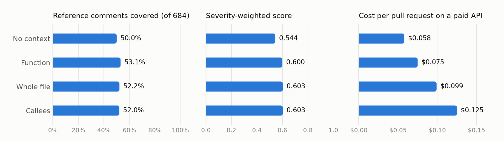
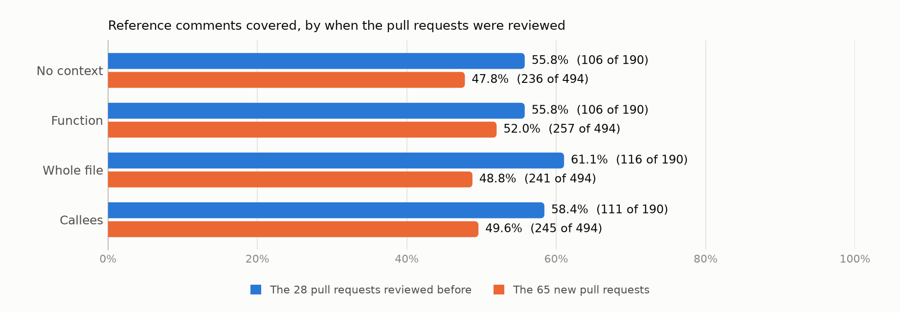
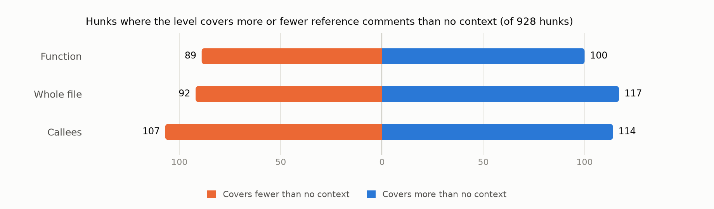
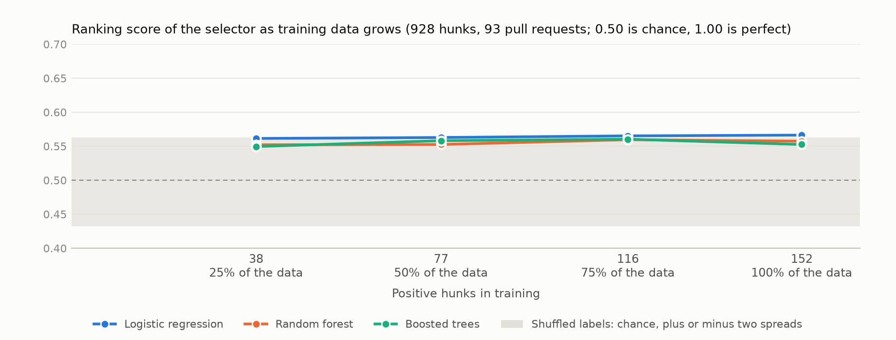
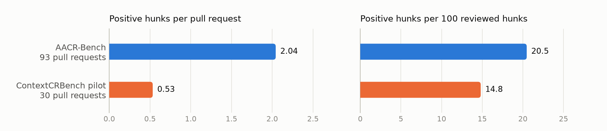

# Four levels on 93 AACR pull requests, the selector checks, and the ContextCRBench pilot at four levels (November 21, 2026)

**Status: run, judged and scored on November 21, 2026.** The four kept context levels were reviewed on half of AACR-Bench (93 pull requests, 684 reference comments). Context adds 2 to 3 points of recall over no context, which is at the edge of what 93 pull requests can tell from nothing, and the three wider levels are level with each other. The cheapest of them, the enclosing function, costs 1.3 times no context. A selector that must say before the review which hunks need context ranks them at 0.55 to 0.57, where 0.50 is chance, and that does not improve with more training data. The ContextCRBench pilot, now reviewed at all four levels, yields 0.53 such hunks per pull request against 2.04 on AACR.

**Update, November 27, 2026:** the other 92 buildable pull requests have since been run ([aacr_confirmation_run.md](aacr_confirmation_run.md)). On all 185 the gain from context reported below does not hold: no level covers more reference comments than no context, by recall or by severity score. The numbers below describe the first 93 only.

This run follows the 28-pull-request run of [per_hunk_review_test.md](per_hunk_review_test.md) (Section 19) and the selector runs on those 28 ([selector_first_run.md](selector_first_run.md), [selector_llm_first_run.md](selector_llm_first_run.md), [selector_llm_a100_run.md](selector_llm_a100_run.md)). The target it serves is in [project_target.md](project_target.md).

## 1. What was run

| Part | Choice |
|---|---|
| Pull requests | 93 of AACR-Bench's 185 buildable pull requests (50.3%), from 37 repositories in ten languages: the 28 reviewed on November 16 and 65 new ones |
| How they were chosen | At random, continuing the draw of November 15 with the same seed, from the 158 pull requests whose ten per-PR levels were all reviewed without a failure in the first run. That pool leaves out 27 buildable pull requests, mostly very large ones |
| Hunks | 928: every hunk in a file that has a reference comment, of the 2,291 hunks in the 93 pull requests. A hunk in another file can never cover a reference, because the judge compares a finding only with the references on the same file |
| Reference comments | 684: 181 written by people and 503 by AI tools; by severity 38 blocking, 197 should fix, 447 nit, and 2 without a label |
| Levels | The four kept on November 20, each adding to the one before: `H01_min` (the pull request's title and description and the hunk, no code context), `H02_function` (the function or class the hunk changes), `H03_file` (the hunk's file), `H04_callees1` (definitions of what the hunk's code calls directly) |
| Reviewer | Qwen3.8-27B, thinking off, the AACR-Bench paper's per-hunk prompt, one call per hunk and level |
| Judge | The same model, thinking off |
| Severity labels | The same model, thinking on |
| Profile and run | `cloud-hunk-kept`, run folder `qwen3.8-27b_aacr-hunk_kept4` |

The run on the server (one RTX PRO 6000, eight requests at a time):

| Stage | Work | Time | Result |
|---|---|---|---|
| Reviews | 2,407 new inputs (4.4 million input tokens); 847 were saved from the 28-PR run | 1 h 47 min | All 3,712 cells `ok`, four of them after the retry rule |
| Judging | 2,407 reviews | 42 min | No judge errors |
| Severity labels | 494 references | 1 h 29 min | 6 unreadable; a second pass answered 4 |

Two references have no severity label after two passes (`PowerShell/PowerShell` 24910, reference 3, and `ppy/osu` 31232, reference 0). In both, the model's thinking repeats itself until it reaches the 16,000-token output limit. The severity score leaves these two out; recall and precision count them.

## 2. The four levels



| Level | Covered, of 684 | Recall | Precision | Severity score | Input tokens per PR | Output tokens per PR | Cost per PR |
|---|---|---|---|---|---|---|---|
| `H01_min` | 342 | 50.0% | 21.9% | 0.544 | 9,927 | 3,808 | $0.058 |
| `H02_function` | 363 | 53.1% | 23.6% | 0.600 | 15,355 | 4,424 | $0.075 |
| `H03_file` | 357 | 52.2% | 23.3% | 0.603 | 24,213 | 5,065 | $0.099 |
| `H04_callees1` | 356 | 52.0% | 23.0% | 0.603 | 36,659 | 5,175 | $0.125 |

How to read the columns:

- **Precision** is the share of counted findings that matched a reference comment. It is higher than in the 28-PR run (16 to 18%) because only hunks in files with a reference are reviewed here; findings on other files can never match.
- **Severity score** is recall weighted by how much each reference matters, under the agreed weights of 5, 2 and 0.5 ([review_score_design.md](review_score_design.md)).
- **Input tokens** are as the model server counted them, with the prompt's own instructions (about 409 tokens per call). The level's text alone, which the run's own tables show, is 5,855, 11,275, 20,131 and 32,577 tokens per pull request.
- **Cost** is what the tokens would cost on a paid API at $2.00 per million input tokens and $10.00 per million output tokens, the price list of [codex_first_trial.md](codex_first_trial.md) (Section 4). Nothing was billed. The whole run of each level would cost $5.39, $6.97, $9.21 and $11.63.

What the table shows:

- **Context adds 2 to 3 points of recall and about 0.06 of severity score.** `H02_function` covers 21 more references than no context, `H03_file` 15 and `H04_callees1` 14.
- **The three wider levels are level with each other.** They are within 7 references and 0.003 of score.
- **`H02_function` gets that gain at the lowest cost:** 1.3 times no context, against 1.7 times for the file and 2.2 times for the callees.
- **Wider context draws findings away from the hunk.** Findings that do not quote the hunk under review, which are not counted, go from 24 at `H01_min` to 121, 233 and 225 at the wider levels. Counted findings stay at about 1,400 per level.

### 2.1 Is the gain more than chance

Each wider level against `H01_min`, with the 93 pull requests drawn again with replacement 10,000 times. The same pull requests are in both levels of a draw, so the interval is for the difference.

| Level | Recall, difference from `H01_min` | 95% interval | Severity score, difference | 95% interval |
|---|---|---|---|---|
| `H02_function` | +3.1 points | −0.1 to +6.1 | +0.056 | −0.002 to +0.112 |
| `H03_file` | +2.2 points | −1.3 to +5.7 | +0.059 | +0.004 to +0.116 |
| `H04_callees1` | +2.1 points | −2.1 to +6.5 | +0.059 | +0.001 to +0.121 |

- **The recall gain is not established.** All three intervals include zero; for `H02_function`, 3% of the draws show no gain.
- **The score gain is at the edge.** The intervals for the file and the callees just exclude zero and the one for the function just includes it.
- **This counts only the choice of pull requests.** Each cell was reviewed once, so the variation between two runs of the same cell is not in these intervals.

### 2.2 By severity and by author of the reference

| Level | Blocking, of 38 | Should fix, of 197 | Nit, of 447 | Human-written, of 181 | AI-written, of 503 |
|---|---|---|---|---|---|
| `H01_min` | 21 | 116 | 205 | 68 | 274 |
| `H02_function` | 25 | 127 | 211 | 70 | 293 |
| `H03_file` | 29 | 119 | 208 | 75 | 282 |
| `H04_callees1` | 27 | 125 | 204 | 78 | 278 |

- **The score gain comes from blocking and should-fix references.** Nits covered barely move (204 to 211). `H03_file` covers 8 more blocking references than no context, and `H02_function` 11 more should-fix references.
- **Human-written references are covered less at every level:** 38 to 43%, against 54 to 58% for the AI-written ones. They rise with each wider level, from 68 to 78.

### 2.3 The pull requests reviewed before and the new ones



| Level | The 28 reviewed on November 16, of 190 | The 65 new ones, of 494 |
|---|---|---|
| `H01_min` | 106 (55.8%) | 236 (47.8%) |
| `H02_function` | 106 (55.8%) | 257 (52.0%) |
| `H03_file` | 116 (61.1%) | 241 (48.8%) |
| `H04_callees1` | 111 (58.4%) | 245 (49.6%) |

- **The file's lead on the 28 did not carry over.** There it covered 5 points more than no context; on the 65 new pull requests it covers 1 point more.
- **The function level did the opposite:** no gain on the 28, 4 points on the 65.
- **Recall is lower on the new pull requests at every level.** Why has not been looked into.
- **So which wider level is best is not settled.** The two sets disagree, and each difference is a handful of references.

## 3. Hunk by hunk



Of the 928 hunks, 429 cover no reference at any level, 164 cover the same references at every level, and on 335 the outcome changes with the level.

| Level, against `H01_min` | Covers more references | Covers fewer | Net |
|---|---|---|---|
| `H02_function` | 100 hunks | 89 | +11 |
| `H03_file` | 117 | 92 | +25 |
| `H04_callees1` | 114 | 107 | +7 |

- **A wider level loses a reference on almost as many hunks as it gains one.** The small net gain of Section 2 is the difference between two much larger numbers.
- **On 190 hunks some wider level covers more than no context:** 2.04 per pull request, 20.5% of the reviewed hunks. These are the hunks a selector should send up. Counting only the file, it is 117 hunks.
- **With hindsight, 459 references (67.1%) could be covered** at 1.5 times the tokens of no context, by taking for each hunk the cheapest level that covers the most. That choice is `H01_min` on 738 hunks, `H02_function` on 94, `H03_file` on 63 and `H04_callees1` on 33. A reference is covered at some level in 476 cases (69.6%).
- **The hindsight number is an upper bound that includes luck.** It picks the best of four single runs per hunk.

**What cannot be said from this run:** how much of the gains and losses would repeat. The 65 new pull requests have one run per cell. On the five pull requests that were reviewed three times, whether the file helps a hunk was the same in all three runs on 75 of 78 hunks, for gains and for losses (Section 20.2 of the per-hunk document). If that holds here, context helps some hunks and hurts others, both for real.

## 4. Can a selector find the hunks that need context

The question: knowing only what is known before any review, rank the hunks so that the 190 where a wider level covers more come first. The measure is the ranking score (AUC): 0.50 is chance and 1.00 is a perfect ranking. Repositories are split into 5 folds, so a hunk is always ranked by a model that saw no hunk of its repository.

### 4.1 From sizes and counts, with growing training data



Inputs: lines added and removed, the diff's length, changed symbols, callees, callers and test callers one step away, text-search hits, hunks in the file and in the pull request, the line the hunk starts at, whether the file is new or a test, the language, and each level's input tokens. 29 inputs in all. Each fold is ranked by a model trained on 25, 50, 75 or 100% of the other folds' repositories, over 40 random splits.

| Training data | Positive hunks in training | Logistic regression | Random forest | Boosted trees |
|---|---|---|---|---|
| 25% | 38 | 0.561 | 0.552 | 0.549 |
| 50% | 77 | 0.563 | 0.552 | 0.558 |
| 75% | 116 | 0.565 | 0.560 | 0.560 |
| 100% | 152 | 0.566 | 0.557 | 0.552 |
| Shuffled labels, 100% | | 0.501 | 0.495 | 0.497 |

- **The score is at the edge of chance.** With shuffled labels it is 0.50 with a spread of 0.03 across splits, and 2.5% of the shuffled splits reach 0.54 to 0.58, depending on the model. The real labels give 0.55 to 0.57.
- **It does not grow with data.** Four times the positive hunks in training move no model by more than 0.01.
- **For the narrower label, "the file covers more than no context"** (117 hunks), logistic regression gives 0.52 and both tree models 0.48. That is chance.
- **The 28-PR numbers were higher but are not like for like.** The first selector run reported about 0.6, over all 397 hunks of those pull requests. That included hunks in files without a reference, which can never be positive; here every ranked hunk is in a file with a reference.

### 4.2 From the hunk's own text

The text of `H01_min` (the pull request's title and description and the hunk's diff) with the file path, as word or character counts, logistic regression, the same folds, 10 splits.

| Predicted, per hunk | Text as words | Text as characters | Shuffled labels |
|---|---|---|---|
| A wider level covers more than no context (190 of 928) | 0.563 | 0.563 | 0.50 |
| A reference is covered at some level (499 of 928) | 0.668 | 0.651 | 0.50 to 0.51 |

- **The text says no more than the sizes and counts** about which hunks need context.
- **It does say where a review finds something at all,** as it did on the 28 pull requests. That is a different question from which level to use.

### 4.3 Reading

- **The selector is not short of data.** A flat curve from 38 to 152 positive hunks says the limit is what these inputs carry about the label, not how many pull requests there are.
- **This agrees with the runs on 28 pull requests,** where no tabular or small-LLM selector beat simple rules.
- **Not tested on the 93:** a selector that reads the code with a language model, a selector that sees the first review, and the token-budget comparison against random choice and the cheapest-first rule.

## 5. The ContextCRBench pilot at four levels

The pilot is 30 pull requests with 54 human review comments, built from ContextCRBench at the commit the reviewers saw. It had been reviewed at `H01_min` and `H03_file`. This run added `H02_function` and `H04_callees1` on the 108 hunks that are in a file with a comment: 161 new reviews and their judging, 12 minutes on the same server, with the same reviewer and judge (profile `cloud-ccrb-hunk`).

| Level | Covered, of all 54 comments | Of the 39 the labeller accepts as findings | Input tokens per PR, level text |
|---|---|---|---|
| `H01_min` | 13 (24.1%) | 11 (28.2%) | 2,548 |
| `H02_function` | 14 (25.9%) | 13 (33.3%) | 4,926 |
| `H03_file` | 17 (31.5%) | 15 (38.5%) | 7,912 |
| `H04_callees1` | 17 (31.5%) | 13 (33.3%) | 11,037 |



Positive hunks, counted the same way on both data sets:

| | ContextCRBench pilot, 30 PRs | AACR-Bench, 93 PRs |
|---|---|---|
| Reviewed hunks | 108 | 928 |
| Hunks where a wider level covers more than no context | 16 | 190 |
| Per pull request | 0.53 | 2.04 |
| Per 100 reviewed hunks | 14.8 | 20.5 |
| `H02_function`: more / fewer than no context | 8 / 6 | 100 / 89 |
| `H03_file`: more / fewer | 10 / 5 | 117 / 92 |
| `H04_callees1`: more / fewer | 9 / 5 | 114 / 107 |

- **Per pull request the pilot yields about a quarter of AACR's positive hunks.** The cause is the number of reference comments: 1.8 per pull request in the pilot against 7.4 on the 93 AACR pull requests. The number of pull requests to build follows this rate.
- **Per reviewed hunk it yields about three quarters.** Review time on the server follows this rate, because only hunks in files with a comment are reviewed.
- **Recall is about half of AACR's.** All of the pilot's comments are written by people, and AACR's human-written references are also covered less (38 to 43%, Section 2.2).
- **Sixteen hunks is a small count.** Another 30 pull requests could easily give 0.4 or 0.7 per pull request.

**Comments per pull request in ContextCRBench.** From the profile of all 68,938 records made on November 20; records include about 15% exact repeats of a thread.

| Records on the pull request | Pull requests |
|---|---|
| 1 | 15,392 |
| 2 | 5,747 |
| 3 to 5 | 4,407 |
| 6 or more | 2,105 |

Keeping only pull requests with many comments would bring the average near AACR's. Keeping those with 4 or more records would leave roughly 4,500 pull requests with about 7 distinct threads each; 6 or more leaves 2,105, with roughly 10 to 14 records each. These are estimates from the four counts above: the split inside "3 to 5" is assumed, and the data was not scanned again for this. In the pilot, 87 of 120 pull requests could still be built and 39 of 54 comments were accepted as findings, so the usable numbers would be lower. The profile is a local script and is not in the repository.

## 6. What this means for the plan

The plan was to test the selector on AACR first and, if it gave a decent result with an improving trend, to build ContextCRBench for more training data and keep AACR for testing.

- **The condition is not met.** The selector's score is at the edge of chance and flat (Section 4).
- **More data built the same way is unlikely to change that,** so scaling ContextCRBench is on hold. Its yield is now known (Section 5) if it is taken up later.
- **What the 93 pull requests do support** is a comparison of fixed levels: a small gain from context, at the edge of chance, and the function level as the cheapest way to get it.

Not decided: what the selector should try next, or whether the project reports the comparison of fixed levels with Codex ([codex_first_trial.md](codex_first_trial.md)) as its main result.

## 7. Limits

- **One run per cell on the 65 new pull requests.** Two runs of the same input can differ, and the differences between levels are of that size (Section 17 of the per-hunk document).
- **The judge is the reviewer's own model and has not been checked by hand** on this run. It is the same for every level, which keeps the comparison even.
- **The severity labels are from the same model,** and two references have none.
- **The pull requests are not all of AACR.** Half of the buildable ones, drawn from a pool without the largest.
- **Only hunks in files with a reference are reviewed.** This does not change recall. It raises precision, and it means the selector checks rank only those hunks.
- **The selector checks use simple inputs and models.** They say these inputs do not carry the label; they do not say that nothing could.
- **The hindsight bound includes luck** (Section 3).
- **The pilot's numbers rest on 54 comments and 16 positive hunks.**
- **Cost is from a price list.** The model ran on our own server.

## 8. Where everything is

| What | Where |
|---|---|
| The run: reviews, judgments, `table.csv`, `hunk_table.csv`, `coverage.csv`, `score_table.csv` | `data/aacr_hunk/outcomes/qwen3.8-27b_aacr-hunk_kept4/` |
| Severity labels | `data/aacr_hunk/labels/severity_qwen3.8-27b_think.jsonl` |
| The selector checks' files | `data/aacr_hunk/selector_test/`: `rows_`, `learning_curve_` and `text_check_qwen3.8-27b_aacr-hunk_kept4.json` |
| The pilot at four levels | `data/ccrb_hunk/outcomes/qwen3.8-27b_ccrb-hunk_pilot/`; its earlier tables over all 432 hunks at two levels are in `tables_two_levels_all_hunks/` there |

All of `data/` is git-ignored. To reproduce the numbers and figures from those files:

```bash
.venv/bin/python scripts/outcome/score_runs.py --labels data/aacr_hunk/labels/severity_qwen3.8-27b_think.jsonl data/aacr_hunk/outcomes/qwen3.8-27b_aacr-hunk_kept4
.venv/bin/python scripts/analysis/selector_checks.py rows --profile cloud-hunk-kept
.venv/bin/python scripts/analysis/selector_checks.py rows --profile cloud-ccrb-hunk
.venv/bin/python scripts/analysis/selector_checks.py curve --profile cloud-hunk-kept
.venv/bin/python scripts/analysis/selector_checks.py text --profile cloud-hunk-kept
.venv/bin/python scripts/analysis/level_run_report.py
```

The learning curve takes about a quarter of an hour and the text check about three minutes on a laptop. `level_run_report.py` prints every number of Sections 2 to 5 and draws the five figures.

The run itself was `scripts/outcome/run_reviews.py`, `run_judgments.py` and `label_severity.py --thinking` with `OUTCOME_PROFILE=cloud-hunk-kept`, and the first two again with `OUTCOME_PROFILE=cloud-ccrb-hunk` for the pilot.

One thing to know when copying a run folder to the server from a Mac: `tar` adds `._` files there, and the review script stops on them. Pack with `COPYFILE_DISABLE=1` or delete them on the server.
