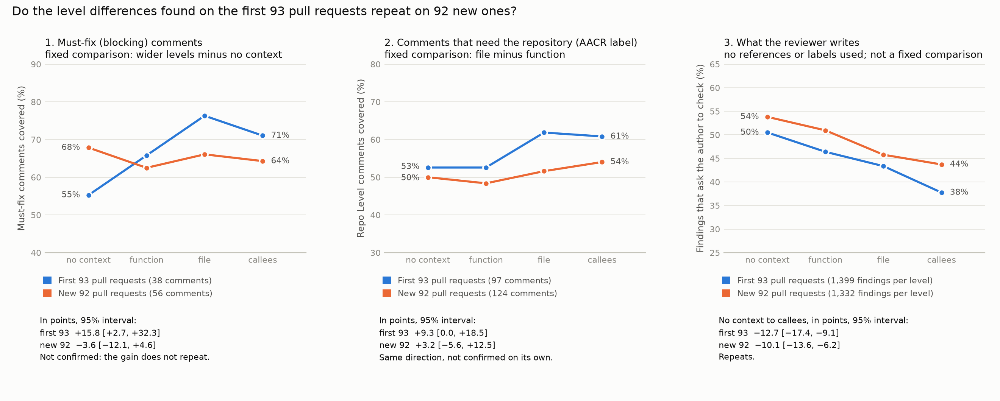
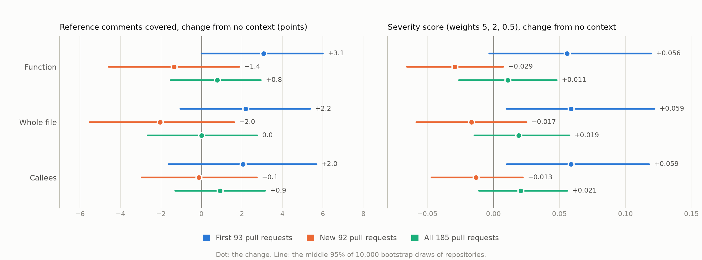

# The four levels on the other 92 AACR pull requests, and on all 185 (November 27, 2026)

**Status: run, judged, labelled and scored on November 27, 2026.** The four kept context levels were reviewed on the 92 buildable AACR-Bench pull requests that were not in the first 93, so all 185 buildable pull requests now have a result at every level. Two comparisons were fixed before the run. The first, that must-fix comments are covered more often with context, was not confirmed: the gain seen on the first 93 does not repeat. The second, that comments the benchmark marks as needing the repository gain from the file level, points the same way but is not confirmed on its own. On all 185 pull requests no level covers more reference comments than no context, by plain recall or by the severity score. What does repeat is the reviewer's wording: with more context it asks the author to check something less often.

This run follows the run on the first 93 pull requests ([aacr_50pct_run.md](aacr_50pct_run.md)) and uses the score of [review_score_design.md](review_score_design.md). The target it serves is in [project_target.md](project_target.md).

## 1. What was run

| Part | Choice |
|---|---|
| Pull requests | The 92 buildable AACR-Bench pull requests outside the first 93, from 40 repositories in ten languages. With the first 93 that is all 185 buildable pull requests, from 50 repositories |
| How they differ from the first 93 | They were not drawn at random. The first 93 came from a pool of 158 pull requests that left out 27 buildable ones, mostly very large. The 92 are the 65 left in that pool and those 27 |
| Hunks | 884: every hunk in a file that has a reference comment. 883 were reviewed (see below) |
| Reference comments | 735: 181 written by people and 554 by AI tools; by severity 56 blocking, 196 should fix, 474 nit, and 9 without a label; by the benchmark's context label 379 `Diff Level`, 232 `File Level`, 124 `Repo Level` |
| Levels | The four kept on November 20: `H01_min` (no code context), `H02_function`, `H03_file`, `H04_callees1` |
| Reviewer, judge, labeller | Qwen3.8-27B: thinking off for the reviews and the judge, thinking on for the severity labels. The same prompts as for the first 93 |
| Profile, run and code | `cloud-hunk-kept`, run folder `qwen3.8-27b_aacr-hunk_kept4`, commit `6daefb3`. A dry run before the start counted every review of the first 93 as already saved, so the inputs and the prompt were unchanged |

The run on the server (one RTX PRO 6000, eight requests at a time):

| Stage | Work | Time | Result |
|---|---|---|---|
| Reviews | 3,011 new inputs (5.5 million input tokens) | 2 h 22 min | 7,244 of the 7,248 cells of all 185 pull requests are `ok` and 4 are `too_long`. Over all 185, six replies were cut off and sent again with a longer output limit; all six then had an answer |
| Judging | 3,011 reviews | 48 min | No judge errors |
| Severity labels | 737 references: the 735 new ones and the 2 the first run left without a label | 2 h 57 min, then 25 min for a second pass | 23 unreadable or failed after the first pass; the second pass answered 14 |

The run was stopped on purpose four minutes into the reviews and started again, to check that it continues from what is saved. No saved file was damaged and nothing was reviewed twice.

**Left out:**

- **One hunk could not be reviewed at any level.** `ollama__ollama__9654__h0015` is 775,839 tokens even with no context, over the 256,000-token input limit. Its four cells are `too_long`. The pull request's other nine hunks were reviewed, and its three reference comments are counted.
- **Nine references have no severity label** after two passes: seven unreadable replies and two whose input was over the limit (both on `ollama/ollama` 9654). The severity score and the comparison on blocking comments leave them out; recall and precision count them. The script prints the list.
- **The two references of the first 93 without a label were labelled in this run** (both nit). The frozen copy of the first run keeps them unlabelled, and the "first 93" columns below use that copy.

## 2. The two comparisons fixed before the run

An offline analysis of the first 93 pull requests on November 26 found two places where the levels seemed to differ. Both rested on few comments and were found after looking at 18 groups of comments, so they needed a run on new data. The two comparisons and the rule for reading them were written down on November 26, before any of the 92 pull requests was built, reviewed, judged or labelled (Section 9 has the text).

| # | Reference comments | Change measured | First 93 | New 92 | Reading |
|---|---|---|---|---|---|
| 1 | Labelled `blocking` | Mean coverage at function, file and callees, minus coverage with no context | +15.8 points [+2.7, +32.3], 38 comments | −3.6 [−12.1, +4.6], 56 comments | **Not confirmed** |
| 2 | AACR context label `Repo Level` | Coverage at file minus coverage at function | +9.3 [0.0, +18.5], 97 comments | +3.2 [−5.6, +12.5], 124 comments | **Same direction, not confirmed on its own** |

Brackets are 95% intervals from 10,000 bootstrap draws of repositories (seed 536). A draw takes whole repositories with replacement, so comments of one repository stay together.



Covered comments at each level:

| Group | Set | Comments | `H01_min` | `H02_function` | `H03_file` | `H04_callees1` |
|---|---|---|---|---|---|---|
| Blocking | First 93 | 38 | 21 | 25 | 29 | 27 |
| Blocking | New 92 | 56 | 38 | 35 | 37 | 36 |
| Blocking | All 185 | 94 | 59 | 60 | 66 | 63 |
| `Repo Level` | First 93 | 97 | 51 | 51 | 60 | 59 |
| `Repo Level` | New 92 | 124 | 62 | 60 | 64 | 67 |
| `Repo Level` | All 185 | 221 | 113 | 111 | 124 | 126 |

- **Blocking comments.** On the 92, no context covers the most. From no context to the file level, 7 comments are gained and 8 lost. On all 185 the fixed change is +4.3 points [−3.7, +13.6].
- **`Repo Level` comments.** On the 92, the file level gains 15 comments over the function level and loses 11 (exact p = 0.56). On all 185 the change is +5.9 points [0.0, +12.2], with 28 gained and 15 lost (p = 0.066).
- **The gain on the first 93 was most likely chance.** It was the largest of the 18 groups looked at, and a result picked that way is expected to shrink on new data.

**A correction to the first-93 numbers.** The note of November 26 quoted +9.3 [+1.1, +17.7] for comparison 2. That interval belongs to file minus no context; for file minus function it is [0.0, +18.5]. The point and the counts are the same for both, because the function level and no context cover 51 comments each. For comparison 1 the note quoted [+2.4, +33.3], from a bootstrap that draws all 37 repositories; drawing the 21 repositories that hold a blocking comment gives [+2.7, +32.3]. The correction was written down before any result of the 92 was looked at.

## 3. The four levels on all 185 pull requests

| Level | Covered, of 1,419 | Recall | Precision | Severity score | Input tokens per PR | Output tokens per PR | Cost per PR |
|---|---|---|---|---|---|---|---|
| `H01_min` | 742 | 52.3% | 24.4% | 0.578 | 9,510 | 3,840 | $0.057 |
| `H02_function` | 753 | 53.1% | 25.3% | 0.589 | 15,482 | 4,478 | $0.076 |
| `H03_file` | 742 | 52.3% | 25.1% | 0.597 | 23,964 | 5,144 | $0.099 |
| `H04_callees1` | 755 | 53.2% | 25.0% | 0.599 | 35,796 | 5,276 | $0.124 |

The columns are as in the first run's table ([aacr_50pct_run.md](aacr_50pct_run.md), Section 2): tokens are as the model server counted them, and cost is at $2.00 per million input tokens and $10.00 per million output tokens. Nothing was billed. The level's text alone is 5,515, 11,479, 19,960 and 31,792 tokens per pull request. The tokens leave out the hunk that could not be reviewed.

Recall on each set:

| Level | First 93, of 684 | New 92, of 735 | All 185, of 1,419 |
|---|---|---|---|
| `H01_min` | 342 (50.0%) | 400 (54.4%) | 742 (52.3%) |
| `H02_function` | 363 (53.1%) | 390 (53.1%) | 753 (53.1%) |
| `H03_file` | 357 (52.2%) | 385 (52.4%) | 742 (52.3%) |
| `H04_callees1` | 356 (52.0%) | 399 (54.3%) | 755 (53.2%) |

Each wider level against `H01_min`, with 95% intervals:



| Level | Set | Recall, difference in points | Severity score, difference |
|---|---|---|---|
| `H02_function` | First 93 | +3.1 [0.0, +6.0] | +0.056 [−0.003, +0.119] |
| `H02_function` | New 92 | −1.4 [−4.6, +1.9] | −0.029 [−0.065, +0.008] |
| `H02_function` | All 185 | +0.8 [−1.5, +2.9] | +0.011 [−0.026, +0.048] |
| `H03_file` | First 93 | +2.2 [−1.0, +5.4] | +0.059 [+0.010, +0.122] |
| `H03_file` | New 92 | −2.0 [−5.5, +1.6] | −0.017 [−0.058, +0.025] |
| `H03_file` | All 185 | 0.0 [−2.7, +2.8] | +0.019 [−0.014, +0.058] |
| `H04_callees1` | First 93 | +2.0 [−1.6, +5.7] | +0.059 [+0.010, +0.118] |
| `H04_callees1` | New 92 | −0.1 [−2.9, +2.7] | −0.013 [−0.047, +0.022] |
| `H04_callees1` | All 185 | +0.9 [−1.3, +3.1] | +0.021 [−0.011, +0.056] |

These intervals draw repositories. The first run's write-up drew pull requests, so its intervals for the first 93 differ slightly.

What the tables show:

- **On all 185 pull requests no level covers more than no context.** The four levels are within 13 comments of each other out of 1,419, and every interval includes zero.
- **The gain of the first 93 does not repeat.** On the 92 new pull requests each wider level covers fewer comments than no context, though no difference is beyond chance.
- **The severity score tells the same story.** Its gain of about 0.06 on the first 93 becomes a small loss on the 92 and +0.01 to +0.02 on all 185.
- **No weighting changes this.** Under the five weightings of the score design (flat, linear, agreed, steep, blocking only) no level's gain over no context has an interval above zero on all 185. The largest is the file level under blocking only, +0.074 [−0.025, +0.186].
- **No context is the cheapest by a wide margin.** The function level costs 1.3 times as much, the file 1.7 times and the callees 2.2 times, for the same coverage.
- **Precision is the same at every level,** 24 to 25%.

## 4. By severity, context label and author

Covered at `H01_min`, `H02_function`, `H03_file` and `H04_callees1`. The last column is mean coverage at the three wider levels minus coverage with no context, in points.

| Group | Set | Comments | Covered at the four levels | Wider levels minus no context |
|---|---|---|---|---|
| Blocking | New 92 | 56 | 38, 35, 37, 36 | −3.6 [−12.1, +4.6] |
| Blocking | All 185 | 94 | 59, 60, 66, 63 | +4.3 [−3.7, +13.6] |
| Should fix | New 92 | 196 | 123, 118, 121, 121 | −1.5 [−6.8, +5.0] |
| Should fix | All 185 | 393 | 239, 245, 240, 246 | +1.2 [−3.2, +5.9] |
| Nit | New 92 | 474 | 235, 232, 223, 239 | −0.8 [−4.8, +2.6] |
| Nit | All 185 | 923 | 440, 443, 432, 443 | −0.1 [−3.0, +2.4] |
| `Diff Level` | New 92 | 379 | 223, 223, 204, 209 | −2.9 [−6.2, +0.8] |
| `Diff Level` | All 185 | 717 | 399, 408, 375, 385 | −1.3 [−3.9, +1.5] |
| `File Level` | New 92 | 232 | 115, 107, 117, 123 | +0.3 [−3.8, +4.3] |
| `File Level` | All 185 | 481 | 230, 234, 243, 244 | +2.1 [−1.4, +5.6] |
| `Repo Level` | New 92 | 124 | 62, 60, 64, 67 | +1.3 [−5.8, +7.9] |
| `Repo Level` | All 185 | 221 | 113, 111, 124, 126 | +3.3 [−1.7, +8.5] |
| Written by a person | New 92 | 181 | 87, 93, 82, 85 | −0.2 [−5.9, +4.9] |
| Written by a person | All 185 | 362 | 155, 163, 157, 163 | +1.7 [−2.1, +5.2] |
| Written by an AI tool | New 92 | 554 | 313, 297, 303, 314 | −1.5 [−4.7, +2.2] |
| Written by an AI tool | All 185 | 1,057 | 587, 590, 585, 592 | +0.2 [−2.2, +2.8] |

- **No group gains from context beyond chance on all 185.** The order of the context labels is as expected (`Diff Level` lowest, `Repo Level` highest), but every interval includes zero.
- **On `Diff Level` comments the file level covers fewer than the function level** in both sets: −4.1 points on the first 93, −5.0 on the 92, −4.6 [−7.7, −1.0] on all 185. This was not fixed in advance; it was seen in the first 93 and repeats. It fits what the first run found: wider context draws findings away from the hunk.
- **Comments written by people are covered less than those written by AI tools at every level:** 43 to 45% against 55 to 56% on all 185. Their rise with each wider level on the first 93 (68 to 78 of 181) does not repeat on the 92 (87, 93, 82, 85).

## 5. What the reviewer writes

This check uses no reference comment and no label. It counts, among the findings of each level, those whose text matches a fixed pattern. The patterns were written on November 26 for the first 93 and were not changed.

| Wording | Set | `H01_min` | `H02_function` | `H03_file` | `H04_callees1` | No context to callees, points |
|---|---|---|---|---|---|---|
| Asks the author to check something | First 93 | 50.5% | 46.4% | 43.4% | 37.8% | −12.7 [−17.4, −9.1] |
| Asks the author to check something | New 92 | 53.8% | 51.0% | 45.8% | 43.7% | −10.1 [−13.6, −6.2] |
| Asks the author to check something | All 185 | 52.1% | 48.6% | 44.5% | 40.7% | −11.5 [−14.8, −8.6] |
| Says code cannot be seen | First 93 | 11.2% | 7.8% | 7.4% | 5.7% | −5.5 [−8.8, −3.0] |
| Says code cannot be seen | New 92 | 9.6% | 7.9% | 6.8% | 6.9% | −2.7 [−4.4, −1.0] |
| Says code cannot be seen | All 185 | 10.4% | 7.8% | 7.1% | 6.3% | −4.1 [−6.1, −2.5] |
| Points to the given context | First 93 | 10.3% | 10.8% | 13.2% | 14.3% | +4.0 [+1.6, +6.3] |
| Points to the given context | New 92 | 9.7% | 10.5% | 13.3% | 13.5% | +3.8 [+1.4, +5.6] |
| Points to the given context | All 185 | 10.0% | 10.7% | 13.3% | 13.9% | +3.9 [+2.3, +5.3] |

Each level has about 2,700 counted findings on all 185 (about 1,400 on the first 93 and 1,330 on the 92).

- **The change repeats on the new pull requests.** With every wider level the reviewer asks the author to check something less often and says less often that it cannot see code. It points to the given context more often.
- **The function level's change is small.** On the 92 its intervals include zero for all three kinds of wording; on all 185 it is −3.5 points [−5.6, −1.4] for asking to check.
- **This is a change in what is written, not in what is covered.** Sections 3 and 4 show the covered comments do not go up with it.

## 6. The levels cover different comments

| | First 93 | New 92 | All 185 |
|---|---|---|---|
| Comments covered at no level | 208 (30.4%) | 216 (29.4%) | 424 (29.9%) |
| Covered at all four levels | 238 (34.8%) | 267 (36.3%) | 505 (35.6%) |
| Covered at some levels and not at others | 238 (34.8%) | 252 (34.3%) | 490 (34.5%) |
| Two levels disagree on a comment, mean of the six pairs | 19.1% | 19.2% | 19.1% |

Hunk by hunk, against `H01_min`:

| Level | First 93: covers more, fewer | New 92: covers more, fewer | All 185: covers more, fewer |
|---|---|---|---|
| `H02_function` | 100, 89 hunks | 79, 92 | 179, 181 |
| `H03_file` | 117, 92 | 88, 102 | 205, 194 |
| `H04_callees1` | 114, 107 | 98, 99 | 212, 206 |

- **A third of the comments are covered at some levels and not at others,** the same share in both sets. The levels average the same because each wider level loses about as many comments as it gains.
- **On 337 of the 1,811 reviewed hunks some wider level covers more than no context:** 1.82 per pull request (2.04 on the first 93, 1.60 on the 92). These are the hunks a selector would have to find.
- **How much of this is the level and how much is the run is not measured on the 92.** Each cell was reviewed once. On the five pull requests reviewed three times ([per_hunk_review_test.md](per_hunk_review_test.md), Section 17; 38 reference comments), the same level in two runs disagrees on 6.1% of comments (28 of 456 comparisons) and two kept levels in one run on 15.2% (104 of 684). So part of the 19% is the run, and five pull requests are too few to say how much.

## 7. What this run settles and what it does not

**Settled, on all 185 buildable pull requests:**

- With this reviewer and this judge, a wider fixed level does not cover more reference comments than no context, at any severity and under any of the score's weightings.
- The reviewer's wording changes with context, and that holds on new data.
- Two statements in the first run's write-up no longer hold beyond the first 93: that context adds 2 to 3 points of recall and about 0.06 of severity score, and that the score gain comes from blocking and should-fix references.

**Not settled:**

- **Whether the levels' different comments are a real difference.** That needs the same level reviewed twice on more pull requests than five.
- **Whether the severity labels are right.** They are the labeller's own; no person has labelled a sample.
- **Findings that match no reference comment are not scored.** A level could raise useful findings that the benchmark does not hold.
- **The comparison with a coding agent** ([project_target.md](project_target.md)) has not been run on this set.
- **The 92 are not a random half.** They hold the 27 pull requests the first pool left out, mostly very large ones, so a difference between the two sets can come from that.

## 8. How to reproduce

The reviews, judgments, labels and tables are in `data/aacr_hunk/outcomes/qwen3.8-27b_aacr-hunk_kept4/` and `data/aacr_hunk/labels/severity_qwen3.8-27b_think.jsonl`. The frozen copy of the first 93 is in `data/aacr_hunk_50%/`. Both are on the laptop only; `data/` is not in git.

```bash
.venv/bin/python scripts/analysis/confirmation_run_report.py
.venv/bin/python -m unittest tests.test_confirmation_report
```

The script calls no model. It prints every number of this document, writes `confirmation_report.json` into the run folder and draws the two figures into `docs/figures/aacr_confirmation_run/`. The pull requests found in the frozen copy are the first set; all others in the run folder are the new set.

## 9. The plan, as written on November 26

Written before any of the 92 pull requests was built, reviewed, judged or labelled.

**Data.** The 92 buildable AACR pull requests that are not among the 93 already reviewed. Same pipeline as the 93: profile `cloud-hunk-kept`, code commit `6daefb3`, reviewer and judge Qwen3.8-27B with thinking off, severity labels by the same model with thinking on, the four kept levels. A reference comment counts as covered at a level when the judge matches it to a finding of that level's reviews.

**The two comparisons.** Both are computed on the 92 new pull requests only: the change in percentage points and a 95% interval from 10,000 bootstrap draws over repositories (seed 536).

1. Comments labelled `blocking`: mean coverage at function, file and callees, minus coverage at no context. Comments the labeller leaves without a severity are left out.
2. Comments with the AACR context label `Repo Level`: coverage at file minus coverage at function.

**How the result is read.**

- Confirmed: the change is positive and its interval lies above zero.
- Same direction, not confirmed on its own: the change is positive and the interval includes zero.
- Not confirmed: the change is zero or negative.

Comparison 1 has little power: about 40 blocking comments are expected. Comparison 2 has 124 comments.

**Reported next to them, not used to decide.** The same two changes on all 185 pull requests; blocking comments from no context to file with gains, losses and the exact test; blocking and should-fix comments together; `Repo Level` comments, file minus no context; the share of findings that ask the author to check something and that say code cannot be seen; plain recall and the severity score at each level. Pull requests that fail to build or review are listed with the result.
