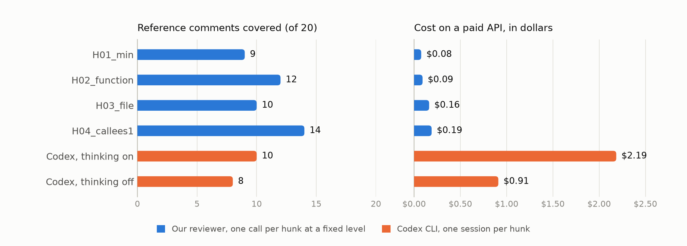
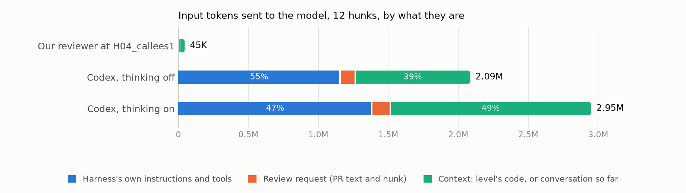
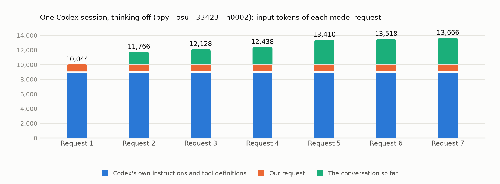

# Codex CLI against our four levels: first trial on 12 hunks (November 21, 2026)

**Status: a first trial, run and judged on November 21, 2026.** Codex CLI reviewed 12 hunks from 3 AACR-Bench pull requests on the same model as our reviewer (Qwen3.8-27B), once with the model's thinking on and once with it off. Its own reviews were scored exactly like our four context levels on the same hunks. Our widest level, `H04_callees1`, covered the most reference comments, and Codex cost 5 to 12 times as much as it. The sample is 20 reference comments, so this shows the shape of the comparison and not a result.

The target this trial serves, and the reasons Codex is run per hunk, are in [project_target.md](project_target.md).

## 1. What was run

| Part | Choice |
|---|---|
| Pull requests | `ppy/osu` 33423 (C#), `infiniflow/ragflow` 6553 (Python), `elastic/elasticsearch` 127697 (Java). Three of the 28 AACR pull requests already reviewed per hunk, chosen because a wider level beat no context on each |
| Hunks | The 12 hunks in files that have a reference comment (2, 5 and 5) |
| Reference comments | 20: 7 written by people and 13 by AI tools; by severity 1 blocking, 5 should fix, 14 nit |
| Our side | The saved reviews and judgments of the run `qwen3.8-27b_aacr-hunk_v2` (November 16) at `H01_min`, `H02_function`, `H03_file` and `H04_callees1`: one call per hunk, thinking off |
| Codex | Codex CLI 0.171.0, one session per hunk. It gets our reviewer's own request for the hunk (the pull request's title and description and the hunk) with leave to look around the repository first, and answers in our reviewer's format |
| Codex's thinking | Two runs: on (the server's default) and off (Codex asks for reasoning effort "none", which the server turns into the same switch our reviewer uses) |
| Scoring | The same parser, the same judge (Qwen3.8-27B, thinking off) and the same severity labels for every row. A finding counts only when it quotes the hunk under review, for Codex as for our reviewer |
| Profile and commands | `cloud-hunk-kept`; `scripts/harness/record_codex.py hunks`, then `score --compare-run qwen3.8-27b_aacr-hunk_v2`, each also with `--thinking off` |

Our levels' numbers in the tables below match our own score table for these pull requests exactly, so both sides went through the same scoring.

## 2. Results

All six on the same 12 hunks (20 reference comments):

| | Covered | Recall | Precision | Severity score | All input tokens | New input tokens | Output tokens | Cost |
|---|---|---|---|---|---|---|---|---|
| `H01_min` | 9 | 0.450 | 0.292 | 0.341 | 8,975 | 8,975 | 5,881 | $0.077 |
| `H02_function` | 12 | 0.600 | 0.417 | 0.545 | 13,211 | 13,211 | 6,483 | $0.091 |
| `H03_file` | 10 | 0.500 | 0.400 | 0.500 | 36,965 | 36,965 | 8,847 | $0.162 |
| `H04_callees1` | **14** | **0.700** | **0.571** | **0.795** | 45,450 | 45,450 | 9,828 | $0.189 |
| Codex, thinking on | 10 | 0.500 | 0.333 | 0.636 | 2,949,848 | 271,640 | 127,034 | $2.185 |
| Codex, thinking off | 8 | 0.400 | 0.263 | 0.386 | 2,086,302 | 204,318 | 23,871 | $0.910 |

How to read the columns:

- **Precision** is the share of findings that matched a reference comment. **Severity score** is recall weighted by how much each reference matters, under the agreed weights ([review_score_design.md](review_score_design.md)).
- **All input tokens** is every model request added up, as the model server counted them, with the prompt's own instructions included. Our levels make 12 requests, one per hunk. Codex made 153 with thinking on and 128 with it off, and each request resends the conversation so far.
- **New input tokens** leaves out what the server had already processed in the request before and reused (cached). Our prompts share only their first 33 tokens, so all of our input is new.
- **Output tokens** includes thinking: 101,772 of the 127,034 with thinking on, none in the other rows.
- **Cost** is what the tokens would cost on a paid API (Section 4).

### 2.1 The fair comparison is thinking off on both sides

Our reviewer runs with thinking off. With Codex's thinking also off:

- Codex covered 8 references, one fewer than our cheapest level (`H01_min`, 9) and six fewer than `H04_callees1` (14).
- It cost $0.910, which is 12 times `H01_min` and 5 times `H04_callees1`.

With thinking on, Codex covered 10 references, level with `H03_file`, at 12 times the cost of `H04_callees1`.

### 2.2 By severity, by author, and under other weights

| | Blocking (of 1) | Should fix (of 5) | Nit (of 14) | Human comments (of 7) | AI comments (of 13) | Linear weights | Agreed weights | Steep weights |
|---|---|---|---|---|---|---|---|---|
| `H01_min` | 0 | 2 | 7 | 1 | 8 | 0.407 | 0.341 | 0.266 |
| `H02_function` | 0 | 4 | 8 | 3 | 9 | 0.593 | 0.545 | 0.438 |
| `H03_file` | 0 | 4 | 6 | 3 | 7 | 0.519 | 0.500 | 0.406 |
| `H04_callees1` | 1 | 4 | 9 | 4 | 10 | 0.741 | 0.795 | 0.844 |
| Codex, thinking on | 1 | 3 | 6 | 3 | 7 | 0.556 | 0.636 | 0.719 |
| Codex, thinking off | 0 | 3 | 5 | 1 | 7 | 0.407 | 0.386 | 0.313 |

With thinking on, Codex's severity score is above `H02_function` and `H03_file` only because it caught the one blocking reference, which weighs five times a nit. `H04_callees1` caught it too. On plain counts Codex is at or below those levels.

### 2.3 Per pull request

References covered, with the severity score in brackets:

| Pull request | `H01_min` | `H02_function` | `H03_file` | `H04_callees1` | Codex, thinking on | Codex, thinking off |
|---|---|---|---|---|---|---|
| osu (8 references) | 4 (0.59) | 5 (0.65) | 5 (0.65) | 5 (0.65) | 4 (0.41) | 6 (0.88) |
| ragflow (6) | 1 (0.06) | 3 (0.33) | 2 (0.28) | 4 (0.89) | 4 (0.89) | 1 (0.06) |
| elasticsearch (6) | 4 (0.44) | 4 (0.78) | 3 (0.67) | 5 (0.89) | 2 (0.56) | 1 (0.11) |

The two Codex runs swing a lot per pull request: osu goes up without thinking and ragflow goes down. With 20 references this is the size of the difference between two runs of the same setup.

## 3. What turning thinking off changed for Codex

| | Thinking on | Thinking off |
|---|---|---|
| References covered (of 20) | 10 | 8 |
| Findings counted | 27 | 19 |
| Findings about other hunks, not counted | 19 | 19 |
| Model requests | 153 | 128 |
| Commands run | 175 | 138 |
| All input tokens | 2,949,848 | 2,086,302 |
| New input tokens | 271,640 | 204,318 |
| Output tokens | 127,034 | 23,871 |
| Cost | $2.185 | $0.910 |
| Time per session | 4.4 to 18.7 minutes, median 8.5 | 1 to 5.7 minutes, median 2.1 |

- **The cost drop is almost all thinking.** Output fell from 127,034 tokens to 23,871.
- **Most of what is left is Codex's loop.** It still sent 2.1 million input tokens over 128 requests (Section 5).
- **It was less reliable.** One of the 12 thinking-off sessions got stuck and needed a second try (Section 7). None of the 12 thinking-on sessions did.

## 4. Cost: how a paid API would bill this

The model runs on our own server, so nothing was billed. To compare the two sides by cost, the same price list is applied to both: the prices of Claude Sonnet 5.5 and of OpenAI's gpt-6.2-sol on November 21, 2026, which are equal.

| Token type | Dollars per million | Compared with normal input |
|---|---|---|
| Normal input | 2.00 | 1× |
| Cached input, read again | 0.10 | 0.05× |
| Input written to the cache | 2.50 | 1.25× |
| Output, thinking included | 10.00 | 5× |

Both providers bill every request's whole input, so an agent is billed for the conversation it resends, at the cached price for the part the server had already seen. Other models on both price lists keep these ratios, so the ratio between Codex and our levels does not depend on the model chosen. Our reviewer's prompts share too little to be cached, so all of its input is billed at the normal price.

Where each Codex run's cost goes:

| Part | Thinking on: tokens | Cost | Share | Thinking off: tokens | Cost | Share |
|---|---|---|---|---|---|---|
| Cached input, read again | 2,678,208 | $0.27 | 12% | 1,881,984 | $0.19 | 21% |
| Input written to the cache | 207,168 | $0.52 | 24% | 149,760 | $0.37 | 41% |
| Other new input | 64,472 | $0.13 | 6% | 54,558 | $0.11 | 12% |
| Output | 127,034 | $1.27 | 58% | 23,871 | $0.24 | 26% |
| **Total** | | **$2.19** | | | **$0.91** | |

Cost by level:

| | Cost | Per hunk | Compared with `H04_callees1` |
|---|---|---|---|
| `H01_min` | $0.077 | $0.006 | 0.4× |
| `H02_function` | $0.091 | $0.008 | 0.5× |
| `H03_file` | $0.162 | $0.014 | 0.9× |
| `H04_callees1` | $0.189 | $0.016 | 1× |
| Codex, thinking on | $2.185 | $0.182 | 12× |
| Codex, thinking off | $0.910 | $0.076 | 5× |

## 5. Why Codex uses so many tokens

Codex does not read much more code than our levels. Most of its tokens are the same text sent again with every request.

Every model request of a Codex session contains three things: Codex's own instructions and tool definitions, the request we gave it, and the conversation so far (the commands it ran, what they printed, its own messages and, when it thinks, its thinking).

| What is in the input | Thinking off | Share | Thinking on | Share |
|---|---|---|---|---|
| Codex's own instructions and tool definitions, about 9,000 tokens in every request | 1,154,942 | 55.4% | 1,382,636 | 46.9% |
| The conversation so far, resent with every later request | 821,978 | 39.4% | 1,435,897 | 48.7% |
| Our request (the pull request's text and the hunk), about 860 tokens in every request | 109,382 | 5.2% | 131,315 | 4.5% |
| **All input** | **2,086,302** | | **2,949,848** | |

For comparison, `H04_callees1` sends 45,450 tokens in its 12 requests: 4,908 of instructions, 4,079 of pull request text and hunks, and 36,463 of context.

So the gap has two very different parts:

- **Code actually read.** With thinking off, Codex's commands printed 110,014 tokens of repository text. `H04_callees1` holds 36,463 tokens of context. That is about 3 times more.
- **The loop.** The rest comes from resending. Codex's own instructions alone, 1.15 million tokens with thinking off, are 25 times all of `H04_callees1`'s input.

With thinking on, the model's thinking is also kept in the conversation and resent, which is why the conversation part is larger in that run.

### One session, request by request

The session for osu hunk 2, thinking off. Its commands printed 2,845 tokens of code, and it sent 86,970 tokens of input:

| Request | Input sent | Already cached | What the model did | Tokens the commands printed |
|---|---|---|---|---|
| 1 | 10,044 | 9,152 | Reads the utility file | 1,566 |
| 2 | 11,766 | 9,984 | Searches for usages and for tests | 133 |
| 3 | 12,128 | 11,648 | Two more searches | 103 |
| 4 | 12,438 | 11,648 | Reads 70 lines of the file under review | 1,010 |
| 5 | 13,410 | 11,648 | Searches the tests | 0 |
| 6 | 13,518 | 13,312 | One more search | 33 |
| 7 | 13,666 | 13,312 | Writes the review (1,095 output tokens) | 0 |

The first request is already 10,044 tokens before Codex has read anything.

## 6. Codex drifts to other hunks

Codex was asked about one hunk, but it usually ran `git diff` and saw the whole pull request. It then often wrote findings about other hunks. Under the per-hunk rule these are not counted, because they do not quote the hunk under review.

| | Findings counted | Findings about other hunks, not counted |
|---|---|---|
| `H01_min` | 24 | 1 |
| `H02_function` | 24 | 0 |
| `H03_file` | 20 | 8 |
| `H04_callees1` | 21 | 8 |
| Codex, thinking on | 27 | 19 |
| Codex, thinking off | 19 | 19 |

On two elasticsearch hunks with thinking on, Codex wrote 10 findings and all of them were about other parts of the pull request. This is the same effect the first per-hunk test found for wide levels ([per_hunk_review_test.md](per_hunk_review_test.md)), and it is stronger for Codex. The same finding can also repeat across hunks. Whether these findings would cover references if they were counted on the hunk they quote has not been checked.

## 7. The stuck session, and what Codex may read

One thinking-off session, on a ragflow hunk, got stuck:

- The model made up a file path that does not exist and ran a search for it across the whole home folder of the laptop Codex ran on.
- It then waited on that search for about 20 minutes, running `sleep` commands, until the search and the session were stopped by hand.
- Nothing from outside the checkout reached the model. The search returned no line, and every check the model made on it came back empty.

Codex's plain read-only mode stops writes but lets a command read any file the user can read. In both runs together, 4 of 320 commands named a path outside the checkout, and none returned anything from the user's files.

After this, the script was changed so that Codex's commands cannot read outside the checkout: a Codex permissions profile denies the folders where people's files live (`/Users`, `/home`, and the like), except the checkout, Codex's own tools and its empty home folder. System folders stay readable, because the shell and git need them. In a rehearsal, listing the home folder or the checkout's parent gave "Operation not permitted", while git and search inside the checkout still worked.

The stuck hunk was then run again with the block on. That session took 98 seconds and ran no command outside the checkout. The thinking-off numbers in this document use the second try for that hunk, and its cost counts only that try. The other 23 sessions ran without the block.

## 8. Where everything is recorded

Each session has a folder under `data/aacr_hunk/harness/codex/` (thinking on) or `codex_nothink/` (thinking off), named by its hunk:

| File | What it holds |
|---|---|
| `session_exec.jsonl` | Every message, every command with its output, and the token counts of each model request |
| `events.jsonl` | Codex's own event stream: each command as it ran, and the final review |
| `last_message.txt` | The review it wrote |
| `run.json` | A summary: time, requests, commands, token totals, status, whether the read block was on |

The scores are under `data/aacr_hunk/outcomes/`, in `qwen3.8-27b_aacr-hunk_kept4_codex/` and `qwen3.8-27b_aacr-hunk_kept4_codex_nothink/`: `table.csv`, `hunk_table.csv`, `coverage.csv` and `score_table.csv` in the structure of our own runs, with the four levels and Codex in each, and `summary.csv` with one row per level. All of `data/` is git-ignored.

`scripts/analysis/codex_trial_report.py` reads these files, prints the numbers of Sections 2 and 5, and draws the three figures.

## 9. Limits

- **The sample is tiny.** 12 hunks, 20 reference comments, 1 of them blocking. A difference of 2 to 3 references is within the difference between two runs of the same setup.
- **The pull requests favour our wider levels.** They were chosen because a wider level beat no context on them.
- **One language each for C#, Python and Java.** No other languages.
- **The judge has not been checked by hand.** The same model judges every row, which keeps the comparison even but does not make the absolute numbers right.
- **One Codex version and one model.** Codex does not know this model and uses fallback settings for it. The settings changed from its defaults are listed in [project_target.md](project_target.md).
- **One hunk needed a second try** in the thinking-off run (Section 7).
- **Codex per pull request was not run.** That is the second number the target asks for.

## 10. What this suggests

On this small sample, Codex is not clearly better than our fixed levels, and it costs several times more on every measure: 5 times `H04_callees1` on cost with thinking off, 12 times with it on. That is the shape the target needs: similar quality at far less cost. Whether it holds needs more hunks, chosen without regard to which level did well, and it needs the selector to be compared with the fixed levels as well as with Codex.
