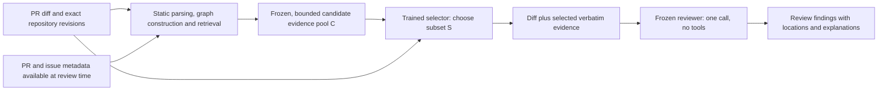
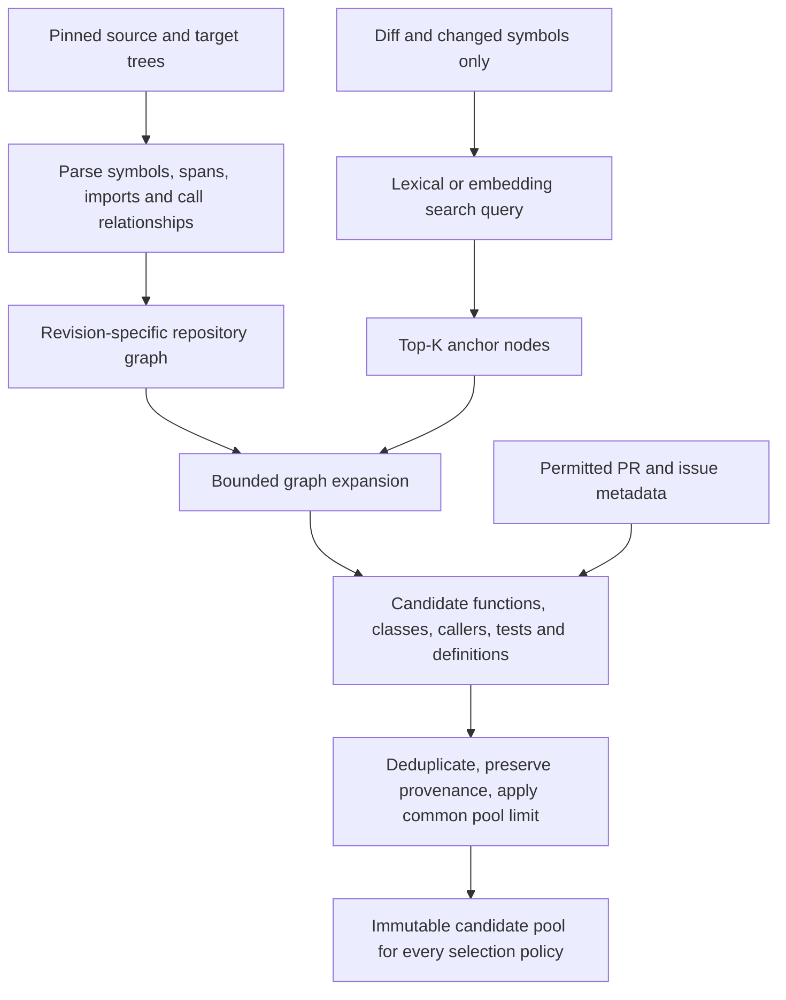
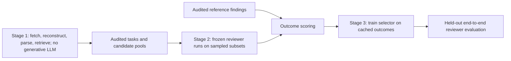
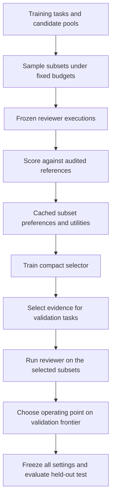
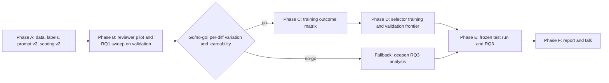

# Context selector roadmap: preserve code-review quality with less repository context

**Revised November 7, 2026. Status: research design, not an implemented or validated system.**

**Update, November 8, 2026:** candidate gathering is now implemented with codebase-memory-mcp instead of RepoHyper. Section 5.5 covers the tracer, the context levels and the batch runner, plus what was measured on three AACR entries. No reviewer, scorer or selector has been run or built; everything outside Section 5.5 remains a design.

This revision records the discussion moving from ContextCRBench merge-status prediction to repository-aware **review generation**. Our intended product is a context-selection component: given a diff and a reproducibly gathered pool of repository evidence, choose a small subset for a frozen reviewer. The reviewer produces useful findings; the selector does not decide whether a PR should merge.

The November 4 roadmap is retained at the end as a **retired historical plan**, including its reported measurements. Its task, labels, phase checklist, model defaults, success thresholds, and schedule are not the active specification. No experiments were rerun for this documentation revision.

## 1. Decisions, scope, and precedence

| Topic | Current direction | What remains unproven or undecided |
|---|---|---|
| Main task | Reduce context tokens while preserving meaningful review findings | Whether a learned selector improves over strong retrieval and fixed-budget baselines |
| Starting dataset | Start with AACR-Bench, reconstructing repository snapshots | Usable release size, supported languages, reference validity, and split feasibility |
| ContextCRBench | Preserve the midpoint pilot; consider a separate transfer evaluation | Whether its review references and available snapshots support the same task |
| Context gathering | **Implemented (Nov 8):** codebase-memory-mcp static code graph plus nested context levels (Section 5.5). RepoHyper was the earlier recommendation | Behavior on the other 8 AACR languages and on very large repositories; whether the levels separate review quality |
| Selector | Train a compact model to select existing evidence chunks | Encoder/ranker, graph-aware model, or small generative selector; no final size chosen |
| Reviewer | Freeze a capable open-weight reviewer during comparisons | Exact model ID, revision, quantization, context window, decoding, and quality floor |
| Preprocessing | Avoid generative LLM calls for fetching, parsing, graph construction, and metadata extraction | Manual effort needed for reliable reference and adoption annotations |
| Learning signal | Compare reviewer outcomes under candidate subsets against audited review references | A validated matching/scoring protocol and affordable supervision budget |
| Deployment shape | Upfront retrieval and selection, then one reviewer call with no further repository tools | Quality loss relative to an interactive agent and actual end-to-end savings |
| Lavish | Leave existing Lavish artifacts unchanged | Update only on an explicit later request |

### Context that still governs the work

Read every document in `docs/`, the project skill, and its index before implementation, as required by `AGENTS.md`. The professor's emphasis remains: study the quality–cost trade-off, include strong baselines, train a learned selector rather than making greedy removal the final contribution, and explain failures. Robustness experiments remain outside the core scope; transfer is optional.

The existing proposal, project skill, and midpoint plan contain the older binary task and four-field mask formulation. This roadmap records the user's newer intended direction and takes precedence for those design choices; it does **not** retroactively change the completed pilot or assert instructor approval. The course kickoff says topic changes after the midpoint require approval. Confirm whether this task/dataset refinement needs that approval before presenting it as an approved scope change. Writing this plan is not evidence that approval has occurred.

The course final report remains 5–8 pages in the supplied NeurIPS format, with an unlimited appendix, baselines, ablations, several seeds, honest limitations, and runnable code. Dates in the kickoff are approximate; use the current course announcement for submission timing. No new responsibility assignments are implied by this revision.

### Research questions, revised for actual reviews

- **RQ1:** How do fixed context policies and repository retrieval choices affect a frozen reviewer's finding quality and input-token count?
- **RQ2:** Can a learned selector choose a smaller evidence subset per diff and improve the quality–cost frontier over the best fixed policy at matched budgets?
- **RQ3:** Which dependencies and context types help, have no effect, or cause harmful/distraction effects, and where does the selector fail?

The previous “within one percentage point of accuracy” threshold concerned a binary label. Do not reuse it as if it were a justified tolerance for review F1. Choose quality tolerances and practical savings targets on development data, document them, and freeze them before test evaluation. A target such as 30% fewer additional context tokens is an aspiration, not a result or automatic success criterion.

## 2. What we are building



The diff is mandatory input. Selection concerns additional evidence: related functions, callers/callees, imported definitions, classes, tests, configuration, PR descriptions, and linked issue information when available. A selector may choose no extra evidence. It selects text already present in the candidate pool rather than inventing a summary or rewriting code.

For a real application, this could sit before a larger remote reviewer. A smaller local selector may make that remote call cheaper. The research experiment should first use a reproducible frozen reviewer so that differences can be attributed to context rather than changing model behavior. Supporting a commercial reviewer later is a deployment possibility, not required for the initial experiment.

### Three different meanings of context

1. **Repository universe U:** files in a pinned repository snapshot and permitted metadata. This can be much larger than any prompt.
2. **Candidate pool C:** evidence retrieved from U under a fixed policy, with explicit size limits and provenance. This is the operational “all context” baseline.
3. **Selected evidence S:** a subset of C chosen for the reviewer. Every policy receives the same C for a given task.

“All context” never means that the whole repository was sent, that every relevant dependency was recovered, or that a human actually read every candidate. Record both the raw retrieved pool and the pool admitted after deterministic upstream limits. If the admitted pool cannot fit the reviewer's window, it is not a valid full-pool comparator until a common overflow policy is defined.

We can assume the human had access to the repository as a motivating ideal. We cannot infer their reading history from their comment. Human references therefore describe desired findings, not ground-truth context-selection masks. We also cannot guarantee that a reviewer with sufficient evidence will discover every human finding.

### One call versus an interactive harness

An LLM consumes the serialized prompt supplied to it; attention is not a mechanism for avoiding the cost of supplied input tokens. Tool-enabled agents can request more evidence over multiple calls. Our primary setting disables that loop, making the evidence budget measurable. A model may still report insufficient evidence; score that transparently rather than quietly granting extra context.

The inspected Codex source at revision `57a808a3920f05f2d4b9eab2d0493e1df136ae6b` constructs initial instructions/history and exposes tools. Its AGENTS discovery and review prompts do not constitute a fixed algorithm that retrieves all relevant code before the first model call. Subsequent searching is model-directed. Thus “copy Codex's exact upfront context search” is not an available specification. Cursor's proprietary retrieval behavior has not been established here. See the pinned [AGENTS discovery](https://github.com/openai/codex/blob/57a808a3920f05f2d4b9eab2d0493e1df136ae6b/codex-rs/core/src/agents_md.rs), [turn construction](https://github.com/openai/codex/blob/57a808a3920f05f2d4b9eab2d0493e1df136ae6b/codex-rs/core/src/session/turn.rs), and [review requests](https://github.com/openai/codex/blob/57a808a3920f05f2d4b9eab2d0493e1df136ae6b/codex-rs/prompts/src/review_request.rs).

An interactive agent comparison would be a separate experiment: include all tool-output tokens, repeated calls, latency, and its potentially higher quality. Do not claim that beating a one-shot all-pool baseline proves superiority to Codex or Cursor.

## 3. What the midpoint work contributed

The 3B QLoRA pilot established useful infrastructure: dataset indexing and deduplication, repository splits, training and restart handling, checkpoints, provenance, prediction caching, comparison notebooks, and cost/error plots. It also exposed label imbalance, formatting failures, and prompt-budget problems before the main selector experiment.

It did **not** train a context selector or establish that review quality was preserved with fewer tokens. Its merge-status objective was a preliminary adaptation experiment. Existing adapter performance should not be described as evidence of RQ2 success.

The historical base-model score of zero was caused by strict output parsing failures in the inspected evaluation cache. This is an evaluation/protocol failure, not proof that the model cannot review code or that all source examples are malformed. Inspect raw responses and report invalid-output rates separately. The adapter's strong majority-class accuracy likewise does not establish useful review behavior.

Preserve v1 splits, prompt text, trained artifacts, and original caches. New review-generation artifacts need a distinct task/protocol namespace. Do not overwrite the historical experiment to make it appear to have measured the new task.

## 4. Dataset choice and audit gates

### 4.1 Why start with AACR-Bench

AACR is more directly aligned with repository-level review findings than an `is_merged` target. Its public records link PRs and commit revisions to reference comments. A PR record can contain several comments; one record is not necessarily one comment, and the included references are not necessarily the complete GitHub discussion. Repository contents must be fetched separately.

The [AACR repository](https://github.com/alibaba/aacr-bench) describes 200 PRs across 50 repositories and ten languages, with 2,145 comments. The inspected [paper version](https://arxiv.org/html/2601.19494v3) reports 1,505 comments, including human-derived and AI-generated expert-verified material. The earlier inspection of the public positive JSON found 196 entries. These are **release/count discrepancies to resolve**, not interchangeable totals. Pin the dataset commit, count actual records and reference provenance, and publish a release-specific data card before allocating splits.

The paper describes curated popular repositories and filtered PRs, rather than a representative random sample of all software changes. Its filtering includes review activity and adopted feedback, followed by augmentation and expert annotation. That creates selection bias toward reviewable changes. Neither successful training nor broad deployment performance follows from its benchmark size.

### 4.2 Required release audit

For every raw record, retain the original JSON and its hash, dataset revision, repository URL, PR number, source/target commits, and all original annotation fields. Produce counts for:

- PRs, repositories, languages, reference comments, and unique finding identities.
- Human-derived, AI-generated/expert-verified, and unknown-provenance references.
- Context-level annotations where supplied: diff, file, repository.
- Accessible and inaccessible revisions, missing files, failed parses, unsupported languages.
- Duplicate PRs, overlapping/forked repositories, duplicate patches, and repeated findings.
- References consistent with the actual diff and snapshot versus unresolved mismatches.
- Samples usable under the proposed language/backend and reviewer token budget.

The filenames `positive_samples.json` and `negative_samples.json` are not sufficient definitions of labels. Verify their semantics against the authors' construction/evaluation code before using the latter as “no findings” or “bad reviews.” A closed PR is not a bad review; a merged PR can contain bad reviews or unresolved defects. Keep unknown semantics quarantined rather than guessing.

### 4.3 Exact revisions and temporal leakage

Treat the dataset's source and target fields as revision pointers whose meaning must be verified by reconstructing the intended comparison. Typically the source identifies the before/base side and target the proposed/head side; neither name alone proves that target is the historical snapshot seen by every reviewer or the final merged commit.

1. Resolve both SHAs, verify repository membership, and reconstruct the dataset's intended diff convention. Record whether the comparison uses the two exact trees or a merge base; do not silently choose a different convention.
2. Associate each reference with its reviewed commit, file side, line span, and timestamp where recoverable.
3. Retrieve candidate code only from allowed before/after snapshots. Never retrieve from a later fix or today's default branch.
4. Admit PR/issue text only if its review-time version is available or its temporal uncertainty is explicitly recorded. Later-edited descriptions can leak fixes.
5. Keep reference comments, later commits, approval events, merge outcomes, and adoption evidence in a separate annotation channel inaccessible to retrieval and selection.
6. Preserve `source` versus `target` on chunks. Before-change and after-change code are different evidence, even with the same path.

A PR with references from multiple incompatible revisions must be split into versioned tasks or excluded under a declared rule. All tasks from that PR stay in the same data split.

### 4.4 Real cases discussed: use as audit fixtures, not fabricated examples

These are concrete leads from the earlier dataset inspection. Revalidate against the pinned release before turning them into fixtures:

| Case | Why it matters | Required check |
|---|---|---|
| ComfyUI PR 8446 | A `lora_dtype` default/options inconsistency illustrates a potentially local finding | Verify exact option/default strings, target file and lines; determine whether the diff alone contains the evidence |
| vLLM PR 17425 | A changed logging call can require following `warning_once` into the logger implementation and understanding cached-call argument hashability | Retrieve the relevant definition through code relationships without using the reference comment as the query |
| Langflow PR 6044 | A missing-return annotation appeared inconsistent with the inspected target file | Resolve revision/line mapping or quarantine the reference; do not train against a known mismatch |
| linera-protocol PR 3151 | A selected documentation-style comment illustrates that a record's references are not the whole PR conversation | Preserve category and provenance; do not automatically equate wording feedback with a serious defect |

Dataset source: [public positive samples](https://github.com/alibaba/aacr-bench/blob/main/dataset/positive_samples.json). The examples are audit observations, not measured retrieval or selector successes.

### 4.5 Is AACR enough?

It is a reasonable starting point for a feasibility study and compact selector; adequacy depends on usable independent PRs, repositories, language coverage, and outcome variation. Several comments or hundreds of sampled subsets from one PR do not create hundreds of independent training tasks.

A 17B selector is an option discussed, not a chosen architecture or a size justified by the available data. Fine-tuning pretrained models requires less data than training from scratch, but cannot eliminate overfitting or repository memorization. Start with a compact neural ranker and learning curves. Consider a larger selector only if it solves a demonstrated limitation within the cost budget.

Mining the top 1,000 starred repositories is a possible later expansion, not the immediate plan. It would require its own licensing, temporal reconstruction, annotation, and bias audits; stars do not guarantee trustworthy review labels.

### 4.6 ContextCRBench transfer is conditional

ContextCRBench is a benchmark, but benchmark records can be partitioned for training if evaluation remains disjoint and the study clearly states the altered protocol. The important limitation is task alignment, not the word “benchmark.”

For this project, preserve its completed pilot and first establish AACR results. A later ContextCRBench transfer study must verify available human review references, revision pointers, and repository reconstruction. PR title/body, issue context, and nearby before/after code do not themselves supply complete call chains or related classes.

If only packaged context fields are recoverable, report transfer in that **restricted-context setting**. Do not claim a repository-aware test. Do not use `is_merged` as a substitute for generated-review quality, and check repository/PR overlap with AACR before calling the result external validation.

## 5. Repository exploration: reuse RepoHyper, adapt the task

> **Superseded for implementation on November 8, 2026.** Sections 5.1–5.4 are the November 7 recommendation, kept as history and for related work. The implemented tracer is codebase-memory-mcp (Section 5.5). RepoHyper's published pipeline is Python-oriented, while AACR spans ten languages. The change keeps a published, deterministic, LLM-free method. The generic candidate-pool rules in 5.3 still apply.

### 5.1 Recommendation and boundaries

**Use RepoHyper's search–expand structure as the leading candidate-generation design.** It provides a published basis for going beyond local surrounding code. Our contribution would be studying review-quality-preserving selection and token cost on this candidate pool, not claiming to invent repository graphs.

RepoHyper represents repository entities and relationships, retrieves embedding-nearest anchors, expands through graph connections, and refines candidates with a learned link predictor. The paper evaluates repository-level code completion on RepoBench, not review generation. Its reported configuration includes three initial anchors, depth four, an expansion limit of 1,000, and two final retrieved snippets. The expansion limit is not “1,000 snippets sent to the LLM,” and two snippets do not imply a fixed token count. [RepoHyper paper, Sections 3–4](https://arxiv.org/html/2403.06095v3).

The named RSG representation belongs to RepoHyper's design; graph-based program analysis predates it. [PyCG](https://arxiv.org/abs/2103.00587) is relevant for Python call relationships, while [code property graphs](https://conferences.computer.org/sp/pdfs/sp/2014/4686a590.pdf) combine program representations for analysis. Reuse an existing implementation where practical rather than implementing an unrestricted multilingual analyzer for this course project.

### 5.2 What to inspect and reuse

The [official RepoHyper implementation](https://github.com/FSoft-AI4Code/RepoHyper) contains useful starting points:

| Component | Upstream location | Our adaptation |
|---|---|---|
| Source parsing | `src/repo_graph/parse_source_code.py` | Extract stable chunks and source spans at pinned revisions |
| Call relationships | `scripts/data/generate_call_graphs.py` | Recover Python call edges with unresolved-call reporting |
| Graph and embeddings | `src/repo_graph/repo_to_graph.py` | Cache by revision, parser version, encoder revision, and chunk hash |
| Anchor and neighborhood search | `src/repo_graph/search_policy/knn_search.py` | Query from diff-visible symbols/text; freeze deterministic candidate pool |
| Graph refinement | `train_gnn.py` | Optional ranker or baseline; completion-trained relevance is not review-quality supervision |

The inspected implementation includes environment-specific paths and device assumptions, and code defaults differ from the paper settings. Pin an upstream commit and make all parameters explicit. Confirm licensing from actual license files before copying code; do not rely on a README badge. No claim is made here that upstream runs unmodified on our environment.

The initial practical gate is **Python versus multilingual coverage**. RepoHyper's supplied pipeline is Python-oriented, while AACR spans ten languages. A Python-only pilot is legitimate if clearly reported and large enough after filtering. Do not present Python parsing as coverage of the full benchmark. If too few independent repositories remain, use a language-agnostic lexical baseline plus explicitly supported parsing backends, or revise the dataset scope before training.

### 5.3 Proposed deterministic candidate generation



Proposed rules, to be finalized in Phase B:

- Construct queries from changed symbols, changed lines, paths, and allowed metadata. Never query with the answer comment, reference defect category, or gold file location.
- Keep lexical retrieval as a reproducible baseline; embedding retrieval is allowed under the user's “no LLM preprocessing” preference.
- Explore definitions, callers, callees, imports, ownership, and inheritance where the backend supports them. Record edge type and uncertainty; static analysis is incomplete for dynamic dispatch, reflection, generated code, and runtime configuration.
- Add tests/configuration only through a declared rule, such as symbol references or path conventions. Label those rules as our additions rather than original RepoHyper features.
- Keep chunks independently attributable: revision, path, symbol, line span, content hash, retrieval rank, and route from the diff.
- Deduplicate overlapping evidence. Do not count shared text repeatedly without reporting it.
- Bound anchors, traversal depth, visited nodes, chunk sizes, and total pool tokens separately. These are different controls.
- Split oversized chunks deterministically around syntax boundaries; record omitted spans. Encoder truncation must also be logged, even if the reviewer later receives the full chunk.
- Use a deterministic order for the full pool and selected chunks. Study order effects separately rather than changing order opportunistically.
- Count the final rendered prompt using the actual reviewer tokenizer, including headers, chat template, diff, and instructions. Reserve output tokens before packing.

Any learned expansion patterns or trainable graph ranker must be fit only on the training split. A frozen externally pretrained encoder may be shared, with its provenance documented. Do not mine patterns from held-out reference locations.

### 5.4 Alternatives and their role

| Work | Useful idea in plain words | Fit and limitation for our project |
|---|---|---|
| [DraCo](https://arxiv.org/abs/2405.19782) | Follow code dependencies to retrieve definitions relevant to completion | Strong alternative for dependency-aware Python retrieval; review adaptation still needed |
| [GraphCoder](https://arxiv.org/abs/2406.07003) | Use code structure and dependencies in coarse-to-fine retrieval | Useful when statement-level evidence matters; potentially greater graph-building effort |
| [RLCoder](https://arxiv.org/abs/2407.19487) | Learn which retrieval helps the downstream model, including when to stop | Closest inspiration for outcome-based retrieval learning; completion likelihood reward must be replaced/validated for reviews |
| [Repoformer](https://proceedings.mlr.press/v235/wu24a.html) | Learn when retrieval is worthwhile | Useful retrieve-or-skip baseline; not by itself arbitrary minimum-subset selection |
| [RepoCoder](https://arxiv.org/abs/2303.12570) | Retrieve related code and improve retrieval through generation iterations | Useful retrieval baseline; the full iterative method differs from our one-call reviewer setting |
| [RECOMP](https://arxiv.org/abs/2310.04408) | Select useful sentences or generate a shorter summary from retrieved passages | It includes extractive selection, not only whole-document summarization; not a repository-code exploration method |

These papers establish working architectures in their original tasks, not proof that our adaptation works. Implement one strong retrieval route and a simple baseline before attempting to combine all of them. RepoHyper is the starting recommendation; RLCoder is a learning-objective influence, not a requirement to run expensive online reinforcement learning.

### 5.5 Implemented: codebase-memory-mcp tracer and nested context levels (November 8, 2026)

**Status:**
- **Implemented and unit-tested** (64 tests pass).
- **All ten levels** have been built for one AACR entry (vllm-project/vllm#17425, Python).
- **The earlier single-level default config** has also been run on one Go entry (ollama/ollama#12185) and one TypeScript entry (cline/cline#5177).
- **Not done:** the dataset has not been run. No reviewer has seen these inputs, so nothing here says whether any level preserves review quality.

#### 5.5.1 Tool and why

The tracer is [codebase-memory-mcp](https://github.com/DeusData/codebase-memory-mcp) v0.12.1 (MIT; described in arXiv [2603.27277](https://arxiv.org/abs/2603.27277), a preprint). It builds a code graph with tree-sitter parsers for all ten AACR languages, without LLM calls. The release binary was checked against the published SHA-256. Settings that matter for repeatability:

- **Fresh index each trace:** each PR is indexed into an empty cache. Re-indexing into an existing cache reuses the stored graph, so it is not a rebuild.
- **Pinned worker count (4):** on our repository, one worker built a graph with one fewer link than 2, 4 or 8 workers.
- **Repeatability:** with a fixed folder path and worker count, repeated fresh builds gave byte-identical link lists and outputs.
- **Folder path:** changing it altered a few similarity links and the order of results within a hop; the walks we use returned the same sets.
- **Two separate walks:** `detect_changes` with `direction: "both"` returns only the outbound set in v0.12.1, so the builder runs an inbound and an outbound walk.

#### 5.5.2 Pipeline (code in `src/tracer_context/`, scripts in `scripts/`)

1. **Checkout** (`aacr.py`):
   - Fetch only `source_commit` and `target_commit` into one clone per repository.
   - Deepen history until they share a merge base, falling back to `refs/pull/<n>/head` for force-pushed commits.
   - Check out `target_commit` clean. The diff is `source...target`, from the merge base.
2. **Trace, once per PR** (`cbm.py`):
   - **Changed symbols:** found from the exact changed lines.
   - **Inbound walk:** `CALLS, USAGE, TESTS, MENTIONS, DEFINES, REFERENCES_FILE`, depth 3.
   - **Outbound walk:** the tool follows only `CALLS`, depth 3.
   - **Ranges and links:** line ranges and the "called by" links come from graph queries.
   - **From git:** the diff (`-U3`), the repository guide files, and whole-word `git grep` hits for changed symbol names.
   - **Names:** the tool's path-derived project prefix is removed, so traces compare across machines.
3. **Select** (`build.py`):
   - **Kinds:** changed symbols, changed files, callees, callers, tests, text-search windows, guide files, and doc sections.
   - **Noise dropped:** module/file nodes and built-ins.
   - **Changed symbols:** keep the innermost changed symbol, folding struct fields and 1–2 line members into their changed container.
   - **Per-kind limits:** a deepest hop and a maximum item count.
4. **Rank** with configurable keys (hop, kind, link type, same file, size), always followed by path, line and name.
5. **Pack** under a token budget:
   - **Counting:** with the reviewer's tokenizer, `Qwen/Qwen3.8-27B` (tokenizer files only; the revision is recorded).
   - **Range fixes:** decorators are added (the tool's Python ranges start below them), and Markdown sections are extended past their heading.
   - **Long items:** windows around the changes, or the first lines.
   - **No repeats:** a line is never shown twice.
6. **Output per PR and level:**
   - **`context.md`:** the PR title and description, the diff, then the repository context. The budget covers only the repository context.
   - **`selection.json`:** every included and excluded item with its reason, plus token counts for each part.

`scripts/run_tracer_batch.py` runs AACR entries one at a time, since the tool allows one active cache at a time. Entries are selected by ID, 0-based file position or language; the whole dataset needs `--all`. It traces each PR once and packs every level from that trace, resumes by reusing unchanged results, and records failures without stopping. It writes `data/aacr_tracer/entries/<id>/{status,trace,pr}.json`, `<level>/{context.md,selection.json}` and `summary.csv`. Reference comments are read only to count the per-entry checks below; their text never enters any output.

The PR title and description come from the GitHub API and are the **current** versions. `lastEditedAt` records whether the description was edited after the reviewed commit. Title edits are not detectable this way, and an edited description is flagged, not reconstructed.

#### 5.5.3 Context levels (`configs/levels/`, base `configs/tracer_levels_base.yaml`)

Levels are nested. Each config inherits the previous one and names it as its parent, and the runner includes the parent's items first, so every line a level shows is also shown by the next. A whole changed file absorbs the pieces of it a smaller level showed. `status.json` records a per-level nesting check. Budgets cover repository context only, and are starting points to check on a pilot, not tuned values.

| # | Level | Adds | Max hop | Context budget |
|---|---|---|---|---|
| 1 | `L01_min` | PR title and description + diff (like one ContextCRBench entry) | 0 | 0 |
| 2 | `L02_function` | full changed functions/classes | 0 | 4k |
| 3 | `L03_file` | full changed files (windows for files over 400 lines) | 0 | 16k |
| 4 | `L04_callees1` | direct callees (≤40) | 1 | 20k |
| 5 | `L05_callers1` | direct callers (≤40) | 1 | 24k |
| 6 | `L06_tests1` | tests exercising the change (≤10) | 1 | 28k |
| 7 | `L07_agent` | guide files (≤5) and text-search windows (≤30), an estimate of what Codex/Cursor/Claude Code read | 1 | 40k |
| 8 | `L08_depth2` | callees and callers two hops away (≤100 each) | 2 | 64k |
| 9 | `L09_depth2_docs` | doc sections (≤10) and tests (≤25) up to two hops | 2 | 80k |
| 10 | `L10_all` | everything traced, three hops, no item limits | 3 | 128k |

`L07_agent` is our estimate of agent behavior, not a measurement. Calibrate it by logging which files real agent reviews open on a few PRs. `L10_all` is an upper bound for what this pipeline can supply, not a human contributor's actual knowledge. Whether a 128k-token context plus the diff fits the reviewer's window and GPU memory has not been tested.

#### 5.5.4 Measured on one PR: vllm-project/vllm#17425 (November 8, 2026)

**The PR and its trace:**
- **The PR:** 13 changed files and 149 diff lines, with 8 reference comments (1 human).
- **The trace** (depth 3, 22 s on a laptop):
  - 31 changed symbols;
  - 888 callers (105 / 451 / 332 at hops 1 / 2 / 3);
  - 134 callees (57 / 54 / 23);
  - 15 guide files;
  - 27 changed names searched;
  - no tool-limit warnings.
- **Packing all ten levels** took 2.7 s.
- **Fixed parts:** the PR text is 61 tokens and the diff 4,932, so every level's input starts at 4,994 tokens.
- **Nesting:** every level passed the check; no parent line is missing.

| Level | Input tokens | Context / budget | Items included (by kind) |
|---|---|---|---|
| `L01_min` | 4,994 | 0 / 0 | — |
| `L02_function` | 8,809 | 3,810 / 4,000 | 14 changed (6 more did not fit) |
| `L03_file` | 20,515 | 15,516 / 16,000 | 11 files + 5 changed (2 files did not fit) |
| `L04_callees1` | 24,997 | 19,998 / 20,000 | 13 files, 11 callees |
| `L05_callers1` | 28,957 | 23,958 / 24,000 | 13 files, 24 callees, **0 callers** |
| `L06_tests1` | 32,939 | 27,940 / 28,000 | + 30 callees, 1 caller, **0 tests** |
| `L07_agent` | 44,986 | 39,987 / 40,000 | + 43 callees, 11 callers, 1 test, **0 guides, 0 search** |
| `L08_depth2` | 68,997 | 63,998 / 64,000 | 50 callees, 37 callers, 11 tests, 2 guides, 7 search |
| `L09_depth2_docs` | 84,949 | 79,950 / 80,000 | + 36 tests, 0 docs |
| `L10_all` | 132,979 | 127,980 / 128,000 | 89 callees, 106 callers, 42 tests, 136 search; 162 traced items still did not fit |

**Finding: with fixed budgets, the levels do not contain what they are named for.** Every level fills its budget. Items that did not fit a level rank ahead of the next level's new kind, so they take its extra budget first. As a result, `L05_callers1` adds no callers, `L06_tests1` no tests, and `L07_agent` no guide files or search hits, which first appear at `L08`. Two options:

1. **Content-defined levels (recommended).** Each level includes everything its definition allows: item limits and line limits control size, the budget is only a safety cap (e.g. the reviewer window), and actual tokens are reported per PR.
2. **Reserved shares.** Keep fixed budgets but reserve part of each level's increment for the kinds it adds.

This is an open decision (Section 14). The run above used fixed budgets.

**Other observations on this PR:**
- **Reference comment evidence:**
  - The human reference comment says the change passes unhashable arguments into `logger.warning_once`, which is wrapped in `lru_cache`.
  - The `@lru_cache` decorators are in the input from `L02` onward; the tool's ranges omit decorators, and the builder adds them back.
  - The definition of `_get_mm_num_tokens` (which returns a `Mapping`) appears from `L04` onward, because its file did not fit `L03`'s budget.
  - Whether a reviewer finds the issue at any level has **not** been tested.
- **The diff dominates the smaller levels:** it is 4,932 of `L01`'s 4,994 tokens.
- **One guide file is large:** `README.md` alone is 3,709 tokens, which is why `L07` could not fit it.
- **Text search dropped the most relevant name:** five names had more than 50 matches and were skipped as too common (`__init__`, `ModelConfig`, `enabled`, `load_weights`, `warning_once`). `warning_once`, the name an agent would most likely search here, had 56.
- **PR text:** the description was never edited (`lastEditedAt` empty).

#### 5.5.5 Per-entry checks so far, and known limits

The runner's automatic checks on the three entries run so far:

| Entry | Diff lines at `target_commit` | `change_line_count` | Reference comments in range / inside shown diff |
|---|---|---|---|
| vllm-project/vllm#17425 | 149 | 154 | 8 / 8 |
| ollama/ollama#12185 | 197 | 64 | 12 / 12 |
| cline/cline#5177 | 28 | 33 | 2 / 2 |

`change_line_count` matches the PR's final version, while `target_commit` can be an earlier one. In ollama#12185, the reviewed commit is a 197-line version the author later force-pushed down to 64 lines. The comments' line numbers fit the reviewed version, so the builder diffs that version. Expect `diff_lines` to differ from `change_line_count` often; it is recorded, not "fixed".

Known limits:

- **Missing links:**
  - The outbound walk follows only `CALLS` links (a tool limit).
  - Calls on objects whose type the tool cannot resolve are missed: in vLLM, no `logger.warning_once(...)` call links to the logger implementation.
  - The text search partly compensates, but skips names with more than 50 matches.
- **Repeatability conditions:** `CBM_WORKERS` must stay pinned. The folder path changes the tool's similarity links (which the builder does not use) and its order within a hop (which the builder re-sorts).
- **Untested:**
  - The other languages: only Python, Go and TypeScript have run, and only Python at all levels.
  - Very large repositories (elasticsearch, ClickHouse, FreeCAD).
  - The force-push fallback against GitHub.
- **Counts depend on the reviewer tokenizer:** the earlier Qwen2.5-Coder counts were about 5% lower on the same text.
- **PR text is current, not historical:** edits after review are flagged but not undone.

## 6. Preprocessing without generative LLMs

The user's constraint means **no generative LLM in the preprocessing stage**, not “no machine learning.” Parsers, static analysis, embeddings, nearest-neighbor search, graph algorithms, and conventional classifiers are acceptable.

Separate three stages so their costs and assumptions remain visible:



Stage 1 can be largely automated. Determining semantic correctness, severity, and whether feedback caused a fix cannot be made reliable merely by writing more deterministic heuristics. Use explicit unknown values and targeted human audits. Stage 2 necessarily calls the reviewer LLM if supervision is based on its behavior. A separate LLM judge is optional and remains an explicit design decision.

### 6.1 Review quality is not PR outcome

Keep these annotation dimensions separate:

| Dimension | Meaning | Appropriate evidence |
|---|---|---|
| Correctness | The finding identifies a real issue in this snapshot | Code inspection, reproducible behavior/tests, expert verification |
| Severity | Consequence if the issue remains | Documented impact rubric and audit; not category name alone |
| Actionability | A developer can understand and address the finding | Specific location, mechanism, and useful explanation |
| Adoption | Feedback was apparently acted upon | Suggestion application, linked fix, later change, explicit reply |
| Provenance/confidence | How the annotation was obtained and how certain it is | Human/AI origin, expert review, evidence links, audit outcome |

A review can be correct and useful even if never adopted, or if the PR closes unmerged. A merged PR does not prove a comment correct. A wording/documentation suggestion can be valid; prioritizing defects over style is a declared task policy, not a universal truth about review quality.

Do not collapse these fields into an invented “ground truth score” before validating the rubric. Begin with audited finding correctness and recovery. Add severity-weighted metrics only where severity labels are defensible, alongside unweighted metrics.

### 6.2 Linking comments to later changes

Fetch review threads, suggestion blocks, replies, commit history, and relevant patches where permitted. Store each proposed link with evidence and confidence:

- **Stronger adoption evidence:** a suggestion patch is applied, or an explicit reply identifies a fix commit whose change addresses the finding.
- **Weaker evidence:** a later commit changes the same lines or symbol. This is correlation and can reflect unrelated work.
- **Insufficient by itself:** resolved thread, approval, PR merge, or temporal proximity.

Map lines across renames and edits, distinguish review-time code from later fixes, and manually audit a sample of every rule. Report rule precision rather than labeling every match causal. For retrospectively generated AI references there may be no historical comment that could have caused a commit; adoption should be not applicable, not false. Adoption remains an auxiliary analysis unless validated strongly enough for a specific training use.

### 6.3 Negative examples

Three different negatives must not be confused:

1. A context chunk that did not help this reviewer under this tested subset.
2. A generated finding audited as unsupported or incorrect.
3. A task audited as containing no in-scope findings.

None is equivalent to an unmerged PR. Missing human comments are not proof of defect-free code. A chunk may appear useless alone yet be essential in combination with another chunk. Build negatives from evaluated outcomes or explicit audits, and retain uncertainty.

## 7. Data artifacts and interfaces

Use separate artifacts for model inputs and labels. The following paths are **proposed**, not already implemented:

```text
data/aacr/raw/<release>/                    original metadata, hashes, source revision
data/aacr/manifests/<protocol>/             task eligibility and grouped splits
data/aacr/snapshots/<repo>/<commit>/        cached code; large and gitignored
data/aacr/processed/<protocol>/tasks.jsonl  diff and allowed metadata
data/aacr/processed/<protocol>/chunks.jsonl candidate text and provenance
data/aacr/annotations/<protocol>/          references, audits, adoption evidence
results/context_selector/<protocol>/      reviewer outputs, outcomes, costs, plots
configs/context_selector/                 small reproducible configurations
```

Pin schemas and validate them before generating large caches. Keep downloaded repositories, weights, and large generated artifacts out of git; retain small manifests/configuration and reproduction instructions.

### 7.1 Task and candidate schema

Illustrative schema only: values below are placeholders, not an actual AACR record or observed token count.

```json
{
  "schema_version": "review_context_v1",
  "task_id": "owner/repo:pr-123:reviewed-revision",
  "dataset_revision": "PINNED_DATASET_COMMIT",
  "repository": "owner/repo",
  "pr_number": 123,
  "source_commit": "SOURCE_SHA",
  "target_commit": "TARGET_SHA",
  "split": "train",
  "diff_artifact": "diffs/task.patch",
  "candidate_pool_id": "POOL_CONTENT_HASH",
  "retrieval_protocol_id": "RETRIEVAL_CONFIG_HASH",
  "candidates": [
    {
      "chunk_id": "CHUNK_CONTENT_AND_LOCATION_HASH",
      "kind": "callee_definition",
      "revision_side": "target",
      "path": "package/helper.py",
      "symbol": "validate_value",
      "line_start": 10,
      "line_end": 30,
      "text_artifact": "chunks/helper.txt",
      "retrieval_route": ["changed_function", "calls", "validate_value"],
      "tokenizer_id": "PINNED_REVIEWER_TOKENIZER",
      "token_count": 120
    }
  ]
}
```

Actual chunks must have verifiable text hashes and spans; metadata chunks use appropriate nullable file fields and provenance URLs/timestamps. Store diff tokens, raw pool tokens, admitted pool tokens, exclusions, unresolved graph edges, and metadata temporal uncertainty in the task audit. A selected chunk ID must resolve to this task's candidate pool.

### 7.2 Reference annotation schema

References live separately from the task input. Required fields include:

- Stable reference/finding ID and PR/version association.
- Original text plus normalized issue identity, category, path/line information, and original provenance fields.
- `origin`: human-derived, AI-generated/expert-verified, or unknown.
- `correctness_status`: verified, disputed, unknown; audit evidence and annotator agreement.
- Optional severity/actionability annotations with rubric version.
- Optional adoption evidence with confidence and event/commit links.
- Revision consistency, eligibility reason, and quarantine status.

Do not expose reference text, context-level gold annotations, severity labels, or adoption fields to the selector through convenience joins. Candidate metadata such as actual edge type is permissible; metadata derived from the answer is not.

### 7.3 Cached outcome schema

Each reviewer execution records task ID, pool hash, selected chunk IDs, exact rendered prompt hash, model/tokenizer revision, precision, decoding settings, raw output, parsed findings, parse status, input/output token counts, runtime, and errors. Scoring adds reference-set hash, matcher/rubric version, matched and unmatched findings, uncertainty, and quality metrics.

The cache key includes **all behavior-affecting inputs**, not just a PR and mask. Retry transient failures without treating them as model errors; preserve failed attempts. A new prompt, model, candidate order, or scoring version requires a new identity. Atomic writes and completion markers should allow resuming incomplete jobs without rerunning completed calls.

## 8. Measuring review quality

### 8.1 Two complementary references

For each task, compare the selected-context review with:

1. **Audited dataset findings:** does it identify the actual issues represented in the references?
2. **The same frozen reviewer using full C:** which useful findings are retained or lost when context is reduced?

The human/expert reference is the target for meaningful quality. The full-pool reviewer is a controlled comparator, not an oracle. It can miss issues or hallucinate. Matching its wrong answer is not success.

Report end-to-end quality over the full eligible population. Separately analyze findings that the full-pool reviewer recovered, to isolate selection loss. Never report only the recoverable subset without disclosing that filtering: it can hide a poor reviewer or incomplete candidate generation.

### 8.2 Output and matching

Request findings with a path/line span when identifiable, issue explanation, and optional evidence IDs. Allow an explicit empty finding list. Optional insufficient-context reporting is useful but must not remove a task from recall calculations.

Use semantic issue matching rather than exact comment text. A paraphrase can identify the same bug; similar words can describe different bugs. Match each reference at most once and deduplicate repeated generated findings. Location agreement is useful where line mapping is trustworthy, but should not be the sole criterion.

Options for matching are manual adjudication, a validated rule/embedding-assisted workflow, or a separately validated LLM judge. **The judge choice is still open.** If an LLM judge is used, record its identity, prompt, cost, and agreement with blinded human audits. Prefer an independent judge family for a sensitivity check when feasible; shared model family is not automatically invalid, but correlated preferences must be acknowledged.

An unmatched generated finding is not automatically false because benchmark references may be incomplete. Audit unmatched findings on a declared sample or full pilot, report unknowns, and distinguish reference-based precision from adjudicated precision. Lexical metrics such as ROUGE can be secondary diagnostics, not the main evidence of correctness.

### 8.3 Required metrics

- Finding precision, recall, and F1 under the frozen matching protocol; report handling of empty references/predictions explicitly.
- PR-level macro summaries and finding-level micro summaries so PRs with many references do not silently dominate.
- Retention of correct full-pool findings, newly recovered findings, and lost findings.
- Unsupported/incorrect finding rate, unknown-match rate, malformed-output rate, and execution-failure rate.
- Severity-stratified recall only where severity has been audited; show unweighted results too.
- Reviewer prompt tokens, additional evidence tokens, generated tokens, selector cost, retrieval cost, and latency.
- Confidence intervals clustered by PR or repository, as appropriate to the split and number of clusters.

Full-pool failure should be decomposed into missing evidence, reviewer reasoning failure, reference mismatch, formatting failure, and uncertain cause where possible. Gold evidence inspection is permitted for post-hoc auditing, never for constructing the evaluated candidate pool.

### 8.4 Feasibility before expensive supervision

Run a small development pilot spanning local and cross-file findings, multiple repositories, and varying pool sizes. Compare diff-only, local context, graph retrieval, and full-pool review. Manually inspect outputs and references.

Proceed to selector training only if the reviewer recovers enough valid findings, contexts cause meaningful outcome differences, and scoring is credible. If full C fails because evidence was never retrieved, improve retrieval rather than expecting selection to repair it. If full C contains evidence but the reviewer cannot use it, reconsider the reviewer or task before spending on thousands of subset evaluations.

## 9. Selector objective and supervision

Let D be the mandatory diff, C the fixed candidate pool, S a subset of C, R the frozen reviewer, H the audited references, and T the actual reviewer prompt-token cost. Conceptually, we want:

```text
minimize T(D, S)
subject to quality(R(D, S), H) preserving a declared quality floor,
           and precision/recall losses versus R(D, C) staying within tolerance.
```

These are empirical constraints, not guaranteed per-task promises. A single-reference task may have discrete quality outcomes; use aggregate constraints and per-finding retention diagnostics. Choose tolerance and aggregation rules on development data. F1 alone can conceal unacceptable precision or recall loss, so retain both safeguards.

A training surrogate can combine measured quality and normalized token cost, for example `utility = quality - lambda * token_fraction`. This is a proposed objective, not a validated score. Tune lambda on validation and display the resulting frontier rather than selecting a favorable test point.

### 9.1 How to obtain labels

The human comment is a reference for judging the reviewer; it is not directly a selector output. Generate selector supervision by evaluating multiple subsets:

1. Include empty-extra-context, full pool, and strong fixed retrieval policies.
2. Sample several token budgets and top-k policies, plus seeded random subsets matched by token budget.
3. Evaluate leave-one-out removals or bounded greedy removal as diagnostic/search procedures.
4. Include some combinations that can reveal dependencies between chunks.
5. Cache reviewer outputs and scores, then form preferred-subset pairs, utility targets, or chunk-level marginal-value targets with their limitations recorded.

There are up to `2^N` subsets for N candidates. Do not transfer the old “evaluate all 16 masks” design to arbitrary repository chunks. Budget the search explicitly. The best observed subset is a **search-derived reference**, not the globally minimal sufficient context.

Chunk-level usefulness is conditional: a caller and callee can be useful together but useless separately. Avoid assuming independent binary relevance labels completely solve the problem. A budget-conditioned reranker with a deterministic packing step is a practical first model; a graph-aware or sequential chooser is an ablation/extension if interactions matter.

### 9.2 Training and evaluation loops



Training can use cached labels without running the reviewer at every gradient step. Ranking loss and cached utility are useful training diagnostics. They are not a substitute for end-to-end validation: if the selector chooses a subset that has never been evaluated, the reviewer must run on that subset to measure actual review quality.

Start with a compact pretrained code encoder and learned ranker; evaluate budget awareness and graph features separately. A small generative selector must emit valid candidate IDs, not code summaries; reject or repair invalid IDs under a fixed documented rule. A 17B selector is a later size/cost comparison if justified, not the default.

Keep the reviewer frozen throughout a comparison. Using related Qwen models for selector and reviewer does not itself invalidate the experiment, but conclusions are conditional on that reviewer family. Transfer to a different reviewer is an optional stronger generalization test. Exact model names mentioned informally in conversation are not configuration choices until their existence, release, hardware requirements, and suitability are verified.

## 10. Splits, baselines, and experimental controls

### 10.1 Splits

Freeze groups before learning anything from labels. Prefer repository-disjoint train/validation/test splits; keep every PR revision, comment, candidate subset, and duplicate/fork cluster together. Audit near-duplicate diffs across groups. A random comment-level split leaks shared code and PR context.

An 80/10/10 split is a starting ratio, not a rule. After Python filtering, the repository count may make that ratio produce an unusably small validation/test set. Publish actual counts and language/context-level composition. If necessary, use grouped development cross-validation with a separately locked test set, or report a deliberately limited pilot. Do not claim robust cross-repository generalization from one or two held-out repositories.

Selection training data are independent at PR/repository level, not at subset level. Report both counts. Repository-disjoint evaluation reduces project leakage but does not eliminate possible pretraining contamination in public models.

### 10.2 Baselines

| Policy | Purpose |
|---|---|
| Diff only | Minimum mandatory input; reveals findings that need no additional context |
| Local surrounding code | Practical simple context baseline |
| Metadata plus local context | Tests the value of PR/issue evidence |
| Full admitted pool C | Controlled high-context comparator |
| Lexical/BM25 top chunks at each budget | Cheap retrieval baseline |
| Embedding top chunks at each budget | Semantic similarity baseline |
| RepoHyper-style search/refinement at each budget | Strong structure-aware baseline |
| Random selection matched by token budget, several seeds | Tests whether learned selection beats arbitrary reduction |
| Best fixed policy chosen on validation | Primary practical comparator |
| Learned selector | Proposed method |
| Best evaluated subset / bounded greedy search | Offline diagnostic upper reference; not deployable performance and not a true oracle |

All methods share the diff, permitted metadata rules, candidate pool, token accounting, reviewer, decoding, and scorer. If a method changes candidate generation, label it a retrieval ablation rather than attributing the gain entirely to selection. Report raw chunk retrieval followed by common packing as well as any method-specific packing where needed.

### 10.3 Controls and ablations

Freeze model revisions, prompt template, tokenizer, quantization, output cap, decoding seed/settings, chunk order, budget, and scoring protocol. Use at least three selector training seeds when feasible and separate them from split variability. Bootstrap paired comparisons over meaningful groups; with few repositories, acknowledge wide or unstable intervals.

Prioritize ablations that answer the question: graph expansion versus similarity alone; budget-aware versus budget-unaware selector; graph features versus text only; metadata inclusion; independent ranking versus interaction-aware selection; and selector size versus total cost. Avoid a combinatorial sweep that prevents any complete held-out result.

Inspect RQ3 failures by context level, relationship type, chunk length, pool coverage, repository, language, reference provenance, and severity where available. Show actual correct-to-incorrect and incorrect-to-correct review changes with code evidence, not only a frontier plot.

## 11. Token, money, and latency accounting

Reducing remote reviewer input can be useful without reducing total tokens or latency. For example, a selector reading 20,000 tokens and sending 4,000 to the reviewer reduces that reviewer's evidence input by 80%, but processes 24,000 input tokens across two models before overhead. This is an illustrative calculation, not a measured result.

Record separately:

- Reviewer input/output tokens and context-window usage.
- Selector input/output tokens if generative, or encoded tokens/chunks and compute time if an encoder.
- Repository indexing, retrieval, and graph-construction time, with cold versus cached runs.
- End-to-end wall-clock latency, throughput, peak memory, and hardware.
- Local/cloud compute cost and remote API cost under a dated pricing assumption, when applicable.
- Offline supervision/judging cost and training cost, separate from deployment cost.
- Cache reuse and the number of future reviews over which indexing/training costs are amortized.

A local model is not computationally free. Do not claim significant dollar savings until measured under a deployment scenario. Compare quality at matched reviewer-token budgets and report the total-system frontier as well. Avoid conflating fewer additional-context tokens with the same percentage reduction in the entire prompt, whose mandatory diff/instructions remain.

## 12. Implementation phases and acceptance gates

These phases replace the retired A–F plan below. Each should become a scoped implementation task with its own tests and measured artifact counts. No full training or cloud execution is authorized merely by this roadmap.

### Phase A — release, references, and temporal reconstruction

**Deliver:** pinned raw release, schema inventory, eligibility manifest, revision audit, provenance counts, negative-file semantics investigation, and grouped split proposal.

**Tasks:** fetch metadata; reconstruct a small set of exact comparisons; validate real cases from Section 4; map comments to reviewed versions; audit correctness and incomplete references; prototype adoption-evidence rules without turning them into quality labels.

**Gate:** enough independent usable PRs/repositories remain for the declared scope; mismatches are resolved or quarantined; no future fixes or answer comments enter inputs. Confirm course scope approval if required. If this fails, narrow the claim or obtain more appropriate data before building a large training set.

### Phase B — reproducible retrieval and full-pool reviewer pilot

**Deliver:** pinned retrieval backend, versioned graph/chunk schema, candidate-pool manifests, exact prompt renderer, fixed reviewer pilot, matching rubric, and cost report.

**Tasks:** adapt RepoHyper components; start with supported languages; compare lexical/local retrieval; measure candidate counts and token distributions; log unresolved edges and overflow; manually assess diff-only versus full-pool outputs.

**Progress (Nov 8):** retrieval uses codebase-memory-mcp instead of RepoHyper.

- **Built:** the deterministic tracer, the ten nested context levels, the prompt-section renderer (PR text, diff, context) and the AACR batch runner with per-entry checks (Section 5.5).
- **Measured:** one PR at all levels; two more at one level.
- **Next:**
  - decide between content-defined and fixed-budget levels;
  - pilot about two PRs per language;
  - run a reviewer on the levels.

**Gate:** identical inputs reproduce candidate IDs and prompt hashes; no reference-driven retrieval; all prompts fit under explicit rules; reviewer/scorer behavior is credible; some context-sensitive findings exist. Measure coverage before assuming all necessary evidence is in C.

### Phase C — bounded subset-outcome generation

**Deliver:** training subset schedule, cached reviewer outputs, adjudicated/scored outcomes, utility/preferences, and completed-versus-pending job manifest.

**Tasks:** estimate cost from the pilot; choose a bounded subset count and budget grid; include strong baseline subsets; inspect chunk interactions; separate unknown matches from incorrect findings; checkpoint progress atomically.

**Gate:** repeatable outcomes with complete provenance, meaningful quality variation, and enough independent training tasks. Publish the achieved coverage of subset search; do not call it exhaustive or optimal. If outcomes are flat, deepen retrieval/reviewer/error analysis rather than force a learning claim.

### Phase D — learned selector and validation frontier

**Deliver:** compact trained selector, configuration and checkpoints, three-seed results where feasible, matched-budget baselines, learning curves, and end-to-end validation predictions.

**Tasks:** train on cached outcome preferences/utilities; enforce valid IDs and budgets; run reviewer for new chosen subsets; choose an operating point on validation; assess whether larger selectors earn their added cost.

**Gate:** reproducible comparison against the best fixed policy with honest uncertainty. A negative result is acceptable if its cause is analyzed. Do not tune against the held-out test or silently redefine the quality metric to obtain a win.

### Phase E — frozen test and optional transfer

**Deliver:** locked protocol manifest, paired test predictions, quality/cost tables and plots, clustered uncertainty, failure cases, and explicit limitations.

**Tasks:** evaluate eligible held-out AACR tasks; audit unmatched findings and major losses under the predetermined protocol; distinguish retrieval failures from selection/reviewer failures. Only then consider a compatible ContextCRBench transfer set or second reviewer if time permits.

**Gate:** every reported number traces to a task set, model, prompt, output, scoring version, and cost record. Unexpected test outcomes become analysis, not another tuning cycle. Necessary bug fixes require a disclosed protocol correction and fresh comparison of all affected methods.

### Phase F — report and demonstration

**Deliver:** course-length NeurIPS report, reproducibility instructions, and optional one-call review demo.

**Report:** explain the midpoint pilot as infrastructure and lessons; distinguish it from the new review task. State dataset filtering, reference provenance, graph limitations, reviewer dependence, selection bias, and total costs. Show a quality–cost frontier, context-level breakdown, cost decomposition, and several concrete success/failure cases.

**Demo:** show diff, candidate evidence, selected chunks, token counts, and resulting findings. It illustrates the pipeline but is not experimental evidence. Do not require a Cursor/Codex integration, Ollama deployment, or remote GUI to complete the study.

### Suggested order under course time constraints

Complete A and a small B before committing to C's compute. Prioritize one supported retrieval backend, one credible frozen reviewer, one compact learned selector, and rigorous baselines. Cut multilingual coverage, model-size sweeps, adoption scoring, transfer, and interactive harness comparisons before cutting reference validation or held-out evaluation. The original November 4 calendar is retired; assign dates and owners after the feasibility gates reveal the actual workload.

## 13. Existing code to reuse and what must change

The repository already contains `src/evaluation/`, `src/context_selection/`, `src/training/runtime.py`, `src/models/qwen.py`, and tests for those components. Reuse hashing, atomic writes, caching patterns, grouped evaluation infrastructure, plots, and resume handling where their interfaces apply.

The current binary parser, majority classifier, four-context-type masks, and merge-label metrics do not implement this new task. Do not merely rename `merged` to `quality` or reuse a 16-output mask head for variable-size candidate pools. Add distinct review-task schemas, prompt/rendering code, finding matching, candidate selectors, and protocol IDs. Keep historical notebooks runnable and results interpretable.

Recommended implementation checks:

- Reconstruct known diffs from pinned snapshots; verify source/target line mapping and renamed files.
- Prove label-only fields cannot enter retrieval queries, selector inputs, or rendered prompts.
- Verify deterministic graph/chunk IDs, deduplication, token limits, and zero-extra-context behavior.
- Handle unsupported parsing, unresolved calls, unavailable snapshots, and oversized diffs explicitly.
- Validate generated IDs, output parsing, duplicate findings, empty-reference cases, and unknown matches.
- Resume interrupted outcome generation without duplicating completed calls or mixing protocol versions.
- Verify all subsets/versions of a PR remain grouped and that no test labels affect learned retrieval or selection.

Choose new module names during implementation; paths in Section 7 are proposals.

As of November 8, the candidate gathering and input rendering are coded: `src/tracer_context/`, `scripts/build_tracer_context.py`, `scripts/run_tracer_batch.py`, `configs/levels/`, and tests in `tests/test_tracer_context.py` and `tests/test_tracer_batch.py` (Section 5.5). The reviewer runs, scoring system and selector have not been coded.

## 14. Open decisions that must stay visible

| Decision | Evidence needed before freezing |
|---|---|
| Exact AACR release and usable size | Release hash, actual counts, reference provenance, and mismatch audit |
| Python-only or broader language scope | Parse support and independent repository counts after filtering |
| RepoHyper adaptation versus alternate backend | **Decided Nov 8:** codebase-memory-mcp (Section 5.5). Still needed: behavior on the other languages and very large repositories |
| Fixed-budget versus content-defined context levels | With fixed budgets, levels did not contain their named content on vllm#17425 (Section 5.5.4); compare both on a pilot |
| Reviewer model/size/precision | Measured review quality, memory, latency, and window fit |
| Review matcher/judge | Agreement with blinded human audit and treatment of unknown findings |
| Severity and adoption use | Reliable annotations; otherwise remain auxiliary or omitted |
| Selector architecture and size | Compact baseline results and learning curves; 17B is not assumed necessary |
| Quality tolerance and token targets | Development evidence and explicit precision/recall safeguards |
| Split proportions or grouped development folds | Actual post-filter repository/PR counts, not inherited 80/10/10 convention |
| ContextCRBench transfer | Compatible references, snapshots, and overlap audit |
| Scope refinement approval | Course clarification if this qualifies as a post-midpoint topic change |

No open item should silently become an asserted fact in a later paper. Distinguish a design recommendation, a configured experiment, and a measured result in every phase document.

## 15. Reading and citation map

Use primary sources, pin code revisions when implementing, and cite our modifications separately from the original methods:

- [AACR-Bench paper](https://arxiv.org/html/2601.19494v3) and [dataset/code](https://github.com/alibaba/aacr-bench): task, curation, provenance, benchmark protocol.
- [RepoHyper paper](https://arxiv.org/html/2403.06095v3) and [implementation](https://github.com/FSoft-AI4Code/RepoHyper): graph retrieval starting point.
- [DraCo](https://arxiv.org/abs/2405.19782), [GraphCoder](https://arxiv.org/abs/2406.07003), and [PyCG](https://arxiv.org/abs/2103.00587): dependency-aware retrieval and static-analysis alternatives/components.
- [RLCoder](https://arxiv.org/abs/2407.19487), [Repoformer](https://proceedings.mlr.press/v235/wu24a.html), and [RepoCoder](https://arxiv.org/abs/2303.12570): learned retrieval utility, retrieval gating, and iterative retrieval baselines.
- [RECOMP](https://arxiv.org/abs/2310.04408): extractive/abstractive compression of retrieved evidence; useful conceptual comparison, not a code graph algorithm.
- [Code property graphs](https://conferences.computer.org/sp/pdfs/sp/2014/4686a590.pdf): earlier graph-based program analysis; avoid claiming RepoHyper originated all such representations.

These references motivate the proposed architecture. They do not establish that our selected evidence preserves review quality, that AACR is sufficient for a large selector, or that a local selector produces net savings. Those are empirical questions for this plan.

---

## Historical appendix — November 4 roadmap, retired

The following is preserved verbatim for provenance. **Do not execute its phase checklist as the current plan.** Its “measured” labels refer to the November 4 local audit and have not been revalidated in this revision. Its binary labels, four-field masks, configurations, thresholds, assignments, and dates are historical. The active replacement is Sections 1–15 above.

<details>
<summary>Expand the retired merge-status / fixed-mask roadmap and historical audit</summary>

# Next-stage roadmap: learning to select context per code diff

Status: planning document written Nov 4, 2026. It is a plan, not measured results, except where numbers are explicitly labeled **measured**. It supersedes the earlier, shorter version of this roadmap.

## 0. How to use this plan

Each phase below (A-F) is written to become its own tech doc. Every phase section includes:
- Goal and the research question (RQ) it serves.
- Context files the tech-doc agent must read.
- Concrete tasks with interfaces, rules and parameters.
- Artifacts, tests and acceptance criteria.
- Risks.

Before writing any tech doc, an agent must still follow `AGENTS.md`: re-list `docs/` and read every document in full. This file is the canonical copy of the roadmap; keep it in sync with any later plan revisions.

Numbers labeled **measured** below come from read-only scripts run on Nov 4 over the local data under `repository_80_10_10_v1.json` and the local tokenizer in `checkpoints/qwen3b-qlora-split-v1-run5-local/`. Token counts use the Qwen2.5-Coder tokenizer. Numbers labeled **estimate** are planning assumptions that a phase must re-measure.

### Global context every tech doc needs

- **Research question.** Can a small learned selector choose context per diff and match the best fixed context policy's accuracy? Success means within 1 percentage point of the best fixed policy while using at least 30% fewer extra context tokens, or higher accuracy at a matched budget. The reviewer stays frozen.
  - RQ1: fixed-context effects.
  - RQ2: the learned selector's accuracy-cost frontier.
  - RQ3: when context helps or hurts.
  - Stretch: transfer to a second reviewer.
- **Professor guidance** (authoritative, in `docs/initial_investigation_context.md` section 3):
  - The accuracy-cost trade-off is the main question.
  - Fine-tune a small transformer selector or reranker. Greedy removal can supply labels or serve as a baseline, but not be the final method.
  - Baselines: diff-only, all-context, best fixed, random, similarity.
  - Robustness is out of scope; transfer is a stretch goal.
- **Course requirements** (`docs/MLII_fall2026_project_kickoff.pdf`):
  - Final report is 5-8 pages, NeurIPS style, with an unlimited appendix, due around Dec 1. Talks are Dec 3/7/10 and every member presents.
  - Graders value baselines, ablations, several seeds, honest error analysis and runnable code.
- **Data layout.**
  - Records live at `data/contextcrbench/extracted/final_json/<id>.json`: 68,938 files.
  - Manifest IDs are paths relative to `data/contextcrbench/extracted/`, e.g. `final_json/63859.json`.
  - The v1 split is `data/contextcrbench/splits/repository_80_10_10_v1.json`. It is immutable.
- **Existing code to reuse.**
  - `src/evaluation/splits.py` (`build_manifest`, `freeze_manifest`, `digest`, `as_bool`).
  - `src/evaluation/prompts.py`: v1 prompt. Keep it byte-identical, because its hash is part of the training run identity.
  - `src/context_selection/prompts.py` (`CONTEXT_TYPES`, `context_chunks`, mask-aware `build_user_prompt`).
  - `src/context_selection/baselines.py` (`select_context` with `diff_only`, `all_context`, `fixed`, `random` and BM25 `similarity`; full-chat token counting).
  - `src/evaluation/comparison.py` (cached paired evaluation, strict parser, `QwenComparison`).
  - `src/evaluation/analysis.py` (paired metrics, repository cluster bootstrap, cost frontier).
  - `src/evaluation/reporting.py`, `src/evaluation/plots.py`, `scripts/analyze_predictions.py`.
  - `src/models/qwen.py` (`QwenCoder`, which has no quantization yet).
  - `src/training/runtime.py` (atomic JSON, hashing, run locks).
  - The `tests/` suite: unittest, no GPU needed.
- **Machines.**
  - Cloud RTX 5090 (32 GB VRAM, 92 GB RAM) for all reviewer runs.
  - Local RTX 5070 Ti (16 GB) for debugging and the selector.
  - M4 Max for CPU analysis and plotting.
  - The existing adapter and pilot caches are mirrored locally under `checkpoints/qwen3b-qlora-split-v1-run5-local/`.
- **Conventions.**
  - Python 3.11 `.venv` with Hugging Face Transformers.
  - Reusable code in `src/`, runners in `scripts/`, configs in `configs/`, small outputs in `results/`.
  - No weights in git. Fixed seeds. Every cache is keyed by (record ID, mask, reviewer identity, prompt version, scoring version).
  - The test split is touched once (Phase E).
- **Conflicts to keep visible.**
  - The skill's "Current milestone" section is outdated.
  - The midpoint promised an LM Studio + `ocr` demo, which conflicts with the skill convention "Transformers, not LM Studio". Keep the demo optional and non-evidential (Phase F).
  - The proposal named a CodeBERT-style selector; this plan defaults to UniXcoder but keeps CodeBERT as an alternative.



### Schedule (tentative owners follow the proposal roles; the team must confirm)

- **Nov 4-9, Phase A.** Michael leads data and protocol. Ruiding owns A6/A7 scoring and re-evaluation. Li-Hua owns the A1/A2 manual audits.
- **Nov 9-13, Phase B.** Ruiding leads reviewer evaluation; Michael owns the infrastructure.
- **Nov 12-17, Phase C.** Michael and Ruiding.
- **Nov 16-22, Phase D.** Li-Hua leads selector training; Michael owns the chooser and evaluation.
- **Nov 22-26, Phase E.** Michael and Ruiding run the test; all three do the analysis.
- **Nov 24-Dec 1, Phase F.** All three, writing; talk preparation through Dec 3.

### Task checklist

- [ ] A1: closure-reason taxonomy from audit-only `pr_comment`, repository-level merge-mechanism rule, manual precision audit, `label_v2` per record.
- [ ] A2: narrow outcome-leakage flagger on PR/issue bodies, 100-record manual audit, strip/drop policy, sensitivity flag.
- [ ] A3: near-duplicate check (MinHash on normalized diff content) across splits; PR-level dedup metadata.
- [ ] A4: write `repository_80_10_10_v2.json` plus data card; never overwrite v1.
- [ ] A5: prompt v2 (field cleaning, token budgets, hunk-centered snippet windows, diff cap, render last) with assistant-marker tests.
- [ ] A6: verdict-logit scoring (single forward pass), validation threshold calibration, AUROC/balanced-accuracy/macro-F1/minority-recall metrics.
- [ ] A7: re-evaluate base vs existing 3B adapter under protocol v2 (no retraining); keep v1 results.
- [ ] B1: timed reviewer pilot (7B bf16 / 7B NF4 / 14B 8-bit / 14B NF4; 14B bf16 only on a rented GPU); freeze `configs/reviewer_main.yaml`.
- [ ] B2: RQ1 all-mask sweep on v2 validation; per-mask metrics, best fixed per budget, oracle and learnability go/no-go.
- [ ] C: training outcome matrix (one hunk per PR, label-stratified, repository-capped) with cached utilities.
- [ ] D: selector (mask-scorer and per-chunk heads), non-neural baselines and ablations, 3 seeds, λ sweep on validation.
- [ ] E: freeze protocol, single test run, frontier plots, clustered bootstrap, RQ3 help/harm analysis, optional transfer.
- [ ] F: final NeurIPS-format report (5-8 pages plus appendix) and talk.

---

## Phase A (Nov 4-9): repair data, labels, prompt and scoring

**Goal.** Fix every limitation listed in the midpoint's "Lessons Learned and Limitations" and "Next steps" (`paper/midpoint/main.tex` lines 105-122), so that later phases rest on trustworthy labels, intact prompts, parse-free scoring and supervision richer than one label.

**Midpoint limitations, each mapped to the step that fixes it.**
- Malformed base answers (82 Markdown-fenced) and lost chat boundaries (118 truncated inputs without the assistant marker): A5 and A6.
- Class imbalance and majority collapse (79.5% True in train, 87.5% in the pilot sample; the adapter always predicted True): A1, A6 and the sampling in Phase C.
- Label provenance and noise (six repositories with under 2% True holding 20.5% of False labels): A1.
- Chronology and leakage not audited: A2.
- Near-duplicates not checked: A3.
- A single `is_merged` label is not a selector objective: A6 and A8.
- The base-vs-adapter comparison must be repeated under a corrected protocol: A7.
- Within-repository AUROC was 0.520, and gradient norms were unstable: A7 reports AUROC. Training stability is out of scope because there is no retraining.

**Context files for the tech doc.**
- `paper/midpoint/main.tex`.
- `paper/midpoint-plan/evaluation-audit.md`, `evaluation-audit.json`, `model-data-audit.json`.
- `docs/midpoint_evaluation_and_demo_plan.md`, especially the Stage 2 and Stage 3 sections.
- `src/evaluation/{splits,prompts,comparison,analysis}.py`, `src/context_selection/{prompts,baselines}.py` and their READMEs.
- The training notebook cell 15 (`tokenize_example`) and cell 16 (`evaluate_generation`) in `notebooks/qwen3b_qlora_contextcrbench.ipynb`.
- `tests/test_splits.py`, `tests/test_context_selection.py`, `tests/test_comparison.py`.

### A0. Current data state ("before", measured)

**Record schema.** 46 keys per record.
- Model inputs: `full_name`, `lang`, `diff_hunk`, `issue_title`, `issue_body`, `pr_title`, `pr_body`, `snippet_before`, `snippet_after`.
- Location fields: `path`, `diff_hunk_*_line`, `snippet_*_line_*`.
- Outcome and post-review fields, **never allowed in prompts**: `merged`, `review_comment`, `comment_lines`, `pr_comment`, `issue_comment`, `commit_id`, `original_commit_id`.
- Full files, too large for prompts: `content_before`, `content_after` (median about 17-19k characters).

**Retained after v1 cleaning.** 46,518 records from 99 repositories.
- train: 38,097 records, 79 repositories, 30,281 True / 7,816 False.
- validation: 3,797 records, 10 repositories, 3,264 True / 533 False.
- test: 4,624 records, 10 repositories, 3,336 True / 1,288 False.
- Validation repositories: polars, micropython, uv, cli, cpython, playwright, aspnetcore, fastify, keras, PowerShell.
- Test repositories: bevy, rubocop, vllm, airflow, sway, ollama, rails, webpack, gitea, mastodon.

**The label is PR-level.** There are 27,629 PRs (train 22,377, validation 2,357, test 2,895), the median PR contributes 1 hunk (max 40), and **0 PRs have mixed labels**. Every hunk inherits its PR's merge flag, so the effective sample size is PRs.

**Context availability.**
- 42,469 records have all four optional chunks; 4,049 have three.
- `snippet_before` is missing in 4,010 records (new files): train 3,066, validation 366, test 578.
- `snippet_after` is missing in 39 records.

**Token lengths** (measured on a random sample of 1,500 retained records):
- `diff_hunk`: median 217, 90th percentile 1,001, 99th percentile 4,872.
- `issue_body`: median 333, p90 1,230.
- `pr_body`: median 192, p90 885.
- `snippet_before`: median 397, p90 3,722, p99 28,827.
- `snippet_after`: median 618, p90 4,334.
- v1 all-context chat: median 2,492, p90 5,117.
- Share of v1 prompts over the 2,016-token cap: train 63.1%, validation 59.5%, test 50.0%.

**Closure evidence in False labels** (regex over audit-only `pr_comment`; noisy, to be validated by A1's manual audit). Of the 7,816 train False labels:
- 2,292 mention staleness.
- 1,039 mention being superseded.
- 1,299 mention merging elsewhere (this pattern is noisy).
- 153 mention a merge bot.
- 3,762 have no detected reason.

In validation (533 False): stale 44, superseded 90, merged-elsewhere 48. In test (1,288 False): stale 282, superseded 206, bot 283.

**Merge-mechanism repositories** (merge rate within the retained data):
- `openssl/openssl`: 630 records, 0.0%. Comments say "Merged to master branch".
- `angular/angular`: 588 records, 0.0%. Merged through caretaker tooling.
- `bazelbuild/bazel`: 304 records, 0.3%.
- `spring-projects/spring-boot`: 73 records, 0.0%.
- `spring-projects/spring-framework`: 36 records, 2.8%.
- `nodejs/node` (701 records, 49.9%): 199 False records carry merge evidence.
- `bevyengine/bevy` (**test**, 1,231 records, 50.1%): **263 False records contain `bors r+ ... Pull request successfully merged into main`**.

**Near-duplicates.** Exact duplicates of whitespace-normalized `diff_hunk_content` leave 58 groups, all within a split; none cross splits. Near-duplicates are not yet checked.

**Leakage phrases.** A broad regex (`merged|reverted|superseded|closing this|landed`) hits 6,532 train bodies. Manual spot checks show this is mostly false positives, for example "resolutions ... are merged into one" and "I merged most of the implementation". Real signals look like "Replace #14860 and #14902 (reverted in #15253)" (`final_json/53759.json`). The flagger must use narrow patterns.

### A1. Label taxonomy and noise rules (new `src/data/labels.py`, `scripts/audit_labels.py`)

1. **Closure reasons.** Derive `closure_reason` from audit-only fields: `pr_comment` and `issue_comment`. These fields are read only by the audit and never enter prompts or selector inputs. Categories:
   - `merged_github`: `merged=True`.
   - `merged_external`: a False record with merge evidence, e.g. `bors r+` together with "successfully merged", "Merged to master", "Landed in <sha>", "pushed to <branch>", "cherry-picked to", or a commit-queue landing.
   - `stale`: a stale-bot or "closing as stale" comment.
   - `superseded`: "replaced by #N", "superseded by", "closing in favor of", "duplicate of".
   - `rejected_or_unknown`: any other False record.

   Patterns are versioned constants (`LABEL_RULES_VERSION = "v2"`). Each category keeps an example and its matched span for audit.
2. **Repository-level rule.** Exclude repositories with merge rate below 2% and at least 30 records, computed on the full retained data. GitHub's merge flag is meaningless for these repositories. Expected to drop angular, openssl, bazel and spring-boot, plus spring-framework, which sits at 2.8% and so needs an explicit decision. All five are in train.
3. **Primary population rule** (`label_v2`):
   - Keep `merged_github` as True and `rejected_or_unknown` as False.
   - **Exclude** `merged_external`, `stale` and `superseded` from the primary experiments. These are not quality judgments about the diff.
   - Sensitivity variant (`label_v2_relabel`): `merged_external` becomes True and stale/superseded are still excluded. Report this variant once in the appendix.
4. **Manual precision audit.** For each regex category, sample 50 train hits plus 50 `rejected_or_unknown` records with seed 42. Li-Hua and a second member record a verdict in `results/audit/label_audit.csv` with columns `id, category, matched_span, human_verdict, notes`. Target at least 90% precision per category. Revise the patterns on **train only**, then freeze them.
5. **Apply the frozen rules to all splits.** Validation and test are affected; bevy in test will lose about 263 records. This is legitimate preprocessing because the rules are fixed from train before any model sees test. Record the per-split before/after counts in the data card.
6. **Expected effect** (estimate). Train False shrinks from 7,816 to roughly 3.5-4.5k, so imbalance gets **worse**, at about 88% True. The fix for imbalance is therefore A6 (scoring and metrics) plus Phase C (sampling), not deleting True examples.

### A2. Chronology and leakage (`src/data/leakage.py`)

- **Narrow outcome patterns** on `pr_body` and `issue_body`: `reverted in #\d+`, `this (pr )?(was|has been) merged`, `merged (in|as|via) [0-9a-f]{7,}`, `landed in`, `closing in favou?r of`, `superseded by`, `replaced by #\d+`, and bot merge templates.
- **Policy decision after a manual audit of 100 hits** (Li-Hua):
  - Default: strip only the matching sentence from that field. Record `leak_stripped=True` and the character span.
  - Sensitivity check: rerun the headline numbers with flagged records dropped.
- **Quoted solutions.** The issue text sometimes contains the fix. For example, `final_json/63859.json`'s issue says "Solution: add following 2 lines ... if data is None: return", which the diff then implements. This is not label leakage; it is a legitimate reason context might help. Flag it as `issue_contains_patch` (token overlap between the issue's code spans and the added diff lines of at least 0.5) and use it as an RQ3 breakdown.
- **Chronology limits.** The record has one timestamp (`created_at`, the review comment time); PR and issue bodies may have been edited later. Document that full chronology cannot be verified from this release.

### A3. Near-duplicates (`src/data/dedup.py`)

- Use MinHash with 128 permutations over 5-line shingles of whitespace-normalized `diff_hunk_content`. Treat Jaccard at least 0.8 as a near-duplicate.
- **Cross-split rule:** drop the train-side member. **Within-split:** keep both; PR clustering already handles dependence.
- Also flag identical `(pr_title, pr_body)` across different repositories (forks and mirrors).
- Report the number of groups and removals.

### A4. Versioned manifest and data card

- Add `build_manifest_v2(rows, exclusions, ...)` in `src/evaluation/splits.py`, or a sibling `src/data/manifest.py`.
  - Same repository assignment as v1, minus excluded repositories and records.
  - New fields: `label_rules_version`, `excluded_by_reason` (counts and IDs), `leak_stripped_ids`, `pr_key` per ID, and `closure_reason` per ID.
  - Written once to `data/contextcrbench/splits/repository_80_10_10_v2.json` with `freeze_manifest` semantics: never overwrite, and never touch v1.
  - A new validation generation sample: the first 200 v2 validation IDs in hash order, at most one per PR.
- `results/audit/data_card_v2.md` contains:
  - Per-split before/after counts by reason and repository.
  - Label balance, language mix, missing chunks, token percentiles per field under prompt v2.
  - Example records for each closure category.

### A5. Prompt v2: budget before rendering (new `src/context_selection/render.py`, `PROMPT_VERSION = "v2"`)

**Rules.** All counts use the frozen reviewer's tokenizer, so the module receives the tokenizer as a parameter.
1. **Field cleaning** for issue and PR bodies:
   - Normalize `\r\n` to `\n`.
   - Drop HTML comments and template checklist lines (`- [x] ...`).
   - Replace fenced code blocks longer than 600 characters with a marker. As an ablation, keep the first 15 lines instead; the pandas example below shows that a reproducible example can be lost.
   - Collapse blank lines and strip NUL bytes. Keep titles.
2. **Hunk-centered code windows.**
   - `snippet_before` keeps lines `[diff_hunk_original_start_line - 15, diff_hunk_original_end_line + 15]`, mapped through `snippet_start_line_before`.
   - `snippet_after` keeps the same window using `diff_hunk_start_line/end_line` and `snippet_start_line_after`.
   - Render a header with the line numbers, e.g. "Code after (lines 475-512)". Window size k=15 is the default; k=40 is an ablation.
3. **Per-field token caps:** issue body 384, PR body 256, code before 384, code after 384. Cut at a token boundary and append the marker `…[truncated]`. Titles are capped at 64 tokens.
4. **Diff policy.**
   - If the diff exceeds 1,024 tokens, keep the `@@` header plus the **last** lines that fit (GitHub review `diff_hunk`s end at the commented line).
   - Never select lines using `comment_lines`; that would leak where the reviewer commented.
   - Set `diff_truncated=True`. This affects roughly 10% of records (diff p90 is 1,001 tokens).
5. **Fixed always-present header:** repository, language, file path, diff. The repository name is a possible prior shortcut, so ablate it without the repository line in Phase B.
6. **Render last.** Call `apply_chat_template(..., add_generation_prompt=True)` on the already-budgeted fields. The rendered chat is **never** truncated afterward. Assert `len(ids) <= max_input_tokens` (default 4,096) and that the rendered text ends with `<|im_start|>assistant\n`.
7. **Interface.** `render_review(example, mask, tokenizer, config) -> RenderedPrompt(text, input_ids, input_tokens, diff_only_tokens, extra_context_tokens, chunk_tokens: dict, truncation_flags: dict, prompt_version)`.
   - `select_context` in `baselines.py` gets a `renderer=` hook so every policy shares the same rendering. The v1 path stays the default for historical reproduction.
   - v1 `src/evaluation/prompts.py` is not edited.
8. **Training-path note.** The training notebook's `tokenize_example` (cell 15) has the same post-render truncation bug. Fix it only if the optional adapter retrain is ever run, which is out of scope per the team's decision.

**Tests** (`tests/test_render_v2.py`, using a fake tokenizer plus one real-tokenizer smoke test that skips if files are absent):
- The marker is always present.
- Total length never exceeds the cap.
- Per-field caps hold.
- Code windows contain the hunk lines.
- A missing `snippet_before` makes that chunk unavailable rather than empty.
- Outcome fields (`merged`, `review_comment`, `pr_comment`, `issue_comment`, `comment_lines`) cannot change the output.
- Diff truncation keeps the header and the tail.
- Rendering is deterministic.

### A6. Verdict scoring and imbalance-aware metrics (new `src/evaluation/scoring.py`, `SCORING_VERSION = "verdict-logit-v1"`)

- **Mechanism** (measured tokenization). The compact answer `{"is_merged":true}` tokenizes as `['{"','is','_merged','":','true','}']`. `true` is token 1866 and `false` is 3849, and the two answers differ only at that position.
  - Append the forced prefix `{"is_merged":` after the assistant marker and run **one forward pass**.
  - Read the logits at the final position: \(s = z_{true} - z_{false}\), and \(\log p(\text{true}) = s - \log(1 + e^{s})\) under the two-way renormalization.
  - Also save the full-vocabulary log-probabilities of both tokens, to detect mass on other tokens. The token IDs must be re-verified for each reviewer tokenizer, and the prefix must match the reviewer's training format: compact for the adapter.
  - There is no free generation, so invalid outputs cannot occur. Strict-JSON generation with 32 tokens stays available as a secondary check.
- **Decisions.**
  - Predict True if \(s > \tau\). Choose \(\tau\) per policy on validation to maximize macro-F1; the alternative (Youden J) is reported in the appendix.
  - Use \(\tau = 0\) for "uncalibrated" diagnostics.
- **Metrics** (extend `src/evaluation/analysis.py`):
  - AUROC (threshold-free and imbalance-robust; the **primary** ranking metric).
  - Balanced accuracy, macro-F1, per-class recall (False recall is the minority-class recall), accuracy.
  - The majority constant baseline.
  - Brier score and a reliability plot for calibration.
  - AUROC within each repository (average over repositories with both classes), matching the midpoint's 0.520 diagnostic.
- **Uncertainty.** Cluster bootstrap by PR, plus by repository as the sensitivity check. Validation and test have only 10 repositories each, so repository intervals will be wide; report both.
- **Record schema** for every scored call (JSONL):
  - Identity: `id, pr_key, repository, lang, label_v2, closure_reason`.
  - Context: `mask` (sorted tuple), `available`, `input_tokens, diff_only_tokens, extra_context_tokens, chunk_tokens`.
  - Score: `score, logp_true, logp_false, other_mass`.
  - Versions: `reviewer_id, prompt_version, scoring_version`.
  - Run info: `latency_seconds, truncation_flags, protocol_hash`.
- **Tests.** Synthetic logits produce the expected score and probabilities. Threshold selection uses validation only and raises on test. Metrics agree with scikit-learn. Bootstrap pairing is preserved.

### A7. Adapter re-evaluation under protocol v2 (no retraining, per the team's decision)

- Reuse `QwenComparison` loading: shared NF4 base, adapter disabled vs enabled, `checkpoint-14289`. Swap `predict` for v2 rendering plus verdict scoring.
- The prompt must match the adapter's training format: the v1 field order and system prompt. Use the v2 budgets and window rendering, and report this as "v1 content order, v2 budgeting".
- Data: the v2 validation generation sample (200 IDs) plus the full v2 validation set if time allows; scoring is cheap.
- Output: `results/phaseA/adapter_reeval_v2/` with `protocol.json`, `predictions.jsonl`, `metrics.json`. The v1 results in `results/midpoint/qwen3b_validation_v1/` and the checkpoint caches stay unchanged.
- Report a three-way table (majority, base, adapter) with AUROC, balanced accuracy, macro-F1 and False recall. If AUROC stays near 0.5, state that directly: it means there is little signal for the reviewer to learn. That justifies the frozen-reviewer framing and motivates Phase B's larger reviewers.

### A8. Supervision richer than one label (design fixed here, executed in Phases B and C)

- **Per-subset outcomes.** For each diff \(x\) and each available mask \(S \subseteq\) {issue, pr, code_before, code_after} (up to 16 masks; 8 when `snippet_before` is missing), store \(s(x,S)\) and \(\ell(x,S) = \log p(y \mid x,S)\).
- **Utility targets**, all in `src/context_selection/utility.py`:
  - `U_logp(x,S) = ℓ(x,S) − ℓ(x,∅) − λ·t(x,S)/B`, the primary target. It is dense and continuous, giving 16 targets per diff instead of one binary label.
  - `U_correct(x,S) = 1[correct at τ] − λ·t/B`. This is the proposal's original target, used as an ablation.
  - `U_margin(x,S) = clip(y'·s(x,S), −m, m)` with \(y' \in \{-1, +1\}\). An ablation.
  - \(B\) is the median all-context extra tokens on train. \(\lambda\) is swept.
- **Auxiliary signals available in the data**, optional if time allows. Each record has `comment_lines` and the human `review_comment`.
  - Context utility for **line localization**: does adding context raise the reviewer's probability of the commented line? This is hunk-specific rather than PR-level.
  - These fields are used only as targets on train, never as inputs.
- **What is not usable.** `commit_id != original_commit_id` holds for 100% of records, so it carries no "revised after review" signal.

### A9. Before and after: real examples

**Example 1: `final_json/63859.json` (train), from [pandas PR #53773](https://github.com/pandas-dev/pandas/pull/53773).**

Before, the raw record and the v1 pipeline:
```text
full_name=pandas-dev/pandas  lang=python  pr_number=53773  merged=False
pr_title="BUG: handle none values in `json.normalize()`"
issue_title="BUG: is a child element contains NULL this results in a TypeError: 'NoneType' object is not iterable"
pr_body (202 tokens): "This PR fixes the error ... Implemented tests to validate the change\r\n\r\n- [x] closes #53719 \r\n- [x] [Tests added and passed](https://pandas.pydata.org/...) ..."
issue_body: 398 tokens; snippet_before: 2,720 tokens (lines 249-548); snippet_after: 2,729 tokens (lines 249-550)
diff_hunk (105 tokens):
@@ -490,6 +490,8 @@ def _pull_records(js: dict[str, Any], spec: list | str) -> list:
     def _recursive_extract(data, path, seen_meta, level: int = 0) -> None:
+        if data is None:
+            return
         if isinstance(data, dict):
pr_comment (audit-only): "This pull request is stale because it has been open for thirty days with no activity..." /
  "Thanks for the pull request, but it appears to have gone stale..."
v1 all-context chat: 5,042 tokens -> right-truncated to 2,016
last kept text: '...{"name": "Palm Beach", "population": 60000},\n ... "info":'   (ends mid-docstring)
ends with <|im_start|>assistant: False
```
After, under the v2 rules:
```text
closure_reason=stale -> excluded from the primary population (label is not a quality judgment)
issue_contains_patch=True (issue says "Solution: add following 2 lines ... if data is None: return")
cleaned pr_body (37 tokens): "This PR fixes the error which is thrown when a field value in `json` is `null` while
  `json_normalize` it to a `DataFrame`. Implemented tests to validate the change"
cleaned issue_body: 115 tokens (template checklist removed; long code block replaced by marker)
code_before window: lines 475-510, 270 tokens; code_after window: lines 475-512, 279 tokens
v2 diff-only chat: 187 tokens
extra tokens by chunk: issue +144, pr +54, code_before +283, code_after +292
v2 all-context chat: 962 tokens, no truncation, ends with '<|im_end|>\n<|im_start|>assistant\n'
```
These after-values come from a throwaway in-memory prototype of the A5 rules run on Nov 4. The real module must reproduce them, with small tolerance, in a test.

**Example 2: `final_json/941.json` (test), bevyengine/bevy PR 1805.**
```text
Before: merged=False (would count as a rejected change)
pr_comment (audit-only): "... Completely agree with your issue and idea  bors r+  Pull request successfully merged into main. Build succeeded ..."
After: closure_reason=merged_external -> excluded (primary); relabeled True in the sensitivity variant
```

**Example 3: `final_json/42840.json` (train), openssl/openssl PR 19238.**
```text
Before: merged=False; repository merge rate 0.0% over 630 records
pr_comment: "This pull request is ready to merge  Merged to master branch. This does not apply cleanly to 3.1. Closing"
After: entire repository excluded by the merge-mechanism rule (rate < 2%, n >= 30)
```

**Example 4: v1 pilot outputs** (cached in `checkpoints/qwen3b-qlora-split-v1-run5-local/generation/`).
```text
Before (base, untruncated, final_json/12452.json, label True): "```json\n{\n  \"is_merged\": false\n}\n```" -> strict parser: invalid
Before (base, truncated at 2,016, final_json/49444.json): " constraints from a source.\n    pub async fn from_source(..." -> code continuation, invalid
Before (adapter, all 200): '{"is_merged":true}' -> constant majority prediction
After (v2): one forward pass with forced prefix '{"is_merged":' -> score s = z_true - z_false for every example,
            no invalid outputs; threshold chosen on validation; AUROC exposes whether any ranking signal exists
```

**Phase A deliverables.**
- `src/data/{labels,leakage,dedup,manifest}.py`, `src/context_selection/render.py`, `src/evaluation/scoring.py`, extended `analysis.py`.
- `scripts/audit_labels.py`, `scripts/build_manifest_v2.py`, `scripts/score_policies.py` (a generic scorer reused in Phases B, C and E).
- Tests for every module.
- `repository_80_10_10_v2.json`, `results/audit/{label_audit.csv,leakage_audit.csv,data_card_v2.md}`.
- `results/phaseA/adapter_reeval_v2/`.

**Acceptance criteria.**
- All tests pass on CPU.
- Every v2 prompt ends with the assistant marker.
- Zero invalid outputs under scoring.
- Audited regex precision is at least 90%.
- The data card lists before/after counts by reason.
- The adapter re-evaluation table exists with AUROC and balanced accuracy.
- Each midpoint limitation is mapped to its fix in `results/audit/README.md`.

**Risks.**
- After cleaning, False labels may be too few for stable validation estimates: validation has about 400 or fewer False. Report confidence intervals and use PR-cluster bootstrap.
- The regex taxonomy may miss reasons. The manual audit bounds this, and the "unknown" bucket is reported.

---

## Phase B (Nov 9-13): reviewer selection and RQ1 fixed-context sweep

**Goal.** Choose and freeze the strongest affordable reviewer. Then answer RQ1: how does each fixed context mask change quality and cost? Finally, decide whether per-diff selection has headroom (go/no-go).

**Context files for the tech doc.**
- Phase A outputs: v2 manifest, `render.py`, `scoring.py`, data card.
- `src/models/qwen.py`, which needs a `quantization=` implementation: `none`, `nf4` and `int8` via bitsandbytes.
- `src/evaluation/comparison.py` for loading and identity hashing.
- `configs/qwen7b.yaml`.
- The proposal sections on RQ1 and the go/no-go (DOCX sections 7 and 10-11).

### B1. Timed reviewer pilot

**Candidates.** Verify exact Hub IDs first.
- `Qwen/Qwen2.5-Coder-7B-Instruct` in bf16: about 15 GB of weights, fits the 5090.
- The same 7B model in NF4: about 5.5 GB. This is the team's minimum acceptable configuration.
- A 14B-class model, e.g. `Qwen/Qwen2.5-Coder-14B-Instruct`, or a newer Qwen 3.x/3.5 14B-class instruct model if one exists on the Hub at pilot time.
  - In 8-bit: about 15 GB. In NF4: about 9 GB.
  - **Unquantized bf16 needs about 29.5 GB of weights alone.** That will not fit a 32 GB 5090 with activations at 4k tokens. Running it requires a rented 48-80 GB GPU (the proposal allows an optional rental after measured throughput).

**Pilot set.** The 200-ID v2 validation sample, run under diff-only and all-context, scored with A6.

**Measurements per candidate:**
- AUROC, balanced accuracy, macro-F1 at a validation-fit \(\tau\) (fit by 2-fold within the pilot, and labeled optimistic), and within-repository AUROC.
- Mean and p95 seconds per scored call, prefill tokens per second, peak VRAM.
- Projected sweep cost = (Phase B2 validation calls + Phase C training calls + Phase E test calls) × seconds per call.

**Reference points.**
- Majority constant.
- A cheap-feature logistic regression on train using language, diff length and chunk lengths. The reviewer must beat this to be meaningful.
- The no-repository-name ablation for the best candidate.

**Selection rule.**
- Pick the candidate with the highest all-context AUROC whose total projected GPU time fits about 20 hours on the 5090, or a rental budget if the team approves one.
- Ties go to the cheaper model.
- The runner-up becomes the transfer reviewer for the Phase E stretch goal.

**Freeze** in `configs/reviewer_main.yaml`: model ID and revision hash, quantization, dtype, `PROMPT_VERSION`, `SCORING_VERSION`, `max_input_tokens`, field budgets, tokenizer hash, verdict token IDs.

### B2. RQ1 all-mask sweep on validation

- **Scope:** every v2 validation record (estimate: about 3.4k records, about 2.2k PRs) × every available mask (up to 16). Estimate about 50k scored calls. At an estimated 0.1-0.3 s per call, that is 1.5-4 hours; Phase B1 must re-measure.
- **Runner:** `scripts/score_policies.py --split validation --masks all` writes `results/phaseB/val_sweep/` (sharded JSONL plus a protocol). It is resumable and reuses the cache keys from A6.
- **Per-mask outputs:**
  - Quality: AUROC, balanced accuracy, macro-F1, False recall, accuracy at a per-mask validation \(\tau\).
  - Cost: mean extra context tokens, mean total tokens.
  - Breakdowns by language and diff-size quartile.
- **Fixed policies:**
  - diff-only and all-context.
  - The best fixed mask per budget: for budgets \(B \in\) {0, 128, 256, 512, 768, 1024, all}, the mask with the highest macro-F1 whose mean extra tokens are at most \(B\).
  - Random at matched budgets (5 seeds) and BM25, both from `baselines.py` with the v2 renderer.
- **Headroom diagnostics (go/no-go):**
  - **Oracle gap.** The label-using per-diff oracle (pick the mask maximizing `U_logp`) vs the best fixed mask, at matched mean tokens. It is optimistic, so report it only as an upper bound.
  - **Noise-floor control.** Compute the same oracle gain after randomly permuting which mask's score belongs to which example within a cost bin. Real per-diff signal must clearly exceed this permutation gain.
  - **Variation.** The fraction of diffs whose best-utility mask differs from the best fixed mask. Also, the distribution of \(\ell(x,S) - \ell(x,\emptyset)\) per chunk type.
  - **Learnability probe.** 5-fold PR-grouped cross-validation on validation: a logistic regression or gradient-boosted model on cheap features predicts the per-diff gain of each chunk. Report the Spearman correlation, against zero.
- **Go rule** (fixed now): proceed to Phase C if
  - the oracle gap minus the permutation gain is at least 2 macro-F1 points or 25% fewer tokens at equal macro-F1, **and**
  - the learnability probe's Spearman correlation is above 0.1 for at least one chunk type.

  Otherwise take the fallback: skip to Phase E's RQ3 analysis, still train a small selector for completeness, and report a negative result.
- **Figures:** a per-mask scatter of macro-F1 and AUROC against mean extra tokens, with the fixed frontier highlighted, and per-chunk Δlogp histograms.

**Deliverables.** `configs/reviewer_main.yaml`, `results/phaseB/{pilot,val_sweep,rq1_report}`, `src/models/qwen.py` quantization support with tests (mocked).

**Acceptance criteria.**
- The reviewer is frozen with all its hashes.
- The validation sweep is 100% complete, with no partial masks.
- The RQ1 table and figure exist.
- The go/no-go decision is recorded with its numbers.

**Risks.**
- The 14B model is too slow: fall back to 7B.
- The reviewer has AUROC near 0.5: the per-diff Δlogp can still vary, so report it and rely on the RQ3 framing.

---

## Phase C (Nov 12-17): training outcome matrix

**Goal.** Create selector supervision: the reviewer's outcomes for every mask on a training sample.

**Context files for the tech doc.** Phase A (A6 schema, A8 utilities), Phase B (frozen config, measured seconds per call), `src/context_selection/baselines.py`, the v2 manifest.

**Sample design** (`scripts/sample_outcome_set.py`, seed 42, saved as an ID list before any scoring):
- Population: v2 train minus excluded records. One hunk per PR, chosen by seeded hash, to break the PR-level label duplication.
- **Label-stratified.** Take all available False PRs, up to N/2, and an equal number of True PRs. Cap each repository at about 4% of the sample so that dotnet/runtime, pingcap/tidb and kubernetes do not dominate.
- Target size N of 4k-8k PRs, chosen from Phase B's measured seconds per call so the run fits about 8 GPU hours. Estimate: 6k × ~15 masks ≈ 90k calls.
- Save prior-correction weights \(w_y = \pi^{train}_y / \pi^{sample}_y\). The selector loss can then be weighted back to the natural distribution (Phase D ablation: weighted vs unweighted).

**Execution.** `scripts/score_policies.py --split train --ids <sample> --masks all` writes `results/phaseC/train_outcomes/`.
- Same schema and cache keys as A6, resumable.
- Log GPU-hours and calls; this is the "training-label cost" metric the proposal requires.

**Derived targets.** `src/context_selection/utility.py` builds `results/phaseC/targets.parquet` with one row per (id, mask): `U_logp`, `U_correct`, `U_margin`, cost, and availability.

**Quality checks.**
- Score drift: rerun 200 random (id, mask) pairs and confirm bitwise-identical or within 1e-3 scores under deterministic kernels.
- Every sampled ID has all its available masks.
- Per-repository and per-label counts are reported.

**Optional greedy baseline** (proposal requirement as a reference). Greedy removal from all-context is computed offline from the cached matrix with no extra calls. Report the number of calls it would need if run online.

**Deliverables.** The ID list, outcomes, targets, and a cost log.

**Acceptance criteria.** The matrix is complete, the determinism check passes, and the cost is reported.

---

## Phase D (Nov 16-22): learned context selector (RQ2)

**Goal.** Train a compact transformer that sees only allowed inputs (never the label or the reviewer output) and predicts per-mask utility. Pair it with a budget-aware chooser that traces an accuracy-cost frontier, and compare against all baselines on validation.

**Context files for the tech doc.** Phase C targets, Phase B validation sweep (the selector's dev set, already containing all-mask outcomes), the proposal DOCX sections 9-11, `src/context_selection/baselines.py`, `src/training/runtime.py`.

### Selector input

- **Encoder.** `microsoft/unixcoder-base` (125M, 1,024 positions) by default. Alternatives: `microsoft/codebert-base` (512 positions) or `Salesforce/codet5p-110m-embedding`.
- **Packed text** of at most 512 tokens with type tags:
  `[DIFF] <diff tail ≤256> [ISSUE] <title + first ≤64> [PR] <title + first ≤64> [CB] <window head ≤48> [CA] <window head ≤48>`.
  Missing chunks render as `[ISSUE] <none>`, and so on.
- **Numeric side features:** the v2 token cost of each chunk, availability flags, language one-hot, diff length, `diff_truncated`, and `issue_contains_patch`. No repository identity, because repositories are disjoint across splits.

### Heads

- **D1, mask scorer (main).** CLS → MLP → 16 outputs, giving predicted `U_logp` at λ=0 for each mask. Unavailable masks are masked out.
  - Loss: Huber on available masks plus listwise KL between softmax(pred/T) and softmax(target/T), with T=1.
  - Optional per-example prior weights \(w_y\).
- **D2, per-chunk cross-encoder (ablation).** One (diff, chunk) pair per input predicts that chunk's marginal gain. A mask's score is the sum of its chunks' gains, so this head captures no interactions. It is cheaper.
- **D3, non-neural baselines** (they answer "is a deep model needed?"):
  - Logistic regression or LightGBM on the side features predicting per-mask utility.
  - A length-only heuristic: add chunks in order of increasing cost while under budget.

### Chooser

- At inference: \(S^* = \arg\max_{S \text{ available}} \hat U(x,S) - \lambda\, t(x,S)/B\). The cost \(t(x,S)\) is the measured v2 token count, computable without the reviewer.
- Sweep λ over 20 log-spaced values on validation to trace the frontier.
- Reviewer threshold \(\tau\): one global \(\tau\) per λ point, fit on validation. Alternatively, a per-mask \(\tau\) from Phase B (ablation).

### Training

- AdamW with lr 2e-5 for the encoder and 1e-3 for the head, batch 32, at most 5 epochs, 6% warmup, bf16.
- Early stopping on the validation **area under the macro-F1 vs extra-token frontier**, computed by lookup in the Phase B sweep (no reviewer calls).
- 3 seeds (13, 42, 1234). Runs on the 5070 Ti or 5090 in minutes to about an hour per seed (estimate).

### Evaluation on validation (all by cache lookup)

- **Policies compared:** diff-only, all-context, best fixed per budget, random at matched budget (5 seeds), BM25, the length heuristic, D3, D2, D1 (3 seeds), and the oracle as a labeled upper bound.
- **Metrics at each operating point:** macro-F1, balanced accuracy, AUROC, False recall, mean extra tokens, mean total tokens.
- **Matched-budget accuracy:** interpolate the fixed frontier at the selector's mean budget.
- **Tokens-to-match:** the selector's extra tokens needed to reach the best fixed macro-F1.
- **Success check** from the proposal: within 1 point of best fixed with at least 30% fewer extra tokens, or better at a matched budget.
- **Selector overhead:** median and p95 ms per diff (tokenization plus forward pass), compared with the reviewer prefill time saved.

### Ablations

- Utility target: `U_logp` vs `U_correct` vs `U_margin`.
- Prior-weighted vs unweighted loss.
- D1 vs D2 (interactions).
- With vs without side features.
- Encoder choice (if time allows).
- Code-window k=15 vs k=40 (requires re-scoring a subset; optional).

### Freeze

`configs/selector_final.yaml` records the selector checkpoint hashes (3 seeds), the chosen λ grid points to report on test, \(\tau\) values, and the baseline settings. The test split is not touched until this file is committed.

**Deliverables.** `src/context_selection/{selector,chooser,utility}.py`, `scripts/train_selector.py`, `scripts/evaluate_policies.py`, tests (shape, masking, chooser feasibility, no label access), `results/phaseD/`.

**Acceptance criteria.** All policies are on one validation frontier figure with seed bands, the ablation table is complete, and the freeze file is committed.

---

## Phase E (Nov 22-26): single frozen test evaluation and RQ3

**Goal.** Run the final, untouched comparison, then explain when context helps or hurts.

**Context files for the tech doc.** `configs/reviewer_main.yaml`, `configs/selector_final.yaml`, the Phase D report, `src/evaluation/analysis.py`, and `prepare_data(final_test=True)` semantics in `comparison.py`.

### Test run

- Score every v2 test record × every available mask. Estimate: about 4.3k records × ~15 masks ≈ 65k calls, 2-5 hours.
- All policies, including the selector, are then evaluated by lookup.
- Before starting, record `results/phaseE/protocol.json` with the hashes of both freeze files. Run it once.

### Reporting

- **Frontier plots** of macro-F1 and balanced accuracy against mean extra tokens and against total tokens, with the 3-seed band for the selector.
- **Headline table at matched budgets.**
- **Paired cluster bootstrap** (2,000 draws) by PR and by repository for the selector-minus-best-fixed difference. Test has only 10 repositories, so present repository intervals as a sensitivity check.

### RQ3 analysis

- **Per-example categories** relative to diff-only, per chunk type: help (wrong to right), harm (right to wrong), neutral. Also report the Δlogp distributions.
- **Breakdowns:**
  - Language.
  - Diff-size quartile.
  - New-file records (missing `snippet_before`).
  - `issue_contains_patch`.
  - `diff_truncated`.
  - Closure category (sensitivity population only).
- **Selector failure analysis:** cases where it chose an expensive mask with no gain, or skipped a helpful chunk. Show 10 qualitative examples chosen by a documented rule, not cherry-picked.
- **Sensitivity reruns:** the `label_v2_relabel` population, leak-flagged records dropped, and the no-repository-name prompt.

### Stretch: transfer

- Score the selector's chosen masks, plus the fixed baselines, with the runner-up reviewer from Phase B on test.
- Report whether the selector keeps its frontier advantage without retraining.

**Deliverables.** `results/phaseE/` (predictions, metrics, bootstrap, figures as PDF/PNG, RQ3 tables), plus a short `results/phaseE/README.md` describing provenance.

**Acceptance criteria.** One test protocol hash, complete pairing across policies, figures generated from saved predictions only.

---

## Phase F (Nov 24-Dec 1; talks Dec 3/7/10): final report and talk

**Context files for the tech doc.**
- `AGENTS.md` LaTeX workflow, `.cursor/skills/latex-document/{PROJECT_GUIDANCE.md,SKILL.md}`, `docs/report_format/README.md`, `docs/report_format/neurips_2026/*`.
- `paper/midpoint/main.tex` for style and author block.
- The `empirical-paper-writer` and `results-backfill` skills.

**Report.** `paper/final/main.tex`, NeurIPS 2026 non-anonymous mode, 5-8 pages plus an appendix. Outline:
1. Motivation and research question.
2. Related work: ContextCRBench, Repoformer, RECOMP, Shi et al., and QLoRA for the pilot.
3. Data and label repair: the midpoint failure, the v2 taxonomy, before/after counts, and the A9 examples.
4. Frozen-reviewer protocol and scoring.
5. RQ1 fixed-context results.
6. Selector method.
7. RQ2 frontier results.
8. RQ3 analysis.
9. Limitations: merge-status proxy, PR-level label, 10 test repositories, chronology.
10. Lessons learned.

The appendix covers the audits, ablations, the adapter re-evaluation, sensitivity runs and compute. Required elements: the GitHub link, team contributions, and acknowledgment of LLM assistance.

**Figures.** Data repair waterfall (counts by exclusion reason), RQ1 mask scatter, main frontier, help/harm by chunk type, and selector overhead.

**Reproducibility.** The README gets exact commands per phase: audit, manifest v2, score, train selector, evaluate, analyze. Every reported number must trace to a file under `results/`.

**Talk.** 12-15 minutes. Suggested split: Michael on problem and data repair, Ruiding on reviewer and RQ1/RQ2 results, Li-Hua on selector and RQ3/lessons. Each member answers questions on their part.

**Optional demo.** An LM Studio + `ocr` terminal walkthrough with a tool-capable model, labeled as a workflow demonstration only, never as evidence.

**Acceptance criteria.** The report compiles and its pages are visually inspected, it stays within 8 content pages, it contains no invented numbers or citations, and the checklist decision is documented.

---

## Cross-cutting risks and fallbacks

- **The reviewer signal is weak even after cleaning** (AUROC near 0.5). Report it honestly, lean on Δlogp utility (it still measures context effects), use the RQ3 framing, and optionally add the `comment_lines` localization signal.
- **Too few minority-class examples** in validation and test after cleaning. Use PR-cluster intervals, AUROC and balanced accuracy, and present the `label_v2_relabel` sensitivity population.
- **Compute overrun.** Cut the Phase C sample size first, then the number of validation masks (greedy-reachable masks only), and never the test pairing.
- **Schedule slip.** Phases B2 and C can overlap once the reviewer is frozen, and Phase D can start on partial Phase C data, because the targets are append-only.

</details>
