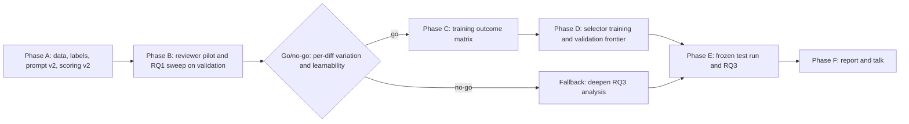

# Next-stage roadmap: learning to select context per code diff

Status: planning document written Nov 4, 2026. It is a plan, not measured results, except where numbers are explicitly labeled **measured**. It supersedes the earlier, shorter version of this roadmap.

## 0. How to use this plan

Each phase below (A-F) is written to become its own tech doc. Every phase section includes:
- Goal and the research question (RQ) it serves.
- Context files the tech-doc agent must read.
- Concrete tasks with interfaces, rules and parameters.
- Artifacts, tests and acceptance criteria.
- Risks.

Before writing any tech doc, an agent must still follow `AGENTS.md`: re-list `docs/` and read every document in full. This file is the canonical copy of the roadmap; keep it in sync with any later plan revisions.

Numbers labeled **measured** below come from read-only scripts run on Nov 4 over the local data under `repository_80_10_10_v1.json` and the local tokenizer in `checkpoints/qwen3b-qlora-split-v1-run5-local/`. Token counts use the Qwen2.5-Coder tokenizer. Numbers labeled **estimate** are planning assumptions that a phase must re-measure.

### Global context every tech doc needs

- **Research question.** Can a small learned selector choose context per diff and match the best fixed context policy's accuracy? Success means within 1 percentage point of the best fixed policy while using at least 30% fewer extra context tokens, or higher accuracy at a matched budget. The reviewer stays frozen.
  - RQ1: fixed-context effects.
  - RQ2: the learned selector's accuracy-cost frontier.
  - RQ3: when context helps or hurts.
  - Stretch: transfer to a second reviewer.
- **Professor guidance** (authoritative, in `docs/initial_investigation_context.md` section 3):
  - The accuracy-cost trade-off is the main question.
  - Fine-tune a small transformer selector or reranker. Greedy removal can supply labels or serve as a baseline, but not be the final method.
  - Baselines: diff-only, all-context, best fixed, random, similarity.
  - Robustness is out of scope; transfer is a stretch goal.
- **Course requirements** (`docs/MLII_fall2026_project_kickoff.pdf`):
  - Final report is 5-8 pages, NeurIPS style, with an unlimited appendix, due around Dec 1. Talks are Dec 3/7/10 and every member presents.
  - Graders value baselines, ablations, several seeds, honest error analysis and runnable code.
- **Data layout.**
  - Records live at `data/contextcrbench/extracted/final_json/<id>.json`: 68,938 files.
  - Manifest IDs are paths relative to `data/contextcrbench/extracted/`, e.g. `final_json/63859.json`.
  - The v1 split is `data/contextcrbench/splits/repository_80_10_10_v1.json`. It is immutable.
- **Existing code to reuse.**
  - `src/evaluation/splits.py` (`build_manifest`, `freeze_manifest`, `digest`, `as_bool`).
  - `src/evaluation/prompts.py`: v1 prompt. Keep it byte-identical, because its hash is part of the training run identity.
  - `src/context_selection/prompts.py` (`CONTEXT_TYPES`, `context_chunks`, mask-aware `build_user_prompt`).
  - `src/context_selection/baselines.py` (`select_context` with `diff_only`, `all_context`, `fixed`, `random` and BM25 `similarity`; full-chat token counting).
  - `src/evaluation/comparison.py` (cached paired evaluation, strict parser, `QwenComparison`).
  - `src/evaluation/analysis.py` (paired metrics, repository cluster bootstrap, cost frontier).
  - `src/evaluation/reporting.py`, `src/evaluation/plots.py`, `scripts/analyze_predictions.py`.
  - `src/models/qwen.py` (`QwenCoder`, which has no quantization yet).
  - `src/training/runtime.py` (atomic JSON, hashing, run locks).
  - The `tests/` suite: unittest, no GPU needed.
- **Machines.**
  - Cloud RTX 5090 (32 GB VRAM, 92 GB RAM) for all reviewer runs.
  - Local RTX 5070 Ti (16 GB) for debugging and the selector.
  - M4 Max for CPU analysis and plotting.
  - The existing adapter and pilot caches are mirrored locally under `checkpoints/qwen3b-qlora-split-v1-run5-local/`.
- **Conventions.**
  - Python 3.11 `.venv` with Hugging Face Transformers.
  - Reusable code in `src/`, runners in `scripts/`, configs in `configs/`, small outputs in `results/`.
  - No weights in git. Fixed seeds. Every cache is keyed by (record ID, mask, reviewer identity, prompt version, scoring version).
  - The test split is touched once (Phase E).
- **Conflicts to keep visible.**
  - The skill's "Current milestone" section is outdated.
  - The midpoint promised an LM Studio + `ocr` demo, which conflicts with the skill convention "Transformers, not LM Studio". Keep the demo optional and non-evidential (Phase F).
  - The proposal named a CodeBERT-style selector; this plan defaults to UniXcoder but keeps CodeBERT as an alternative.



### Schedule (tentative owners follow the proposal roles; the team must confirm)

- **Nov 4-9, Phase A.** Michael leads data and protocol. Ruiding owns A6/A7 scoring and re-evaluation. Li-Hua owns the A1/A2 manual audits.
- **Nov 9-13, Phase B.** Ruiding leads reviewer evaluation; Michael owns the infrastructure.
- **Nov 12-17, Phase C.** Michael and Ruiding.
- **Nov 16-22, Phase D.** Li-Hua leads selector training; Michael owns the chooser and evaluation.
- **Nov 22-26, Phase E.** Michael and Ruiding run the test; all three do the analysis.
- **Nov 24-Dec 1, Phase F.** All three, writing; talk preparation through Dec 3.

### Task checklist

- [ ] A1: closure-reason taxonomy from audit-only `pr_comment`, repository-level merge-mechanism rule, manual precision audit, `label_v2` per record.
- [ ] A2: narrow outcome-leakage flagger on PR/issue bodies, 100-record manual audit, strip/drop policy, sensitivity flag.
- [ ] A3: near-duplicate check (MinHash on normalized diff content) across splits; PR-level dedup metadata.
- [ ] A4: write `repository_80_10_10_v2.json` plus data card; never overwrite v1.
- [ ] A5: prompt v2 (field cleaning, token budgets, hunk-centered snippet windows, diff cap, render last) with assistant-marker tests.
- [ ] A6: verdict-logit scoring (single forward pass), validation threshold calibration, AUROC/balanced-accuracy/macro-F1/minority-recall metrics.
- [ ] A7: re-evaluate base vs existing 3B adapter under protocol v2 (no retraining); keep v1 results.
- [ ] B1: timed reviewer pilot (7B bf16 / 7B NF4 / 14B 8-bit / 14B NF4; 14B bf16 only on a rented GPU); freeze `configs/reviewer_main.yaml`.
- [ ] B2: RQ1 all-mask sweep on v2 validation; per-mask metrics, best fixed per budget, oracle and learnability go/no-go.
- [ ] C: training outcome matrix (one hunk per PR, label-stratified, repository-capped) with cached utilities.
- [ ] D: selector (mask-scorer and per-chunk heads), non-neural baselines and ablations, 3 seeds, λ sweep on validation.
- [ ] E: freeze protocol, single test run, frontier plots, clustered bootstrap, RQ3 help/harm analysis, optional transfer.
- [ ] F: final NeurIPS-format report (5-8 pages plus appendix) and talk.

---

## Phase A (Nov 4-9): repair data, labels, prompt and scoring

**Goal.** Fix every limitation listed in the midpoint's "Lessons Learned and Limitations" and "Next steps" (`paper/midpoint/main.tex` lines 105-122), so that later phases rest on trustworthy labels, intact prompts, parse-free scoring and supervision richer than one label.

**Midpoint limitations, each mapped to the step that fixes it.**
- Malformed base answers (82 Markdown-fenced) and lost chat boundaries (118 truncated inputs without the assistant marker): A5 and A6.
- Class imbalance and majority collapse (79.5% True in train, 87.5% in the pilot sample; the adapter always predicted True): A1, A6 and the sampling in Phase C.
- Label provenance and noise (six repositories with under 2% True holding 20.5% of False labels): A1.
- Chronology and leakage not audited: A2.
- Near-duplicates not checked: A3.
- A single `is_merged` label is not a selector objective: A6 and A8.
- The base-vs-adapter comparison must be repeated under a corrected protocol: A7.
- Within-repository AUROC was 0.520, and gradient norms were unstable: A7 reports AUROC. Training stability is out of scope because there is no retraining.

**Context files for the tech doc.**
- `paper/midpoint/main.tex`.
- `paper/midpoint-plan/evaluation-audit.md`, `evaluation-audit.json`, `model-data-audit.json`.
- `docs/midpoint_evaluation_and_demo_plan.md`, especially the Stage 2 and Stage 3 sections.
- `src/evaluation/{splits,prompts,comparison,analysis}.py`, `src/context_selection/{prompts,baselines}.py` and their READMEs.
- The training notebook cell 15 (`tokenize_example`) and cell 16 (`evaluate_generation`) in `notebooks/qwen3b_qlora_contextcrbench.ipynb`.
- `tests/test_splits.py`, `tests/test_context_selection.py`, `tests/test_comparison.py`.

### A0. Current data state ("before", measured)

**Record schema.** 46 keys per record.
- Model inputs: `full_name`, `lang`, `diff_hunk`, `issue_title`, `issue_body`, `pr_title`, `pr_body`, `snippet_before`, `snippet_after`.
- Location fields: `path`, `diff_hunk_*_line`, `snippet_*_line_*`.
- Outcome and post-review fields, **never allowed in prompts**: `merged`, `review_comment`, `comment_lines`, `pr_comment`, `issue_comment`, `commit_id`, `original_commit_id`.
- Full files, too large for prompts: `content_before`, `content_after` (median about 17-19k characters).

**Retained after v1 cleaning.** 46,518 records from 99 repositories.
- train: 38,097 records, 79 repositories, 30,281 True / 7,816 False.
- validation: 3,797 records, 10 repositories, 3,264 True / 533 False.
- test: 4,624 records, 10 repositories, 3,336 True / 1,288 False.
- Validation repositories: polars, micropython, uv, cli, cpython, playwright, aspnetcore, fastify, keras, PowerShell.
- Test repositories: bevy, rubocop, vllm, airflow, sway, ollama, rails, webpack, gitea, mastodon.

**The label is PR-level.** There are 27,629 PRs (train 22,377, validation 2,357, test 2,895), the median PR contributes 1 hunk (max 40), and **0 PRs have mixed labels**. Every hunk inherits its PR's merge flag, so the effective sample size is PRs.

**Context availability.**
- 42,469 records have all four optional chunks; 4,049 have three.
- `snippet_before` is missing in 4,010 records (new files): train 3,066, validation 366, test 578.
- `snippet_after` is missing in 39 records.

**Token lengths** (measured on a random sample of 1,500 retained records):
- `diff_hunk`: median 217, 90th percentile 1,001, 99th percentile 4,872.
- `issue_body`: median 333, p90 1,230.
- `pr_body`: median 192, p90 885.
- `snippet_before`: median 397, p90 3,722, p99 28,827.
- `snippet_after`: median 618, p90 4,334.
- v1 all-context chat: median 2,492, p90 5,117.
- Share of v1 prompts over the 2,016-token cap: train 63.1%, validation 59.5%, test 50.0%.

**Closure evidence in False labels** (regex over audit-only `pr_comment`; noisy, to be validated by A1's manual audit). Of the 7,816 train False labels:
- 2,292 mention staleness.
- 1,039 mention being superseded.
- 1,299 mention merging elsewhere (this pattern is noisy).
- 153 mention a merge bot.
- 3,762 have no detected reason.

In validation (533 False): stale 44, superseded 90, merged-elsewhere 48. In test (1,288 False): stale 282, superseded 206, bot 283.

**Merge-mechanism repositories** (merge rate within the retained data):
- `openssl/openssl`: 630 records, 0.0%. Comments say "Merged to master branch".
- `angular/angular`: 588 records, 0.0%. Merged through caretaker tooling.
- `bazelbuild/bazel`: 304 records, 0.3%.
- `spring-projects/spring-boot`: 73 records, 0.0%.
- `spring-projects/spring-framework`: 36 records, 2.8%.
- `nodejs/node` (701 records, 49.9%): 199 False records carry merge evidence.
- `bevyengine/bevy` (**test**, 1,231 records, 50.1%): **263 False records contain `bors r+ ... Pull request successfully merged into main`**.

**Near-duplicates.** Exact duplicates of whitespace-normalized `diff_hunk_content` leave 58 groups, all within a split; none cross splits. Near-duplicates are not yet checked.

**Leakage phrases.** A broad regex (`merged|reverted|superseded|closing this|landed`) hits 6,532 train bodies. Manual spot checks show this is mostly false positives, for example "resolutions ... are merged into one" and "I merged most of the implementation". Real signals look like "Replace #14860 and #14902 (reverted in #15253)" (`final_json/53759.json`). The flagger must use narrow patterns.

### A1. Label taxonomy and noise rules (new `src/data/labels.py`, `scripts/audit_labels.py`)

1. **Closure reasons.** Derive `closure_reason` from audit-only fields: `pr_comment` and `issue_comment`. These fields are read only by the audit and never enter prompts or selector inputs. Categories:
   - `merged_github`: `merged=True`.
   - `merged_external`: a False record with merge evidence, e.g. `bors r+` together with "successfully merged", "Merged to master", "Landed in <sha>", "pushed to <branch>", "cherry-picked to", or a commit-queue landing.
   - `stale`: a stale-bot or "closing as stale" comment.
   - `superseded`: "replaced by #N", "superseded by", "closing in favor of", "duplicate of".
   - `rejected_or_unknown`: any other False record.

   Patterns are versioned constants (`LABEL_RULES_VERSION = "v2"`). Each category keeps an example and its matched span for audit.
2. **Repository-level rule.** Exclude repositories with merge rate below 2% and at least 30 records, computed on the full retained data. GitHub's merge flag is meaningless for these repositories. Expected to drop angular, openssl, bazel and spring-boot, plus spring-framework, which sits at 2.8% and so needs an explicit decision. All five are in train.
3. **Primary population rule** (`label_v2`):
   - Keep `merged_github` as True and `rejected_or_unknown` as False.
   - **Exclude** `merged_external`, `stale` and `superseded` from the primary experiments. These are not quality judgments about the diff.
   - Sensitivity variant (`label_v2_relabel`): `merged_external` becomes True and stale/superseded are still excluded. Report this variant once in the appendix.
4. **Manual precision audit.** For each regex category, sample 50 train hits plus 50 `rejected_or_unknown` records with seed 42. Li-Hua and a second member record a verdict in `results/audit/label_audit.csv` with columns `id, category, matched_span, human_verdict, notes`. Target at least 90% precision per category. Revise the patterns on **train only**, then freeze them.
5. **Apply the frozen rules to all splits.** Validation and test are affected; bevy in test will lose about 263 records. This is legitimate preprocessing because the rules are fixed from train before any model sees test. Record the per-split before/after counts in the data card.
6. **Expected effect** (estimate). Train False shrinks from 7,816 to roughly 3.5-4.5k, so imbalance gets **worse**, at about 88% True. The fix for imbalance is therefore A6 (scoring and metrics) plus Phase C (sampling), not deleting True examples.

### A2. Chronology and leakage (`src/data/leakage.py`)

- **Narrow outcome patterns** on `pr_body` and `issue_body`: `reverted in #\d+`, `this (pr )?(was|has been) merged`, `merged (in|as|via) [0-9a-f]{7,}`, `landed in`, `closing in favou?r of`, `superseded by`, `replaced by #\d+`, and bot merge templates.
- **Policy decision after a manual audit of 100 hits** (Li-Hua):
  - Default: strip only the matching sentence from that field. Record `leak_stripped=True` and the character span.
  - Sensitivity check: rerun the headline numbers with flagged records dropped.
- **Quoted solutions.** The issue text sometimes contains the fix. For example, `final_json/63859.json`'s issue says "Solution: add following 2 lines ... if data is None: return", which the diff then implements. This is not label leakage; it is a legitimate reason context might help. Flag it as `issue_contains_patch` (token overlap between the issue's code spans and the added diff lines of at least 0.5) and use it as an RQ3 breakdown.
- **Chronology limits.** The record has one timestamp (`created_at`, the review comment time); PR and issue bodies may have been edited later. Document that full chronology cannot be verified from this release.

### A3. Near-duplicates (`src/data/dedup.py`)

- Use MinHash with 128 permutations over 5-line shingles of whitespace-normalized `diff_hunk_content`. Treat Jaccard at least 0.8 as a near-duplicate.
- **Cross-split rule:** drop the train-side member. **Within-split:** keep both; PR clustering already handles dependence.
- Also flag identical `(pr_title, pr_body)` across different repositories (forks and mirrors).
- Report the number of groups and removals.

### A4. Versioned manifest and data card

- Add `build_manifest_v2(rows, exclusions, ...)` in `src/evaluation/splits.py`, or a sibling `src/data/manifest.py`.
  - Same repository assignment as v1, minus excluded repositories and records.
  - New fields: `label_rules_version`, `excluded_by_reason` (counts and IDs), `leak_stripped_ids`, `pr_key` per ID, and `closure_reason` per ID.
  - Written once to `data/contextcrbench/splits/repository_80_10_10_v2.json` with `freeze_manifest` semantics: never overwrite, and never touch v1.
  - A new validation generation sample: the first 200 v2 validation IDs in hash order, at most one per PR.
- `results/audit/data_card_v2.md` contains:
  - Per-split before/after counts by reason and repository.
  - Label balance, language mix, missing chunks, token percentiles per field under prompt v2.
  - Example records for each closure category.

### A5. Prompt v2: budget before rendering (new `src/context_selection/render.py`, `PROMPT_VERSION = "v2"`)

**Rules.** All counts use the frozen reviewer's tokenizer, so the module receives the tokenizer as a parameter.
1. **Field cleaning** for issue and PR bodies:
   - Normalize `\r\n` to `\n`.
   - Drop HTML comments and template checklist lines (`- [x] ...`).
   - Replace fenced code blocks longer than 600 characters with a marker. As an ablation, keep the first 15 lines instead; the pandas example below shows that a reproducible example can be lost.
   - Collapse blank lines and strip NUL bytes. Keep titles.
2. **Hunk-centered code windows.**
   - `snippet_before` keeps lines `[diff_hunk_original_start_line - 15, diff_hunk_original_end_line + 15]`, mapped through `snippet_start_line_before`.
   - `snippet_after` keeps the same window using `diff_hunk_start_line/end_line` and `snippet_start_line_after`.
   - Render a header with the line numbers, e.g. "Code after (lines 475-512)". Window size k=15 is the default; k=40 is an ablation.
3. **Per-field token caps:** issue body 384, PR body 256, code before 384, code after 384. Cut at a token boundary and append the marker `…[truncated]`. Titles are capped at 64 tokens.
4. **Diff policy.**
   - If the diff exceeds 1,024 tokens, keep the `@@` header plus the **last** lines that fit (GitHub review `diff_hunk`s end at the commented line).
   - Never select lines using `comment_lines`; that would leak where the reviewer commented.
   - Set `diff_truncated=True`. This affects roughly 10% of records (diff p90 is 1,001 tokens).
5. **Fixed always-present header:** repository, language, file path, diff. The repository name is a possible prior shortcut, so ablate it without the repository line in Phase B.
6. **Render last.** Call `apply_chat_template(..., add_generation_prompt=True)` on the already-budgeted fields. The rendered chat is **never** truncated afterward. Assert `len(ids) <= max_input_tokens` (default 4,096) and that the rendered text ends with `<|im_start|>assistant\n`.
7. **Interface.** `render_review(example, mask, tokenizer, config) -> RenderedPrompt(text, input_ids, input_tokens, diff_only_tokens, extra_context_tokens, chunk_tokens: dict, truncation_flags: dict, prompt_version)`.
   - `select_context` in `baselines.py` gets a `renderer=` hook so every policy shares the same rendering. The v1 path stays the default for historical reproduction.
   - v1 `src/evaluation/prompts.py` is not edited.
8. **Training-path note.** The training notebook's `tokenize_example` (cell 15) has the same post-render truncation bug. Fix it only if the optional adapter retrain is ever run, which is out of scope per the team's decision.

**Tests** (`tests/test_render_v2.py`, using a fake tokenizer plus one real-tokenizer smoke test that skips if files are absent):
- The marker is always present.
- Total length never exceeds the cap.
- Per-field caps hold.
- Code windows contain the hunk lines.
- A missing `snippet_before` makes that chunk unavailable rather than empty.
- Outcome fields (`merged`, `review_comment`, `pr_comment`, `issue_comment`, `comment_lines`) cannot change the output.
- Diff truncation keeps the header and the tail.
- Rendering is deterministic.

### A6. Verdict scoring and imbalance-aware metrics (new `src/evaluation/scoring.py`, `SCORING_VERSION = "verdict-logit-v1"`)

- **Mechanism** (measured tokenization). The compact answer `{"is_merged":true}` tokenizes as `['{"','is','_merged','":','true','}']`. `true` is token 1866 and `false` is 3849, and the two answers differ only at that position.
  - Append the forced prefix `{"is_merged":` after the assistant marker and run **one forward pass**.
  - Read the logits at the final position: \(s = z_{true} - z_{false}\), and \(\log p(\text{true}) = s - \log(1 + e^{s})\) under the two-way renormalization.
  - Also save the full-vocabulary log-probabilities of both tokens, to detect mass on other tokens. The token IDs must be re-verified for each reviewer tokenizer, and the prefix must match the reviewer's training format: compact for the adapter.
  - There is no free generation, so invalid outputs cannot occur. Strict-JSON generation with 32 tokens stays available as a secondary check.
- **Decisions.**
  - Predict True if \(s > \tau\). Choose \(\tau\) per policy on validation to maximize macro-F1; the alternative (Youden J) is reported in the appendix.
  - Use \(\tau = 0\) for "uncalibrated" diagnostics.
- **Metrics** (extend `src/evaluation/analysis.py`):
  - AUROC (threshold-free and imbalance-robust; the **primary** ranking metric).
  - Balanced accuracy, macro-F1, per-class recall (False recall is the minority-class recall), accuracy.
  - The majority constant baseline.
  - Brier score and a reliability plot for calibration.
  - AUROC within each repository (average over repositories with both classes), matching the midpoint's 0.520 diagnostic.
- **Uncertainty.** Cluster bootstrap by PR, plus by repository as the sensitivity check. Validation and test have only 10 repositories each, so repository intervals will be wide; report both.
- **Record schema** for every scored call (JSONL):
  - Identity: `id, pr_key, repository, lang, label_v2, closure_reason`.
  - Context: `mask` (sorted tuple), `available`, `input_tokens, diff_only_tokens, extra_context_tokens, chunk_tokens`.
  - Score: `score, logp_true, logp_false, other_mass`.
  - Versions: `reviewer_id, prompt_version, scoring_version`.
  - Run info: `latency_seconds, truncation_flags, protocol_hash`.
- **Tests.** Synthetic logits produce the expected score and probabilities. Threshold selection uses validation only and raises on test. Metrics agree with scikit-learn. Bootstrap pairing is preserved.

### A7. Adapter re-evaluation under protocol v2 (no retraining, per the team's decision)

- Reuse `QwenComparison` loading: shared NF4 base, adapter disabled vs enabled, `checkpoint-14289`. Swap `predict` for v2 rendering plus verdict scoring.
- The prompt must match the adapter's training format: the v1 field order and system prompt. Use the v2 budgets and window rendering, and report this as "v1 content order, v2 budgeting".
- Data: the v2 validation generation sample (200 IDs) plus the full v2 validation set if time allows; scoring is cheap.
- Output: `results/phaseA/adapter_reeval_v2/` with `protocol.json`, `predictions.jsonl`, `metrics.json`. The v1 results in `results/midpoint/qwen3b_validation_v1/` and the checkpoint caches stay unchanged.
- Report a three-way table (majority, base, adapter) with AUROC, balanced accuracy, macro-F1 and False recall. If AUROC stays near 0.5, state that directly: it means there is little signal for the reviewer to learn. That justifies the frozen-reviewer framing and motivates Phase B's larger reviewers.

### A8. Supervision richer than one label (design fixed here, executed in Phases B and C)

- **Per-subset outcomes.** For each diff \(x\) and each available mask \(S \subseteq\) {issue, pr, code_before, code_after} (up to 16 masks; 8 when `snippet_before` is missing), store \(s(x,S)\) and \(\ell(x,S) = \log p(y \mid x,S)\).
- **Utility targets**, all in `src/context_selection/utility.py`:
  - `U_logp(x,S) = ℓ(x,S) − ℓ(x,∅) − λ·t(x,S)/B`, the primary target. It is dense and continuous, giving 16 targets per diff instead of one binary label.
  - `U_correct(x,S) = 1[correct at τ] − λ·t/B`. This is the proposal's original target, used as an ablation.
  - `U_margin(x,S) = clip(y'·s(x,S), −m, m)` with \(y' \in \{-1, +1\}\). An ablation.
  - \(B\) is the median all-context extra tokens on train. \(\lambda\) is swept.
- **Auxiliary signals available in the data**, optional if time allows. Each record has `comment_lines` and the human `review_comment`.
  - Context utility for **line localization**: does adding context raise the reviewer's probability of the commented line? This is hunk-specific rather than PR-level.
  - These fields are used only as targets on train, never as inputs.
- **What is not usable.** `commit_id != original_commit_id` holds for 100% of records, so it carries no "revised after review" signal.

### A9. Before and after: real examples

**Example 1: `final_json/63859.json` (train), from [pandas PR #53773](https://github.com/pandas-dev/pandas/pull/53773).**

Before, the raw record and the v1 pipeline:
```text
full_name=pandas-dev/pandas  lang=python  pr_number=53773  merged=False
pr_title="BUG: handle none values in `json.normalize()`"
issue_title="BUG: is a child element contains NULL this results in a TypeError: 'NoneType' object is not iterable"
pr_body (202 tokens): "This PR fixes the error ... Implemented tests to validate the change\r\n\r\n- [x] closes #53719 \r\n- [x] [Tests added and passed](https://pandas.pydata.org/...) ..."
issue_body: 398 tokens; snippet_before: 2,720 tokens (lines 249-548); snippet_after: 2,729 tokens (lines 249-550)
diff_hunk (105 tokens):
@@ -490,6 +490,8 @@ def _pull_records(js: dict[str, Any], spec: list | str) -> list:
     def _recursive_extract(data, path, seen_meta, level: int = 0) -> None:
+        if data is None:
+            return
         if isinstance(data, dict):
pr_comment (audit-only): "This pull request is stale because it has been open for thirty days with no activity..." /
  "Thanks for the pull request, but it appears to have gone stale..."
v1 all-context chat: 5,042 tokens -> right-truncated to 2,016
last kept text: '...{"name": "Palm Beach", "population": 60000},\n ... "info":'   (ends mid-docstring)
ends with <|im_start|>assistant: False
```
After, under the v2 rules:
```text
closure_reason=stale -> excluded from the primary population (label is not a quality judgment)
issue_contains_patch=True (issue says "Solution: add following 2 lines ... if data is None: return")
cleaned pr_body (37 tokens): "This PR fixes the error which is thrown when a field value in `json` is `null` while
  `json_normalize` it to a `DataFrame`. Implemented tests to validate the change"
cleaned issue_body: 115 tokens (template checklist removed; long code block replaced by marker)
code_before window: lines 475-510, 270 tokens; code_after window: lines 475-512, 279 tokens
v2 diff-only chat: 187 tokens
extra tokens by chunk: issue +144, pr +54, code_before +283, code_after +292
v2 all-context chat: 962 tokens, no truncation, ends with '<|im_end|>\n<|im_start|>assistant\n'
```
These after-values come from a throwaway in-memory prototype of the A5 rules run on Nov 4. The real module must reproduce them, with small tolerance, in a test.

**Example 2: `final_json/941.json` (test), bevyengine/bevy PR 1805.**
```text
Before: merged=False (would count as a rejected change)
pr_comment (audit-only): "... Completely agree with your issue and idea  bors r+  Pull request successfully merged into main. Build succeeded ..."
After: closure_reason=merged_external -> excluded (primary); relabeled True in the sensitivity variant
```

**Example 3: `final_json/42840.json` (train), openssl/openssl PR 19238.**
```text
Before: merged=False; repository merge rate 0.0% over 630 records
pr_comment: "This pull request is ready to merge  Merged to master branch. This does not apply cleanly to 3.1. Closing"
After: entire repository excluded by the merge-mechanism rule (rate < 2%, n >= 30)
```

**Example 4: v1 pilot outputs** (cached in `checkpoints/qwen3b-qlora-split-v1-run5-local/generation/`).
```text
Before (base, untruncated, final_json/12452.json, label True): "```json\n{\n  \"is_merged\": false\n}\n```" -> strict parser: invalid
Before (base, truncated at 2,016, final_json/49444.json): " constraints from a source.\n    pub async fn from_source(..." -> code continuation, invalid
Before (adapter, all 200): '{"is_merged":true}' -> constant majority prediction
After (v2): one forward pass with forced prefix '{"is_merged":' -> score s = z_true - z_false for every example,
            no invalid outputs; threshold chosen on validation; AUROC exposes whether any ranking signal exists
```

**Phase A deliverables.**
- `src/data/{labels,leakage,dedup,manifest}.py`, `src/context_selection/render.py`, `src/evaluation/scoring.py`, extended `analysis.py`.
- `scripts/audit_labels.py`, `scripts/build_manifest_v2.py`, `scripts/score_policies.py` (a generic scorer reused in Phases B, C and E).
- Tests for every module.
- `repository_80_10_10_v2.json`, `results/audit/{label_audit.csv,leakage_audit.csv,data_card_v2.md}`.
- `results/phaseA/adapter_reeval_v2/`.

**Acceptance criteria.**
- All tests pass on CPU.
- Every v2 prompt ends with the assistant marker.
- Zero invalid outputs under scoring.
- Audited regex precision is at least 90%.
- The data card lists before/after counts by reason.
- The adapter re-evaluation table exists with AUROC and balanced accuracy.
- Each midpoint limitation is mapped to its fix in `results/audit/README.md`.

**Risks.**
- After cleaning, False labels may be too few for stable validation estimates: validation has about 400 or fewer False. Report confidence intervals and use PR-cluster bootstrap.
- The regex taxonomy may miss reasons. The manual audit bounds this, and the "unknown" bucket is reported.

---

## Phase B (Nov 9-13): reviewer selection and RQ1 fixed-context sweep

**Goal.** Choose and freeze the strongest affordable reviewer. Then answer RQ1: how does each fixed context mask change quality and cost? Finally, decide whether per-diff selection has headroom (go/no-go).

**Context files for the tech doc.**
- Phase A outputs: v2 manifest, `render.py`, `scoring.py`, data card.
- `src/models/qwen.py`, which needs a `quantization=` implementation: `none`, `nf4` and `int8` via bitsandbytes.
- `src/evaluation/comparison.py` for loading and identity hashing.
- `configs/qwen7b.yaml`.
- The proposal sections on RQ1 and the go/no-go (DOCX sections 7 and 10-11).

### B1. Timed reviewer pilot

**Candidates.** Verify exact Hub IDs first.
- `Qwen/Qwen2.5-Coder-7B-Instruct` in bf16: about 15 GB of weights, fits the 5090.
- The same 7B model in NF4: about 5.5 GB. This is the team's minimum acceptable configuration.
- A 14B-class model, e.g. `Qwen/Qwen2.5-Coder-14B-Instruct`, or a newer Qwen 3.x/3.5 14B-class instruct model if one exists on the Hub at pilot time.
  - In 8-bit: about 15 GB. In NF4: about 9 GB.
  - **Unquantized bf16 needs about 29.5 GB of weights alone.** That will not fit a 32 GB 5090 with activations at 4k tokens. Running it requires a rented 48-80 GB GPU (the proposal allows an optional rental after measured throughput).

**Pilot set.** The 200-ID v2 validation sample, run under diff-only and all-context, scored with A6.

**Measurements per candidate:**
- AUROC, balanced accuracy, macro-F1 at a validation-fit \(\tau\) (fit by 2-fold within the pilot, and labeled optimistic), and within-repository AUROC.
- Mean and p95 seconds per scored call, prefill tokens per second, peak VRAM.
- Projected sweep cost = (Phase B2 validation calls + Phase C training calls + Phase E test calls) × seconds per call.

**Reference points.**
- Majority constant.
- A cheap-feature logistic regression on train using language, diff length and chunk lengths. The reviewer must beat this to be meaningful.
- The no-repository-name ablation for the best candidate.

**Selection rule.**
- Pick the candidate with the highest all-context AUROC whose total projected GPU time fits about 20 hours on the 5090, or a rental budget if the team approves one.
- Ties go to the cheaper model.
- The runner-up becomes the transfer reviewer for the Phase E stretch goal.

**Freeze** in `configs/reviewer_main.yaml`: model ID and revision hash, quantization, dtype, `PROMPT_VERSION`, `SCORING_VERSION`, `max_input_tokens`, field budgets, tokenizer hash, verdict token IDs.

### B2. RQ1 all-mask sweep on validation

- **Scope:** every v2 validation record (estimate: about 3.4k records, about 2.2k PRs) × every available mask (up to 16). Estimate about 50k scored calls. At an estimated 0.1-0.3 s per call, that is 1.5-4 hours; Phase B1 must re-measure.
- **Runner:** `scripts/score_policies.py --split validation --masks all` writes `results/phaseB/val_sweep/` (sharded JSONL plus a protocol). It is resumable and reuses the cache keys from A6.
- **Per-mask outputs:**
  - Quality: AUROC, balanced accuracy, macro-F1, False recall, accuracy at a per-mask validation \(\tau\).
  - Cost: mean extra context tokens, mean total tokens.
  - Breakdowns by language and diff-size quartile.
- **Fixed policies:**
  - diff-only and all-context.
  - The best fixed mask per budget: for budgets \(B \in\) {0, 128, 256, 512, 768, 1024, all}, the mask with the highest macro-F1 whose mean extra tokens are at most \(B\).
  - Random at matched budgets (5 seeds) and BM25, both from `baselines.py` with the v2 renderer.
- **Headroom diagnostics (go/no-go):**
  - **Oracle gap.** The label-using per-diff oracle (pick the mask maximizing `U_logp`) vs the best fixed mask, at matched mean tokens. It is optimistic, so report it only as an upper bound.
  - **Noise-floor control.** Compute the same oracle gain after randomly permuting which mask's score belongs to which example within a cost bin. Real per-diff signal must clearly exceed this permutation gain.
  - **Variation.** The fraction of diffs whose best-utility mask differs from the best fixed mask. Also, the distribution of \(\ell(x,S) - \ell(x,\emptyset)\) per chunk type.
  - **Learnability probe.** 5-fold PR-grouped cross-validation on validation: a logistic regression or gradient-boosted model on cheap features predicts the per-diff gain of each chunk. Report the Spearman correlation, against zero.
- **Go rule** (fixed now): proceed to Phase C if
  - the oracle gap minus the permutation gain is at least 2 macro-F1 points or 25% fewer tokens at equal macro-F1, **and**
  - the learnability probe's Spearman correlation is above 0.1 for at least one chunk type.

  Otherwise take the fallback: skip to Phase E's RQ3 analysis, still train a small selector for completeness, and report a negative result.
- **Figures:** a per-mask scatter of macro-F1 and AUROC against mean extra tokens, with the fixed frontier highlighted, and per-chunk Δlogp histograms.

**Deliverables.** `configs/reviewer_main.yaml`, `results/phaseB/{pilot,val_sweep,rq1_report}`, `src/models/qwen.py` quantization support with tests (mocked).

**Acceptance criteria.**
- The reviewer is frozen with all its hashes.
- The validation sweep is 100% complete, with no partial masks.
- The RQ1 table and figure exist.
- The go/no-go decision is recorded with its numbers.

**Risks.**
- The 14B model is too slow: fall back to 7B.
- The reviewer has AUROC near 0.5: the per-diff Δlogp can still vary, so report it and rely on the RQ3 framing.

---

## Phase C (Nov 12-17): training outcome matrix

**Goal.** Create selector supervision: the reviewer's outcomes for every mask on a training sample.

**Context files for the tech doc.** Phase A (A6 schema, A8 utilities), Phase B (frozen config, measured seconds per call), `src/context_selection/baselines.py`, the v2 manifest.

**Sample design** (`scripts/sample_outcome_set.py`, seed 42, saved as an ID list before any scoring):
- Population: v2 train minus excluded records. One hunk per PR, chosen by seeded hash, to break the PR-level label duplication.
- **Label-stratified.** Take all available False PRs, up to N/2, and an equal number of True PRs. Cap each repository at about 4% of the sample so that dotnet/runtime, pingcap/tidb and kubernetes do not dominate.
- Target size N of 4k-8k PRs, chosen from Phase B's measured seconds per call so the run fits about 8 GPU hours. Estimate: 6k × ~15 masks ≈ 90k calls.
- Save prior-correction weights \(w_y = \pi^{train}_y / \pi^{sample}_y\). The selector loss can then be weighted back to the natural distribution (Phase D ablation: weighted vs unweighted).

**Execution.** `scripts/score_policies.py --split train --ids <sample> --masks all` writes `results/phaseC/train_outcomes/`.
- Same schema and cache keys as A6, resumable.
- Log GPU-hours and calls; this is the "training-label cost" metric the proposal requires.

**Derived targets.** `src/context_selection/utility.py` builds `results/phaseC/targets.parquet` with one row per (id, mask): `U_logp`, `U_correct`, `U_margin`, cost, and availability.

**Quality checks.**
- Score drift: rerun 200 random (id, mask) pairs and confirm bitwise-identical or within 1e-3 scores under deterministic kernels.
- Every sampled ID has all its available masks.
- Per-repository and per-label counts are reported.

**Optional greedy baseline** (proposal requirement as a reference). Greedy removal from all-context is computed offline from the cached matrix with no extra calls. Report the number of calls it would need if run online.

**Deliverables.** The ID list, outcomes, targets, and a cost log.

**Acceptance criteria.** The matrix is complete, the determinism check passes, and the cost is reported.

---

## Phase D (Nov 16-22): learned context selector (RQ2)

**Goal.** Train a compact transformer that sees only allowed inputs (never the label or the reviewer output) and predicts per-mask utility. Pair it with a budget-aware chooser that traces an accuracy-cost frontier, and compare against all baselines on validation.

**Context files for the tech doc.** Phase C targets, Phase B validation sweep (the selector's dev set, already containing all-mask outcomes), the proposal DOCX sections 9-11, `src/context_selection/baselines.py`, `src/training/runtime.py`.

### Selector input

- **Encoder.** `microsoft/unixcoder-base` (125M, 1,024 positions) by default. Alternatives: `microsoft/codebert-base` (512 positions) or `Salesforce/codet5p-110m-embedding`.
- **Packed text** of at most 512 tokens with type tags:
  `[DIFF] <diff tail ≤256> [ISSUE] <title + first ≤64> [PR] <title + first ≤64> [CB] <window head ≤48> [CA] <window head ≤48>`.
  Missing chunks render as `[ISSUE] <none>`, and so on.
- **Numeric side features:** the v2 token cost of each chunk, availability flags, language one-hot, diff length, `diff_truncated`, and `issue_contains_patch`. No repository identity, because repositories are disjoint across splits.

### Heads

- **D1, mask scorer (main).** CLS → MLP → 16 outputs, giving predicted `U_logp` at λ=0 for each mask. Unavailable masks are masked out.
  - Loss: Huber on available masks plus listwise KL between softmax(pred/T) and softmax(target/T), with T=1.
  - Optional per-example prior weights \(w_y\).
- **D2, per-chunk cross-encoder (ablation).** One (diff, chunk) pair per input predicts that chunk's marginal gain. A mask's score is the sum of its chunks' gains, so this head captures no interactions. It is cheaper.
- **D3, non-neural baselines** (they answer "is a deep model needed?"):
  - Logistic regression or LightGBM on the side features predicting per-mask utility.
  - A length-only heuristic: add chunks in order of increasing cost while under budget.

### Chooser

- At inference: \(S^* = \arg\max_{S \text{ available}} \hat U(x,S) - \lambda\, t(x,S)/B\). The cost \(t(x,S)\) is the measured v2 token count, computable without the reviewer.
- Sweep λ over 20 log-spaced values on validation to trace the frontier.
- Reviewer threshold \(\tau\): one global \(\tau\) per λ point, fit on validation. Alternatively, a per-mask \(\tau\) from Phase B (ablation).

### Training

- AdamW with lr 2e-5 for the encoder and 1e-3 for the head, batch 32, at most 5 epochs, 6% warmup, bf16.
- Early stopping on the validation **area under the macro-F1 vs extra-token frontier**, computed by lookup in the Phase B sweep (no reviewer calls).
- 3 seeds (13, 42, 1234). Runs on the 5070 Ti or 5090 in minutes to about an hour per seed (estimate).

### Evaluation on validation (all by cache lookup)

- **Policies compared:** diff-only, all-context, best fixed per budget, random at matched budget (5 seeds), BM25, the length heuristic, D3, D2, D1 (3 seeds), and the oracle as a labeled upper bound.
- **Metrics at each operating point:** macro-F1, balanced accuracy, AUROC, False recall, mean extra tokens, mean total tokens.
- **Matched-budget accuracy:** interpolate the fixed frontier at the selector's mean budget.
- **Tokens-to-match:** the selector's extra tokens needed to reach the best fixed macro-F1.
- **Success check** from the proposal: within 1 point of best fixed with at least 30% fewer extra tokens, or better at a matched budget.
- **Selector overhead:** median and p95 ms per diff (tokenization plus forward pass), compared with the reviewer prefill time saved.

### Ablations

- Utility target: `U_logp` vs `U_correct` vs `U_margin`.
- Prior-weighted vs unweighted loss.
- D1 vs D2 (interactions).
- With vs without side features.
- Encoder choice (if time allows).
- Code-window k=15 vs k=40 (requires re-scoring a subset; optional).

### Freeze

`configs/selector_final.yaml` records the selector checkpoint hashes (3 seeds), the chosen λ grid points to report on test, \(\tau\) values, and the baseline settings. The test split is not touched until this file is committed.

**Deliverables.** `src/context_selection/{selector,chooser,utility}.py`, `scripts/train_selector.py`, `scripts/evaluate_policies.py`, tests (shape, masking, chooser feasibility, no label access), `results/phaseD/`.

**Acceptance criteria.** All policies are on one validation frontier figure with seed bands, the ablation table is complete, and the freeze file is committed.

---

## Phase E (Nov 22-26): single frozen test evaluation and RQ3

**Goal.** Run the final, untouched comparison, then explain when context helps or hurts.

**Context files for the tech doc.** `configs/reviewer_main.yaml`, `configs/selector_final.yaml`, the Phase D report, `src/evaluation/analysis.py`, and `prepare_data(final_test=True)` semantics in `comparison.py`.

### Test run

- Score every v2 test record × every available mask. Estimate: about 4.3k records × ~15 masks ≈ 65k calls, 2-5 hours.
- All policies, including the selector, are then evaluated by lookup.
- Before starting, record `results/phaseE/protocol.json` with the hashes of both freeze files. Run it once.

### Reporting

- **Frontier plots** of macro-F1 and balanced accuracy against mean extra tokens and against total tokens, with the 3-seed band for the selector.
- **Headline table at matched budgets.**
- **Paired cluster bootstrap** (2,000 draws) by PR and by repository for the selector-minus-best-fixed difference. Test has only 10 repositories, so present repository intervals as a sensitivity check.

### RQ3 analysis

- **Per-example categories** relative to diff-only, per chunk type: help (wrong to right), harm (right to wrong), neutral. Also report the Δlogp distributions.
- **Breakdowns:**
  - Language.
  - Diff-size quartile.
  - New-file records (missing `snippet_before`).
  - `issue_contains_patch`.
  - `diff_truncated`.
  - Closure category (sensitivity population only).
- **Selector failure analysis:** cases where it chose an expensive mask with no gain, or skipped a helpful chunk. Show 10 qualitative examples chosen by a documented rule, not cherry-picked.
- **Sensitivity reruns:** the `label_v2_relabel` population, leak-flagged records dropped, and the no-repository-name prompt.

### Stretch: transfer

- Score the selector's chosen masks, plus the fixed baselines, with the runner-up reviewer from Phase B on test.
- Report whether the selector keeps its frontier advantage without retraining.

**Deliverables.** `results/phaseE/` (predictions, metrics, bootstrap, figures as PDF/PNG, RQ3 tables), plus a short `results/phaseE/README.md` describing provenance.

**Acceptance criteria.** One test protocol hash, complete pairing across policies, figures generated from saved predictions only.

---

## Phase F (Nov 24-Dec 1; talks Dec 3/7/10): final report and talk

**Context files for the tech doc.**
- `AGENTS.md` LaTeX workflow, `.cursor/skills/latex-document/{PROJECT_GUIDANCE.md,SKILL.md}`, `docs/report_format/README.md`, `docs/report_format/neurips_2026/*`.
- `paper/midpoint/main.tex` for style and author block.
- The `empirical-paper-writer` and `results-backfill` skills.

**Report.** `paper/final/main.tex`, NeurIPS 2026 non-anonymous mode, 5-8 pages plus an appendix. Outline:
1. Motivation and research question.
2. Related work: ContextCRBench, Repoformer, RECOMP, Shi et al., and QLoRA for the pilot.
3. Data and label repair: the midpoint failure, the v2 taxonomy, before/after counts, and the A9 examples.
4. Frozen-reviewer protocol and scoring.
5. RQ1 fixed-context results.
6. Selector method.
7. RQ2 frontier results.
8. RQ3 analysis.
9. Limitations: merge-status proxy, PR-level label, 10 test repositories, chronology.
10. Lessons learned.

The appendix covers the audits, ablations, the adapter re-evaluation, sensitivity runs and compute. Required elements: the GitHub link, team contributions, and acknowledgment of LLM assistance.

**Figures.** Data repair waterfall (counts by exclusion reason), RQ1 mask scatter, main frontier, help/harm by chunk type, and selector overhead.

**Reproducibility.** The README gets exact commands per phase: audit, manifest v2, score, train selector, evaluate, analyze. Every reported number must trace to a file under `results/`.

**Talk.** 12-15 minutes. Suggested split: Michael on problem and data repair, Ruiding on reviewer and RQ1/RQ2 results, Li-Hua on selector and RQ3/lessons. Each member answers questions on their part.

**Optional demo.** An LM Studio + `ocr` terminal walkthrough with a tool-capable model, labeled as a workflow demonstration only, never as evidence.

**Acceptance criteria.** The report compiles and its pages are visually inspected, it stays within 8 content pages, it contains no invented numbers or citations, and the checklist decision is documented.

---

## Cross-cutting risks and fallbacks

- **The reviewer signal is weak even after cleaning** (AUROC near 0.5). Report it honestly, lean on Δlogp utility (it still measures context effects), use the RQ3 framing, and optionally add the `comment_lines` localization signal.
- **Too few minority-class examples** in validation and test after cleaning. Use PR-cluster intervals, AUROC and balanced accuracy, and present the `label_v2_relabel` sensitivity population.
- **Compute overrun.** Cut the Phase C sample size first, then the number of validation masks (greedy-reachable masks only), and never the test pairing.
- **Schedule slip.** Phases B2 and C can overlap once the reviewer is frozen, and Phase D can start on partial Phase C data, because the targets are append-only.
