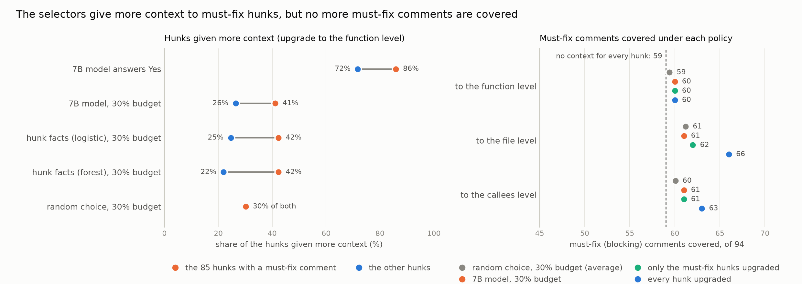

# Do the selectors give more context to must-fix hunks? All 185 AACR pull requests (November 28, 2026)

**Status: computed on November 28, 2026 from saved results; no model was called.** On all 185 buildable AACR-Bench pull requests, three of the five selectors looked at give more context to hunks that carry a must-fix comment than to other hunks. The untrained 7B model answers "give more code" for 86% of those hunks against 72% of the others. Two things limit what this shows. Most of the preference is hunk size: larger hunks draw more comments of every kind. And it does not raise the number of must-fix comments the reviewer covers: 60 or 61 of 94 under the 7B model's choice, against 59 with no context and 59 to 61 under random choice.

This follows the level results on all 185 pull requests ([aacr_confirmation_run.md](aacr_confirmation_run.md)) and the selector comparison on the first 93 ([selector50_run.md](selector50_run.md)). The severity labels are those of [review_score_design.md](review_score_design.md). What a selector has to beat is in [project_target.md](project_target.md), Section 3.



## 1. What was looked at

| Part | Choice |
|---|---|
| Pull requests | All 185 buildable AACR-Bench pull requests: 50 repositories, 1,811 reviewed hunks, 1,419 reference comments |
| Must-fix comment | A reference comment with the severity label `blocking`: 94 of the 1,419. The labels come from Qwen3.8-27B with thinking on, not from a person |
| Must-fix hunk | A hunk with a must-fix comment on its lines, by the scorer's own rule: 85 of the 1,811. 93 of the 94 must-fix comments sit on a reviewed hunk |
| Other groups | 850 hunks have some reference comment on their lines; 356 have a must-fix or should-fix one; 494 have only milder ones (nit, or without a label); 961 have none |
| Selectors | Three untrained Qwen2.5-Coder models (1.5B, 3B, 7B) asked whether more code would help the reviewer, and two selectors trained on 71 facts about the hunk (logistic regression, random forest) |
| A selector's choice | Either the model's own answer (Yes when its score, log P(Yes) − log P(No), is above 0), or a budget: hunks go from no context to one wider level in the selector's order until 30% of that level's extra tokens is spent |
| Intervals | The middle 95% of 5,000 bootstrap draws of repositories (seed 536). Random choice is 1,000 random orders of the hunks |

No selector sees the reference comments or their labels. A must-fix hunk is known only afterwards, so this asks what a selector's choices turn out to favour.

**Where the selectors' scores come from.** They were computed on all 185 pull requests with the notebooks of [selector50_run.md](selector50_run.md), run unchanged through `scripts/analysis/run_selector185.py`: the same five repository folds (fold hash `d9125e9ed7`), the label "some wider level covers more reference comments than no context" (337 of the 1,811 hunks) and the same budgets. The models' scores are out-of-fold. The three Qwen2.5-Coder models ran on a laptop (Apple M4 Max, float16). On the 928 hunks of the first 93 pull requests their scores agree with the earlier A100 run: AUC 0.559 and 0.590 for the 1.5B and 7B models, against 0.555 and 0.591.

One thing differs from the run on the first 93. The 92 pull requests added on November 27 were built with the four kept levels only, so the trained selectors use 71 facts and not 114. On the first 93 alone that change moves the logistic baseline from AUC 0.551 to 0.542.

For reference, how the same selectors do at the task they were built for, finding the hunks that need context:

| Selector | AUC for "needs context" [95% interval] | At 30% of the function level's extra tokens: comments covered, severity score |
|---|---|---|
| 7B model, zero-shot | 0.576 [0.542, 0.616] | 759, 0.594 |
| 3B model, zero-shot | 0.565 [0.533, 0.601] | 750, 0.581 |
| 1.5B model, zero-shot | 0.552 [0.510, 0.587] | 740, 0.569 |
| Hunk facts, random forest | 0.553 [0.524, 0.580] | 750, 0.582 |
| Hunk facts, logistic regression | 0.545 [0.512, 0.579] | 739, 0.577 |
| Cheapest hunks first, no learning | | 758, 0.594 |
| Random choice | 0.5 | score 0.586 on average, 0.599 at the 95th percentile |
| No context for every hunk | | 742, 0.578 |
| Function level for every hunk | | 753, 0.589 |
| Hindsight (upper bound) | | 865, 0.677 |

As on the first 93, no selector beats random choice at a budget. Over the eleven selectors run (these five and six more without a model), three upgrade levels and seven budgets there are 231 points. Two are above random choice's 95th percentile, both the 7B model at a 20% budget, which is fewer than chance alone would give. The intervals in this table are the notebooks' (2,000 draws).

## 2. The selectors lean toward must-fix hunks

**The 7B model's own answer.** It answers Yes, give more code, for 72.4% of all hunks:

| Hunks | Count | The 7B model answers Yes |
|---|---|---|
| With a must-fix comment | 85 | 85.9% (73) |
| With a must-fix or should-fix comment | 356 | 85.1% (303) |
| With only milder comments | 494 | 73.9% (365) |
| With no reference comment | 961 | 67.0% (644) |
| Without a must-fix comment | 1,726 | 71.8% (1,239) |

Must-fix hunks get a Yes 14.1 points more often than the other hunks [+7.0, +20.4].

The two smaller models cannot show this with their answer. The 3B model answers Yes for 99.3% of hunks and the 1.5B model for all of them.

**At a budget.** Each selector upgrades the hunks it ranks highest until 30% of the extra tokens is spent. Random choice upgrades 30% of the must-fix hunks, and more than 37.7% of them in one order in twenty.

| Selector | Must-fix hunks upgraded to the function level | Other hunks upgraded | Difference in points [95% interval] |
|---|---|---|---|
| 7B model, zero-shot | 41.2% (35 of 85) | 26.4% | +14.8 [+3.3, +26.6] |
| Hunk facts, logistic regression | 42.4% (36 of 85) | 24.6% | +17.7 [+6.1, +29.1] |
| Hunk facts, random forest | 42.4% (36 of 85) | 22.0% | +20.4 [+4.8, +35.6] |
| 1.5B model, zero-shot | 32.9% (28 of 85) | 21.3% | +11.7 [−2.3, +24.6] |
| 3B model, zero-shot | 35.3% (30 of 85) | 30.2% | +5.1 [−5.4, +14.9] |
| Cheapest hunks first | 58.8% (50 of 85) | 72.8% | −13.9 [−24.4, −3.7] |

- **Three selectors prefer must-fix hunks beyond chance:** the 7B model and the two trained on hunk facts. The 1.5B and 3B models do not.
- **The same holds for the other two levels.** For the 7B model the difference is +15.1 [+3.8, +26.8] to the file level and +14.3 [+3.0, +26.2] to the callees level.
- **The cheapest-first rule does the opposite.** Must-fix hunks are larger and cost more to upgrade, so it upgrades fewer of them.

## 3. Most of the lean is hunk size

How well each score ranks a must-fix hunk above another hunk (AUC; 0.5 is a coin flip):

| Score | Must-fix hunk against all others | Among the 850 hunks with a reference comment | Among hunks of similar size |
|---|---|---|---|
| 7B model, zero-shot | 0.625 [0.571, 0.674] | 0.570 [0.509, 0.624] | 0.573 |
| 3B model, zero-shot | 0.571 [0.499, 0.630] | 0.523 [0.451, 0.586] | 0.533 |
| 1.5B model, zero-shot | 0.609 [0.534, 0.673] | 0.560 [0.494, 0.624] | 0.585 |
| Hunk facts, logistic regression | 0.624 [0.532, 0.705] | 0.508 [0.427, 0.589] | 0.566 |
| Hunk facts, random forest | 0.676 [0.588, 0.752] | 0.559 [0.463, 0.647] | 0.617 |
| Changed lines alone | 0.688 [0.612, 0.759] | 0.591 [0.509, 0.669] | 0.563 |

"Similar size" compares only hunks in the same fifth by changed lines.

- **Counting changed lines does as well as any selector.** Larger hunks draw more reference comments of every kind, must-fix ones included. A selector that prefers large hunks will prefer must-fix hunks.
- **Little is left once size is held fixed.** The 7B model drops from 0.625 to 0.573. The fifths are wide at the top (13 to 711 changed lines), so some of what is left is still size.
- **The selectors barely separate must-fix comments from milder ones.** Among hunks that have a reference comment, the 7B model's interval stays just above 0.5, as does the count of changed lines. The other four selectors' intervals include 0.5.

## 4. It does not cover more must-fix comments

The 94 must-fix comments covered under each policy:

| Policy | To the function level | To the file level | To the callees level |
|---|---|---|---|
| No context for every hunk | 59 | 59 | 59 |
| Random choice at the 30% budget, on average | 59.4 | 61.2 | 60.1 |
| 7B model at the 30% budget | 60 | 61 | 61 |
| Hunk facts, logistic regression, at the 30% budget | 59 | 60 | 59 |
| Hunk facts, random forest, at the 30% budget | 59 | 61 | 58 |
| Cheapest hunks first, at the 30% budget | 60 | 66 | 64 |
| Only the 85 must-fix hunks upgraded | 60 | 62 | 61 |
| Every hunk upgraded | 60 | 66 | 63 |

Random choice covers at least as many as the 7B model in 50%, 59% and 43% of its orders for the three levels, so the model's counts are what chance gives. The one count that random choice rarely reaches is the cheapest-first rule's 66 to the file level (5% of orders), and that rule upgrades fewer must-fix hunks than other hunks.

- **Knowing the must-fix hunks exactly would add 1 to 3 comments.** That row is not a selector: it uses the labels. It is the most that a perfect preference for must-fix hunks could gain.
- **More context changes which must-fix comments are covered more than how many.** When every hunk goes to a wider level, the reviewer covers some comments it missed and misses some it had covered:

  | Level | Covered now, missed with no context | Missed now, covered with no context | Net |
  |---|---|---|---|
  | Function | 9 | 8 | +1 |
  | File | 17 | 10 | +7 |
  | Callees | 13 | 9 | +4 |

- **Part of the file level's gain comes from other hunks.** A hunk's review can cover a comment elsewhere in its file. Upgrading every hunk to the file level covers 66 must-fix comments, and upgrading only the must-fix hunks covers 62.
- **This agrees with the level results.** On all 185 pull requests the wider levels cover 4.3 points more of the blocking comments than no context, with an interval of −3.7 to +13.6 ([aacr_confirmation_run.md](aacr_confirmation_run.md), Section 2).

## 5. What can and cannot be claimed

1. **Can be claimed:** the 7B model and the two selectors trained on hunk facts give more context to hunks with a must-fix comment than to other hunks, by 15 to 20 points at a 30% budget, and the 7B model's Yes rate rises with the severity of the comments on the hunk.
2. **Cannot be claimed:** that the selectors recognise what makes a hunk hard. Hunk size explains most of the preference.
3. **Cannot be claimed:** that this improves the review. The must-fix comments covered do not rise, and a perfect pick of the must-fix hunks would add at most 3 of 94.

## 6. Limits

- **The numbers are small:** 85 hunks and 94 comments, so one or two comments move a count by as much as the differences in Section 4.
- **The question came after the results.** It was asked once the selectors had been scored on all 185 pull requests, and five selectors and three levels were looked at. Nothing here was fixed before a run.
- **The must-fix label is a model's.** No person labelled severity.
- **One reviewer run per hunk and level.** On the five pull requests reviewed three times, one level in two runs disagrees on 6.1% of comments ([aacr_confirmation_run.md](aacr_confirmation_run.md), Section 6). Part of the gains and losses in Section 4 is of that kind.
- **Only the direct question was run for the models on all 185.** The embedding and LoRA selectors of [selector50_run.md](selector50_run.md) were not, and neither was a 14B model.
- **The budget is in tokens,** so a selector that prefers large hunks upgrades fewer hunks for the same budget (27.1% of hunks for the 7B model, 72.1% for cheapest first).

## 7. How to reproduce

```bash
.venv/bin/python scripts/analysis/run_selector185.py inputs        # data/aacr_hunk_selector_files/
.venv/bin/python scripts/analysis/run_selector185.py nonllm        # results/selector185_nonllm/
HF_HUB_OFFLINE=1 .venv/bin/python scripts/analysis/run_selector185.py llm --zero-shot-sizes 1.5 3 7 --skip-embeddings --skip-lora
                                                                   # results/selector185_llm/ (models from the Hugging Face cache)
.venv/bin/python scripts/analysis/selector_must_fix.py             # this document's numbers and figure
```

- The last command calls no model and takes about 15 seconds. It prints every number above, writes `results/selector185_llm/must_fix.json` and draws the figure.
- The three models took 8.5, 18 and 41 minutes on the laptop.
- Tests: `tests/test_selector_must_fix.py` and `tests/test_run_selector185.py`.
