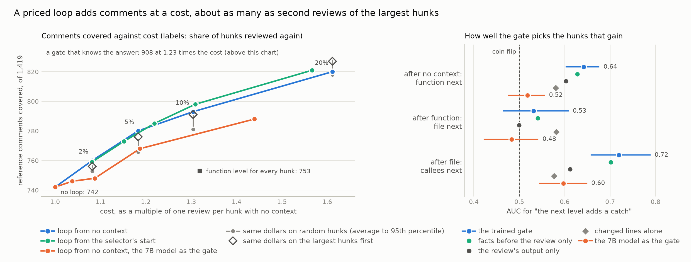

# A priced feedback loop on top of the selector: all 185 AACR pull requests (November 28, 2026)

**Status: simulated on November 28, 2026 from saved reviews; no new review was run.** On all 185 buildable AACR-Bench pull requests, a loop that reviews a few hunks a second time with more context covers more reference comments than one review per hunk: 760 to 820 of 1,419 against 742, at 1.08 to 1.61 times the cost. Each extra comment costs 3.4 to 5.8 times what a comment costs in the first pass. While at most a tenth of the hunks are reviewed again, the loop's gate does better than the same dollars spent on second reviews of random hunks, but only 2 to 4 comments better than spending them on the largest hunks. A gate that knew which hunks gain would cover 908 at 1.23 times the cost, so the loop is limited by its gate, which ranks those hunks at AUC 0.64. Letting the selector choose the starting level does about the same at equal cost. A 7B code model asked directly, in place of the trained gate, does not work: it ranks the hunks at AUC 0.52, 0.48 and 0.60 on the three steps, and its loop covers no more than the same dollars spent on random hunks.

This is the feedback loop the project had kept as later work: the one-shot selector stays, and a hunk can still get more context when one review is not enough, at a price on each extra request. It follows the selector results on all 185 pull requests ([selector185_must_fix.md](selector185_must_fix.md), Section 1) and the level results ([aacr_confirmation_run.md](aacr_confirmation_run.md)). Two earlier tests on 28 pull requests asked whether a first review tells which hunks need the file ([per_hunk_review_test.md](per_hunk_review_test.md), Sections 20.4 and 20.5). What a selector has to beat is in [project_target.md](project_target.md), Section 3.



## 1. What was simulated

| Part | Choice |
|---|---|
| Pull requests | All 185 buildable AACR-Bench pull requests: 50 repositories, 1,811 reviewed hunks, 1,419 reference comments |
| Reviews | The saved reviews of the run on all 185: Qwen3.8-27B, thinking off, one request per hunk and level, at the four kept levels (no context, function, file, callees). A hunk's second review is the one already saved for it at the next level, so it was made without seeing the first |
| The loop | A hunk is reviewed at its starting level. A gate then gives it a score. When the score is at least the price, the hunk is reviewed again one level up and the findings of all its reviews are kept. This repeats up to the callees level, so a hunk gets at most three extra reviews |
| What is counted | A reference comment is covered when any of the hunk's reviews covers it, by the run's judge. Cost is the input and output tokens of every review a hunk gets, at $2 and $10 per million tokens |
| The trained gate | One logistic regression per step. Its score is the chance that the next level covers a comment that the reviews so far missed. Inputs: 29 facts known before any review (the hunk's size and place in the pull request, trace counts, each level's token cost, whether the file is a test, the language) and 7 facts of the review just made (findings, findings off the hunk, output tokens, characters, question marks, findings that say code cannot be seen, findings that ask the author to check). Trained on other repositories, over the selector runs' five repository folds |
| The price | Set by the share of hunks whose score after the no-context review reaches it: 2%, 5%, 10% and 20%. The same price is used at the later steps and for both starts |
| Starts | Either every hunk starts with no context, or the selector picks the start: the 7B model asked directly, at 30% of the function level's extra tokens. That is the setting of the selector write-ups and was fixed before this was run. 491 hunks then start at the function level and are not reviewed with no context |
| Compared with | The same extra dollars spent on one second review of hunks drawn at random (500 draws) and of the largest hunks first; a gate that knows the answer (hindsight); every level for every hunk |
| Intervals | The middle 95% of 5,000 bootstrap draws of repositories (seed 536) |

No gate sees a reference comment when it decides. The trained gate's label, "the next level adds a catch", comes from the reference comments of other repositories.

## 2. The gate

How well each score ranks the hunks where the next level adds a catch (AUC; 0.5 is a coin flip). Each step is scored on all 1,811 hunks, whether or not the loop takes them there.

| Step | Hunks where the next level adds a catch | Trained gate [95% interval] | Facts before the review only | The review's output only | Changed lines alone | The 7B selector's score, made before any review |
|---|---|---|---|---|---|---|
| After no context: function next | 215 | 0.642 [0.603, 0.675] | 0.628 | 0.603 | 0.581 | 0.604 |
| After function: file next | 145 | 0.532 [0.466, 0.608] | 0.541 | 0.500 | 0.582 | 0.526 |
| After file: callees next | 68 | 0.719 [0.659, 0.788] | 0.702 | 0.612 | 0.577 | 0.693 |

- **The first step is where the loop acts.** At the 10% price, 150 of the 182 hunks reviewed again stop at the function level. The gate ranks that step at 0.642.
- **The first review adds little to the decision.** The facts known before any review give 0.628, and adding the review's output gives 0.642.
- **The gate mostly picks large hunks.** The 37 hunks sent back at the 2% price have a median of 40 changed lines, against 4 for all hunks. The function review adds a catch on 32% of them, against 12% of all hunks.
- **The second step is at chance,** and the third ranks well on few hunks (68), again mostly from the facts known beforehand.

## 3. The loop from no context

| Policy | Hunks reviewed again | Extra reviews | Comments covered, of 1,419 | Severity score | Cost, times one review per hunk | Same dollars on random hunks: average (95th percentile) | Random is as good in | Same dollars on the largest hunks |
|---|---|---|---|---|---|---|---|---|
| No loop | 0 | 0 | 742 | 0.578 | 1.00 | | | |
| Loop, price that sends back 2% | 37 | 40 | 760 | 0.592 | 1.08 | 752.8 (758) | 3% of draws | 756 |
| Loop, 5% | 91 | 109 | 780 | 0.608 | 1.18 | 765.9 (774) | 1% | 776 |
| Loop, 10% | 182 | 218 | 793 | 0.619 | 1.30 | 781.1 (791) | 4% | 791 |
| Loop, 20% | 363 | 491 | 820 | 0.637 | 1.61 | 817.9 (828) | 41% | 827 |
| Function level for every hunk, no loop | 0 | 0 | 753 | 0.589 | 1.32 | | | |
| Loop with a gate that knows the answer | 215 | 233 | 908 | 0.705 | 1.23 | | | |
| Every level for every hunk | 1,811 | 5,433 | 995 | 0.763 | 6.22 | | | |

- **The loop covers more at every price:** 18 to 78 more comments, which is 1.3 to 5.5 recall points over the 52.3% of one review per hunk.
- **Each extra comment costs more than a first-pass comment.** The first pass costs $0.014 per covered comment. The loop's extra comments cost $0.048 each at the 2% price and $0.083 at 20%, which is 3.4 to 5.8 times as much. An extra review covers 0.45 new comments at the 2% price and 0.16 at 20%.
- **It beats the function level for every hunk at a lower cost:** 780 at 1.18 times the cost, against 753 at 1.32. The loop keeps the first review's findings, and a wider level alone replaces them.
- **Up to a tenth of the hunks, the gate beats random second reviews.** Random hunks do as well in 1 to 4% of draws. At a fifth of the hunks they do as well in 41%.
- **A size rule does about as well.** Spending the same dollars on the largest hunks first, with no gate and no training, covers 2 to 4 fewer comments up to a tenth of the hunks and 7 more at a fifth.
- **The room is in the gate.** A gate that knew the answer would add 166 comments with 233 extra reviews, at the first pass's cost per comment.

## 4. The selector picks the start

The selector's choice is made once, before any review. The same gates and prices then run from that start.

| Policy | Hunks reviewed again | Extra reviews | Comments covered, of 1,419 | Severity score | Cost, times one review per hunk with no context | Same dollars on random hunks: average (95th percentile) | Random is as good in | Same dollars on the largest hunks |
|---|---|---|---|---|---|---|---|---|
| Selector's start, no loop | 0 | 0 | 759 | 0.594 | 1.08 | | | |
| Loop, 2% price | 32 | 34 | 773 | 0.607 | 1.15 | 766.5 (771) | 2% of draws | 771 |
| Loop, 5% price | 71 | 82 | 785 | 0.613 | 1.22 | 773.4 (780) | 1% | 783 |
| Loop, 10% price | 136 | 158 | 798 | 0.625 | 1.31 | 783.0 (791) | under 1% | 797 |
| Loop, 20% price | 293 | 378 | 821 | 0.639 | 1.57 | 808.4 (818) | 2% | 824 |

- **The two starts do about the same at equal cost.** At 1.08 times the cost the selector's start alone covers 759 and the loop from no context covers 760. At about 1.3 times it is 798 against 793, and at about 1.6 times 821 against 820.
- **The loop adds as much on top of the selector's start:** 14 to 62 comments over the start alone.
- **The gates were not retrained for this start.** They were trained for hunks that start with no context.

## 5. A code model as the gate

The trained gate can be replaced by a model that is asked the question directly. The model is Qwen2.5-Coder-7B-Instruct, untrained, the one the selector uses. For each hunk it reads the question, the hunk as the reviewer saw it with no context (cut to 1,400 tokens, the diff first) and the findings of the review just made (numbered, cut to 500 tokens). Its score is log P(Yes) − log P(No) for the next word, and the price is compared with that score. The question was written once, before any score was looked at:

```text
A code reviewer has reviewed the diff hunk below. For that review it was given <what it saw>. Its
findings are listed after the hunk. The reviewer can be asked to review the hunk a second time with
more code: <the next level>. A second review costs a full extra request, so it should be asked for
only when it is likely to pay off. Would the second review likely find a real problem in this hunk
that the first review missed? Answer with Yes or No only.
```

**How well it ranks the hunks that gain** (AUC, with the trained gate of Section 2 beside it):

| Step | 7B model asked after the review [95% interval] | Trained gate | Difference [95% interval] | It answers Yes for | Yes where the next level adds a catch, elsewhere |
|---|---|---|---|---|---|
| After no context: function next | 0.518 [0.477, 0.555] | 0.642 | −0.124 [−0.172, −0.074] | 62.2% of hunks | 65.1%, 61.8% |
| After function: file next | 0.483 [0.423, 0.541] | 0.532 | −0.049 [−0.148, +0.026] | 50.6% | 46.2%, 51.0% |
| After file: callees next | 0.597 [0.545, 0.648] | 0.719 | −0.122 [−0.220, −0.042] | 54.2% | 67.6%, 53.7% |

- **It is at chance on the first two steps,** where almost all second reviews happen.
- **Its Yes barely depends on whether a second review pays off:** 65% against 62% on the first step.
- **It ranks worse than its own answer before the review.** The selector's question, asked with no review to read, ranks the first step's hunks at 0.604 (Section 2).
- **The last step is above chance** (0.597), still 0.12 below the trained gate, on 68 hunks.

**The loop with this gate,** from no context, at the prices that send the same shares of hunks back:

| Price that sends back | Hunks reviewed again | Extra reviews | Comments covered | Cost, times one review per hunk | Same dollars on random hunks: average (95th percentile) | Random is as good in | Same dollars on the largest hunks |
|---|---|---|---|---|---|---|---|
| 2% | 37 | 49 | 746 | 1.04 | 747.0 (751) | 74% of draws | 749 |
| 5% | 91 | 117 | 748 | 1.09 | 753.6 (760) | 98% | 758 |
| 10% | 182 | 245 | 768 | 1.19 | 766.4 (775) | 39% | 776 |
| 20% | 363 | 547 | 788 | 1.44 | 797.6 (808) | 95% | 812 |

- **It does no better than second reviews of random hunks** at any price, and worse than the largest hunks first at every price.
- **It costs less than the trained gate's loop at the same share** (1.19 against 1.30 at 10%, with more extra reviews), so the hunks it sends back are cheaper to review, and it covers fewer comments (768 against 793).
- **From the selector's start it is the same:** 762, 765, 774 and 791 comments at 1.11, 1.16, 1.25 and 1.48 times the cost, with random hunks as good in 66 to 96% of draws.

## 6. What can and cannot be claimed

1. **Can be claimed:** on saved reviews, a loop with a high price reviews 2% of the hunks again and covers 18 more comments at 8% more cost, and lower prices buy more at a rising cost per comment.
2. **Can be claimed:** the trained gate picks better than chance on the first step, and its loop covers more than the same dollars spent on random hunks while at most a tenth of the hunks are reviewed again.
3. **Cannot be claimed:** that the gate uses what the first review says. The facts known before the review carry almost all of its ranking, and reviewing the largest hunks again does about as well.
4. **Cannot be claimed:** that the gain comes from the added context. A second review at the same level was not run on these pull requests, and two runs of one level already differ (Section 7).
5. **Cannot be claimed:** that the selector's start improves on starting with no context.
6. **Cannot be claimed:** that a code model can stand in for the trained gate. The one question tried is at chance on the first two steps, and its loop does no better than random second reviews.

## 7. Limits

- **Simulated, not run.** Each second review was made without the first. A real loop could show the reviewer its first review, and its result could differ either way.
- **A second review may help without more context.** On the five pull requests reviewed three times, the same level in two runs disagrees on 6.1% of comments ([aacr_confirmation_run.md](aacr_confirmation_run.md), Section 6). Keeping two reviews of one level would also cover more than one, and that was not measured here.
- **Precision is not measured.** Keeping the findings of two reviews also keeps more findings that match no reference comment.
- **The prices were not fixed before the run.** Four round shares are reported. Only the selector's start setting was fixed beforehand. An earlier look at a 10% start share came out about 9 comments better and is not reported.
- **The later steps have few hunks to learn from:** 145 and 68 where the next level adds a catch.
- **The gate's own cost is not counted.** A logistic regression is free. A 7B model call after every review is not, at about 850 tokens per hunk.
- **The judge is the reviewer's model,** and the comments counted are the ones it matches to a reference comment.
- **The 7B gate is one question, not tuned,** on an untrained model.

## 8. How to reproduce

```bash
.venv/bin/python scripts/analysis/run_selector185.py inputs        # data/aacr_hunk_selector_files/
HF_HUB_OFFLINE=1 .venv/bin/python scripts/analysis/run_selector185.py llm --zero-shot-sizes 1.5 3 7 --skip-embeddings --skip-lora
                                                                   # the selector's scores and the folds, results/selector185_llm/
.venv/bin/python scripts/analysis/selector_loop.py                 # Sections 2 to 4 and the figure
HF_HUB_OFFLINE=1 .venv/bin/python scripts/analysis/selector_gate_llm.py
                                                                   # the 7B gate's scores, results/selector185_llm/gate_llm_scores.csv
.venv/bin/python scripts/analysis/selector_loop.py --gate-scores results/selector185_llm/gate_llm_scores.csv \
    --gate-name "7B model asked after the review"                  # Section 5
.venv/bin/python scripts/analysis/selector_loop.py --compare results/selector185_llm/selector_loop_gate_llm_scores.json \
    --compare-name "the 7B model"                                  # the figure with both gates
```

- `selector_loop.py` calls no model. It prints every number of Sections 2 to 4, writes `results/selector185_llm/selector_loop.json` and draws the figure. With `--gate-scores` it prints the given gate's AUC beside the trained gate's and runs the loop with it.
- `selector_gate_llm.py` runs the 7B model from the Hugging Face cache. The three steps took 39, 41 and 41 minutes on a laptop (Apple M4 Max, float16), with other jobs running beside it. It writes the scores file only when all three steps are done, and a stopped run continues from its cache.
- Tests: `tests/test_selector_loop.py` and `tests/test_selector_gate_llm.py`.
