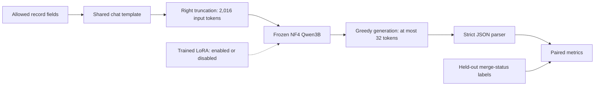

# Read-only pilot audit — October 31, 2026

The saved pilot shows two different failures: the base condition fails the
strict output contract, while the adapter always predicts the majority class.
The artifacts do **not** establish that class imbalance caused the base's zero
score, or that adaptation improved code-review judgment.

## Scope and provenance

Inspected `/root/workspace/CS536_Project` through the user-authorized SSH
connection. Server HEAD was `c1bcbb9faff135c1124d200db8ed5d5129d4adaa`.
The two notebooks and `src/evaluation/comparison.py` already had local changes;
this audit used their actual contents rather than assuming HEAD described them.
The server is behind the current GitHub paper/baseline work; implementations on
GitHub are not evidence that context-policy experiments ran on the server.

During the audit, the comparison notebook was saved concurrently with two added
code cells for a zoomed loss plot and an opt-in test-results section. All eleven
original code cells were preserved. The other six inspected program files and
all three audited validation artifacts retained their original hashes. These
concurrent additions do not change the validation snapshot analyzed here; the
audit did not execute them or write to the server.

The audited run is `checkpoints/qwen3b-qlora-split-v1-run5-local`, with
`training_complete.json` recording three epochs and 14,289 optimizer steps.
The final checkpoint is `checkpoint-14289`. Its run manifest is still marked
`trained`; training completion alone does not certify a finalized evaluation
workflow. Do not mix this run with the older similarly named directory on
other storage, or with the training notebook's separate cached generation.

The independent comparison is in
`results/midpoint/qwen3b_validation_v1/`. Read its `protocol.json`,
`predictions.jsonl`, and `metrics.json`. The accompanying
[audit summary](evaluation-audit.json) records their SHA-256 checksums, the
project's protocol digest, source-hash matches, recomputed scores, and CPU
tokenization checks. No model weights or raw predictions are committed here.
The base revision is the training manifest's assertion; this audit did not
independently match the local weights against Hub artifacts.

The four server documents match the previously read local originals by SHA-256.
No server program, configuration, checkpoint, prediction, or dependency was
changed. Analysis consisted of reading artifacts, local metric computation,
and CPU tokenization of existing validation examples. No model was loaded for
inference or training, and no data/model download was started.

## Architecture and data flow

The model is `Qwen/Qwen2.5-Coder-3B-Instruct`: a decoder-only language model
with 36 layers, hidden size 2,048, feed-forward size 11,008, and grouped-query
attention with 16 query heads and two key/value heads. The base is frozen in
NF4 with double quantization and bfloat16 computation. Rank-16 LoRA adapters
with alpha 32 and dropout 0.05 cover attention and feed-forward projections,
giving 29,933,568 trainable parameters. This is language-model answer training,
not a newly added binary classification head.

The training notebook constructs repository-held-out splits, renders allowed
fields, right-truncates prompts, and supervises the JSON answer plus EOS only.
It trains with batch size 1, accumulation 8, paged 8-bit AdamW, learning rate
0.0002, cosine scheduling, 3% warmup, and weight decay 0.01. Saved run artifacts
and the model config agree with the existing [model/data audit](model-data-audit.json).

`QwenComparison` loads a shared quantized base with an unmerged adapter. The
base condition disables that adapter; the adapter condition enables it.
Bias training and saved non-adapter modules are rejected to protect the matched
base comparison. Source hashes, model/tokenizer identity, split membership,
and decoding settings are recorded in the evaluation protocol. Cache files
support resume. The main frozen-reviewer context-selection study remains a
separate planned experiment.

## Verified saved results

All three conditions have the same 200 unique validation IDs from ten
repositories, with matching labels/repository/PR identities and protocol
digests. Raw outputs reproduce the saved strict predictions; independently
recomputed accuracy, macro-F1, and invalid rates match `metrics.json`.

| Condition | Accuracy | Macro-F1 | Invalid output | False recall | Predicted True |
| --- | ---: | ---: | ---: | ---: | ---: |
| Training-majority constant | 87.5% | 0.4667 | 0% | 0% | 200/200 |
| Base, adapter disabled | 0% | 0 | 100% | 0% | No valid predictions |
| Trained adapter enabled | 87.5% | 0.4667 | 0% | 0% | 200/200 |

Macro-F1 averages the two Boolean classes. Invalid predictions are always
incorrect and contribute false negatives for their true class. These are
diagnostics of the original pipeline, not a valid claim of an 87.5-point gain
in review quality. Latency differences also cannot establish a speedup: the
conditions generate different amounts and kinds of text.

## Limitation: imbalance and distribution shift

Training has 30,281 True and 7,816 False examples (79.5% True); full validation
has 3,264 True and 533 False (86.0% True). The saved generation sample has 175
True and 25 False (87.5% True). The adapter's constant True predictions obtain
high raw accuracy while missing every False example, exactly matching the
majority control. This is consistent with majority-class bias, but a controlled
ablation is needed to establish its cause.

Repository grouping also changes the language distribution: Go and Python lead
training, while C# and Rust lead validation. Only ten validation repositories
and 25 minority-label examples in the generation sample limit conclusions.
Merge status is a proxy for code quality; chronology and near-duplicate audits
are still unfinished.

## Separate limitation: malformed answers and lost chat boundaries

The base score is zero because **all 200 outputs fail the strict parser**:

- All 82 untruncated outputs wrap their JSON in Markdown code fences, which the
  pre-existing contract disallows.
- The other 118 inputs are truncated. Reconstructing the chats with the saved
  template and checkpoint tokenizer confirms that every one loses the terminal
  `<|im_start|>assistant` token sequence. Their outputs are invalid verdicts;
  inspected examples continue code from the input.

The CPU check reproduces saved input lengths and truncation flags for all 200
examples, and verifies their labels against the original records. It loads
only tokenizer files, not model weights. Losing the assistant marker is an
observed preprocessing defect; the extent to which restoring it improves
judgments requires new generation. Hugging Face explains that these markers
signal a new assistant response and that omitting them may cause continuation
of the user's message. [Chat-template documentation](https://huggingface.co/docs/transformers/chat_templating#add_generation_prompt).

Class imbalance does not explain why a fenced Boolean JSON object is rejected.
We therefore separate format compliance, prompt integrity, and classification
quality rather than attributing every zero to the label distribution.

## Proposed remedies, not implemented experiments

1. **Repair prompt construction first.** Allocate content budgets before chat
   rendering, retain the diff and role boundaries, and reserve generation space.
   An oversized mandatory diff needs an explicit documented policy rather than
   silent truncation of the formatted chat. Add boundary checks for training
   as well as evaluation. Any training change requires a new run identity.
2. **Version the evaluation.** Rerun both base and adapter with identical repaired
   prompts, model/tokenizer revisions, quantization, and deterministic decoding.
   Keep original strict results. A constrained Boolean-JSON decoder or scoring
   the two complete canonical answers is a separate protocol candidate; changing
   parsing or extracting fenced answers retrospectively is not the same experiment.
3. **Test imbalance remedies in the adaptation pilot.** Compare balanced sampling
   of whole training examples with example-weighted answer-token loss, one change
   at a time. A possible weight is `N / (2 * N_class)`, computed from training
   labels only. For this causal LM, apply the example's weight to its supervised
   answer loss; two Boolean-class weights are not vocabulary-class weights for
   the model's token cross-entropy. PyTorch documents the class dimension and
   weighting semantics of [CrossEntropyLoss](https://docs.pytorch.org/docs/2.14/generated/torch.nn.CrossEntropyLoss.html).
4. **Use metrics that expose the failure.** Retain accuracy, the majority control,
   macro-F1, per-class precision/recall, confusion counts, and invalid rate.
   Balanced accuracy is another useful diagnostic because it averages class
   recalls. [scikit-learn definition](https://scikit-learn.org/stable/modules/generated/sklearn.metrics.balanced_accuracy_score.html).
   Choose methods using validation and repeat seeds; retain the original
   validation/test distributions. A balanced diagnostic subset must be labeled
   separately rather than replacing the representative headline evaluation.

No improvement from any remedy is claimed. Balancing QLoRA training belongs to
the adaptation pilot; the main context-selection study keeps its reviewer frozen.
